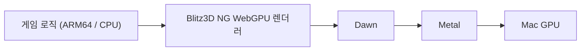

<!-- dev-docs-ai-translation: {"document":"docs/macos-architecture.md","language":"ko","syncedHash":"a72523857229bd19f2d0276afee082524c5bdd9c83e52a34d22e0918f5f2c010"} -->

# macOS 구현 원리

[English](macos-architecture.md) · [한국어](macos-architecture-ko.md)

[개발 가이드](development-ko.md#실험용-macos-네이티브-빌드) · [웹 버전 구현 원리](web-architecture-ko.md) · [현지화 가이드](localization-ko.md)

**macOS 버전은 Apple Silicon에서 직접 실행되는 실험용 네이티브 앱이며, WebGPU 기반 렌더러가 Dawn을 통해 Metal을 사용합니다.** 게임 로직은 CPU에서 ARM64 코드로 실행되고, 화면은 Metal을 통해 GPU에서 그립니다.

이 문서는 다운로드하는 `Stranded II.app`의 구조를 설명합니다. Mac의 브라우저에서 실행하는 웹 버전은 별도의 실행 환경입니다. 빌드 명령과 배포 절차는 [개발 가이드](development-ko.md#실험용-macos-네이티브-빌드)를 참고하세요.

## 1. 게임 코드는 ARM64 실행 파일로 컴파일합니다

macOS 진입점인 [`StrandedIIMac.bb`](../src/engine/StrandedIIMac.bb)는 macOS용 연결 함수와 공통 `StrandedII.bb`를 포함합니다. 게임플레이 코드는 Windows·웹과 공유하고, 플랫폼마다 컴파일러와 런타임을 선택합니다.

컴파일러는 공통 [내장 Blitz3D 소스](../src/blitz3d/)에서 관리합니다. [버전을 고정한 외부 의존성](../config/blitz3d-toolchain.json)은 별도로 준비하므로 엔진 수정 내용을 덮어쓰지 않습니다. LLVM이 ARM64 기계어를 생성하고 Apple 링커가 실행 전에 네이티브 **Mach-O** 실행 파일을 만드는 **AOT 방식**입니다.

컴파일러와 게임·콘솔 런타임은 [macOS 설정](../config/macos-toolchain.json)의 동일한 최소 OS 버전과 `xcrun`이 선택한 SDK로 빌드합니다. 타겟 식별자를 일치시켜 32비트 숫자 ABI와 SDK 라이브러리 검색을 유지합니다.

Dawn과 게임 런타임은 실행 파일에 정적으로 연결합니다. 게임 리소스·언어팩도 앱에 포함하므로 플레이에 브라우저, Python, Homebrew, Wine 또는 Rosetta가 필요하지 않습니다. Python은 개발 과정에서 리소스 준비·빌드 실행·검증을 담당합니다.

## 2. WebGPU 명령은 Dawn을 거쳐 Metal로 전달됩니다

실행 중 그래픽 처리 흐름은 다음과 같습니다.

| 구성 요소 | 역할 |
| --- | --- |
| 게임 코드 | 카메라·개체·UI 등 그릴 내용을 결정하고 Blitz 그래픽 명령을 호출합니다. |
| WebGPU 렌더러 | 게임의 2D·3D 그래픽 명령을 WebGPU의 버퍼·텍스처·그리기 명령으로 처리합니다. |
| Dawn | WebGPU를 구현하는 네이티브 라이브러리입니다. 이 앱에서는 Metal 백엔드로 GPU 장치와 렌더링을 관리합니다. |
| Metal | macOS가 제공하는 그래픽 API입니다. 실제 GPU 작업과 화면 출력을 위한 경로를 제공합니다. |

**WebGPU는 그래픽 API이고, Dawn은 그 구현체이며, Metal은 이 앱에서 사용하는 macOS 백엔드입니다.** WebGPU는 브라우저에서 사용할 수 있지만, 이 앱은 네이티브 C/C++ API로 Dawn을 호출합니다. WebGPU를 쓴다는 사실만으로 브라우저나 WebAssembly에서 실행된다는 뜻은 아닙니다.

코드에서는 `WGPUBackendType_Metal`을 명시적으로 선택합니다. SDL2로 Metal용 창을 만들고, `SDL_Metal_CreateView()`와 `SDL_Metal_GetLayer()`로 얻은 화면 레이어를 WebGPU의 출력 대상(surface)으로 연결합니다. 그리기가 끝나면 `wgpuSurfacePresent()`로 프레임을 표시합니다. 렌더러의 셰이더(GPU에서 실행하는 그래픽 프로그램)는 WGSL로 작성돼 있으며, Dawn이 이를 Metal에서 사용할 수 있게 처리합니다.

런타임 생성 함수에는 기존 이름인 `bbCreateOpenGLRuntime`이 남아 있습니다. 실제 그래픽 경로는 연결한 `graphics.webgpu`·`blitz3d.webgpu` 모듈과 Metal 백엔드 선택으로 결정됩니다.

## 3. 웹 버전과 공유하는 부분, 달라지는 부분

Windows·웹·macOS·Studio는 WebGPU 렌더러를 포함한 `src/blitz3d/`를 공유합니다. 플랫폼 선택에 따라 네이티브 Dawn/D3D12, 브라우저 WebGPU, 네이티브 Dawn/Metal을 사용하며 엔진 변경은 이 소스에 직접 작성합니다.

| 항목 | 웹 버전 | macOS 앱 |
| --- | --- | --- |
| 게임 코드 실행 | Emscripten으로 빌드한 WebAssembly | LLVM으로 빌드한 ARM64 기계어 |
| WebGPU 호출 환경 | 브라우저 | 앱에 연결한 네이티브 Dawn 라이브러리 |
| 화면 대상 | HTML canvas | SDL2 창의 Metal 레이어 |
| 설정·세이브 | 브라우저의 IndexedDB | Mac의 파일시스템 |

게임 로직을 공유해도 실행 파일과 저장소는 별개입니다. macOS 앱은 Windows나 브라우저의 설정·세이브를 자동으로 가져오지 않습니다.

## 4. 원작의 32비트 숫자와 Mac의 64비트 주소를 분리합니다

원작 Blitz3D의 정수와 실수는 32비트입니다. Apple Silicon 앱의 메모리 주소는 64비트이므로, 주소를 그대로 게임의 정수에 넣으면 값이 잘릴 수 있습니다.

macOS 런타임은 **정수·실수를 32비트로 유지하고, 내부 포인터는 64비트로 처리**합니다. 게임 코드가 사용하는 리소스 핸들은 32비트 ID이며, 런타임이 ID와 실제 포인터를 대응시킵니다. 리소스를 해제하면 그 대응도 제거합니다. 컴파일러의 `Type` 필드와 `Data` 저장 구조도 네이티브 포인터 크기에 맞춰 처리합니다.

이렇게 원작의 숫자 연산·바이너리 데이터 표현을 유지하면서 64비트 엔진을 사용할 수 있게 합니다. 호환성 검사는 원본 Blitz3D 1.118에서 얻은 기준 결과와 비교하며, 전체 게임의 호환성은 별도의 플레이 검증이 필요합니다.

## 5. 창·입력·소리·저장은 macOS 기능에 연결합니다

그래픽 이외의 기능은 다음 계층에서 처리합니다.

| 기능 | 구현 |
| --- | --- |
| 창, 키보드·마우스, 이벤트 | SDL2가 창과 입력 이벤트를 처리하고 게임 런타임에 전달합니다. |
| 검색 입력창, 클립보드 | Cocoa의 `NSTextField`와 `NSPasteboard`를 사용합니다. |
| 시간 측정 | macOS의 `mach_absolute_time`·`mach_continuous_time`을 공통 게임의 시간 측정 함수에 연결합니다. |
| 파일 저장·교체 | POSIX 파일 함수와 macOS의 동기화 기능을 사용합니다. 저장 교체에는 `rename`, 쓰기 동기화에는 `fsync`·`F_FULLFSYNC`를 사용합니다. |
| 소리 | 네이티브 OpenAL 모듈을 사용하며, SDL 런타임의 이벤트 처리 중 스트리밍 오디오를 갱신합니다. |

공통 게임 코드와 운영체제 사이의 연결은 [`services.bb`](../src/engine/platforms/macos/services.bb)와 [`services.mm`](../src/native/macos/services.mm)가 담당합니다. 지원하지 않는 원본 WAV 인코딩은 준비 단계에서 FFmpeg로 PCM WAV로 변환합니다. 원본 파일은 보존하며 FFmpeg는 플레이에 필요하지 않습니다.

### 앱과 사용자 데이터는 따로 보관합니다

앱은 실행할 때 번들의 리소스 목록과 리소스 식별값을 읽고, 쓰기 가능한 데이터 폴더에 필요한 리소스를 준비한 뒤 게임을 시작합니다. 식별값은 포함된 파일들의 해시로 계산합니다.

| 용도 | 위치 |
| --- | --- |
| 앱에 포함된 리소스 | `Stranded II.app/Contents/Resources/game/` |
| 일반 실행의 리소스·설정·세이브 | `~/Library/Application Support/Stranded II Native Preview/` |
| `run --platform macos`의 개발용 데이터 | `build/macos/runtime/` |

리소스 식별값이 달라지면 배포 리소스를 갱신하지만, 기존 `.cfg`, `settings.inf`, `core/modern.ini`는 유지합니다. 식별값이 같으면 없는 파일만 복사합니다. 세이브는 앱의 리소스 목록에 포함하지 않아 갱신 대상이 아닙니다. 개발 실행은 `S2_NATIVE_DATA_DIR`로 데이터 경로를 지정해 일반 실행과 분리합니다.

## 6. 현재 지원 범위와 검증 방법

현재 대상은 **Apple Silicon, macOS 15.0 이상, 기본판**입니다. 포함하는 Dawn 라이브러리에 맞춰 최소 OS를 지정합니다. Intel Mac·네이티브 Extended·네이티브 동영상 재생·원시 TCP/UDP는 지원하지 않습니다. 기본 로컬 앱과 `notarize=false`인 수동 CI는 임시 서명입니다. 배포는 드래그 설치용 Applications 바로가기가 있는 압축된 읽기 전용 DMG를 사용합니다. 수동 CI의 기본값인 `notarize=true`는 검증된 앱 복사본을 서명·공증하고 티켓을 붙인 뒤 최종 DMG도 서명·공증하고 티켓을 붙입니다. 둘 다 티켓·Gatekeeper 검사를 통과해야 합니다. 패키징은 마운트한 내용의 일치를 확인하고 설치용으로 복사한 앱을 검사합니다. 수동 CI는 아티팩트만 보관하며 데스크톱 워크플로가 macOS 실행기에서 양쪽 배포판을 확인한 뒤 게시합니다. [개발 가이드](development-ko.md#실험용-macos-네이티브-빌드)를 참고하세요.

| 검사 | 확인하는 범위 |
| --- | --- |
| `check --platform macos --suite core` | 화면을 열지 않고 원본과의 바이너리 결과 일치, `Type` 메모리 재사용, 앱 구조·서명·ARM64·최소 OS·시스템 라이브러리 의존성을 검사합니다. |
| `check --platform macos --suite full` | `core`에 더해 실제 Metal 렌더링·픽셀 읽기, 메뉴·인트로·섬 시나리오, 한글 글꼴·오디오 디코딩, 저장·재불러오기, Cocoa 문자열 왕복, 리소스 갱신 시 데이터 보존을 검사합니다. |
| 수동 플레이 | 실제 FPS, 들리는 소리, 한글 조합 입력, 전체화면·앱 전환 후 입력 복귀, 장시간 플레이와 캠페인 진행을 확인합니다. |

표는 구현된 검사 범위를 설명합니다. 특정 배포본의 실제 수행 결과는 함께 제공하는 `verification-summary.json`을 확인하세요. CI는 `core`를 실행하며, `full`의 게임 시나리오도 가상으로 진행시킨 시간을 사용하므로 실제 플레이 속도나 전체 캠페인을 검증하지는 않습니다.

구현을 따라가려면 [도구 준비](../scripts/macos_toolchain.py) → [공통 네이티브 엔진](../src/blitz3d/src/runtime/s2macos/CMakeLists.txt) → [앱 빌드·패키징](../scripts/macos_build.py) → [검증](../scripts/verify_macos.py) 순서로 읽으면 됩니다.
