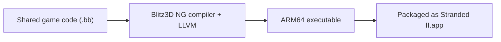
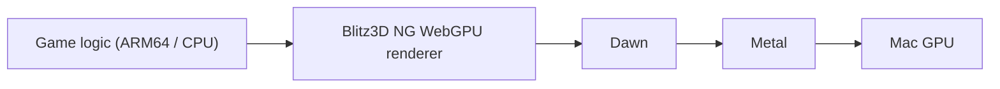

<!-- dev-docs-ai-translation: {"document":"docs/macos-architecture.md","language":"en","syncedHash":"bc7040803640d61c448a63e9f3cf17ced2ba00b2db6752a6b3ef9f5910371f01"} -->

# How the macOS version works

[English](macos-architecture.md) · [한국어](macos-architecture-ko.md)

[Development guide](development.md#experimental-native-macos-build) · [How the web version works](web-architecture.md) · [Localization guide](localization.md)

**The macOS version is an experimental native app that runs directly on Apple Silicon. Its WebGPU renderer uses Metal through Dawn.** Game logic runs as ARM64 code on the CPU, while graphics are drawn on the GPU through Metal.

This document explains the downloadable `Stranded II.app`. Playing the web version in a Mac browser uses a separate execution environment. See the [development guide](development.md#experimental-native-macos-build) for build commands and distribution procedures.

## 1. Game code compiles to an ARM64 executable

The macOS entrypoint, [`StrandedIIMac.bb`](../src/engine/StrandedIIMac.bb), includes the macOS adapters and the shared `StrandedII.bb`. Gameplay code is shared with Windows and the web; each platform selects its compiler and runtime.

The compiler lives in the shared [embedded Blitz3D source](../src/blitz3d/). [Pinned external dependencies](../config/blitz3d-toolchain.json) are prepared separately without overwriting local engine edits. LLVM generates ARM64 machine code; Apple’s linker produces a native **Mach-O** executable ahead of time (**AOT**).

The compiler and both game and console runtimes use the same minimum OS version from the [macOS configuration](../config/macos-toolchain.json) and the SDK selected by `xcrun`. Matching target identifiers preserves the 32-bit numeric ABI and SDK library lookup.

Dawn and the game runtime are statically linked into the executable. Game resources and language packs are also bundled, so playing requires no browser, Python, Homebrew, Wine, or Rosetta. Python handles resource preparation, build orchestration, and verification during development.

## 2. WebGPU commands reach Metal through Dawn

Graphics follow this path while the game runs:

| Component | Role |
| --- | --- |
| Game code | Determines what to draw, including cameras, entities, and UI, and calls Blitz graphics commands. |
| WebGPU renderer | Handles the game's 2D and 3D graphics commands using WebGPU buffers, textures, and draw commands. |
| Dawn | A native implementation of WebGPU. This app uses its Metal backend to manage the GPU device and rendering. |
| Metal | The graphics API provided by macOS. It provides the path for GPU work and screen output. |

**WebGPU is the graphics API, Dawn implements it, and Metal is the macOS backend used by this app.** WebGPU is available in browsers, but this app calls Dawn through the native C/C++ API. Using WebGPU does not by itself mean the game runs in a browser or as WebAssembly.

The code explicitly selects `WGPUBackendType_Metal`. SDL2 creates a Metal-capable window; `SDL_Metal_CreateView()` and `SDL_Metal_GetLayer()` provide the display layer connected as a WebGPU surface (the presentation target). After drawing, `wgpuSurfacePresent()` presents the frame. The renderer's shaders, graphics programs that run on the GPU, are written in WGSL; Dawn processes them for use with Metal.

The runtime factory retains the old name `bbCreateOpenGLRuntime`. The linked `graphics.webgpu` and `blitz3d.webgpu` modules and the Metal backend selection determine the actual graphics path.

## 3. What the web and macOS versions share

Windows, web, macOS and Studio share `src/blitz3d/`, including the WebGPU renderer. Platform selection chooses native Dawn/D3D12, browser WebGPU or native Dawn/Metal; engine changes are made directly in these sources.

| Item | Web version | macOS app |
| --- | --- | --- |
| Game code execution | WebAssembly built with Emscripten | ARM64 machine code built with LLVM |
| WebGPU calling environment | Browser | Native Dawn library linked into the app |
| Display target | HTML canvas | Metal layer in an SDL2 window |
| Settings and saves | Browser IndexedDB | Mac filesystem |

Sharing game logic does not merge executables or storage. The macOS app does not automatically import Windows or browser settings and saves.

## 4. Original 32-bit numbers are separate from 64-bit addresses

The original Blitz3D uses 32-bit integers and floats. Memory addresses in an Apple Silicon app are 64-bit, so putting an address directly into a game integer could truncate it.

The macOS runtime **keeps integers and floats at 32 bits while using 64-bit internal pointers**. Resource handles exposed to game code are 32-bit IDs, which the runtime maps to actual pointers. Freeing a resource removes its mapping. The compiler also handles `Type` field and `Data` storage layouts using the native pointer size.

This allows a 64-bit engine to retain the original numeric operations and binary data representation. Compatibility checks compare results with a reference captured from the original Blitz3D 1.118. Compatibility across the entire game still requires gameplay verification.

## 5. Windows, input, audio, and storage use macOS facilities

Functions outside graphics use these layers:

| Feature | Implementation |
| --- | --- |
| Windows, keyboard, mouse, events | SDL2 handles windows and input events and passes them to the game runtime. |
| Search field, clipboard | Cocoa's `NSTextField` and `NSPasteboard`. |
| Timing | macOS `mach_absolute_time` and `mach_continuous_time`, connected to the shared game's timing functions. |
| File saving and replacement | POSIX file functions and macOS synchronization facilities: `rename` for save replacement, and `fsync` and `F_FULLFSYNC` for write synchronization. |
| Audio | The native OpenAL module, with streaming audio updated during SDL runtime event processing. |

[`services.bb`](../src/engine/platforms/macos/services.bb) and [`services.mm`](../src/native/macos/services.mm) connect shared game code to the operating system. Unsupported original WAV encodings are converted to PCM WAV with FFmpeg during preparation. Original files are preserved, and FFmpeg is not needed to play.

### The app and player data are stored separately

At launch, the app reads its bundled resource list and resource fingerprint, prepares the required resources in a writable data directory, and starts the game. The fingerprint is calculated from the hashes of the included files.

| Purpose | Location |
| --- | --- |
| Bundled resources | `Stranded II.app/Contents/Resources/game/` |
| Resources, settings, and saves for normal launches | `~/Library/Application Support/Stranded II Native Preview/` |
| Development data for `run --platform macos` | `build/macos/runtime/` |

When the resource fingerprint changes, the app refreshes packaged resources while retaining existing `.cfg`, `settings.inf`, and `core/modern.ini` files. If the fingerprint is unchanged, only missing files are copied. Saves are excluded from the app's resource list and are not refreshed. Development launches set `S2_NATIVE_DATA_DIR` to keep their data separate from normal launches.

## 6. Current support and verification

The current target is **Apple Silicon, macOS 15.0 or later, and the base game**. The minimum OS matches the bundled Dawn library. Intel Macs, native Extended, native movie playback, and raw TCP/UDP are unsupported. Default local apps and manual CI with `notarize=false` use ad hoc signing. Distribution uses a compressed, read-only DMG with an Applications shortcut for drag installation. Manual CI defaults to `notarize=true`: sign/notarize/staple the verified app copy, then sign/notarize/staple the final DMG. Both artifacts must pass ticket and Gatekeeper checks. Packaging compares the mounted payload and validates an installation copy of the app. Manual CI stores artifacts without publishing a Release; the desktop workflow publishes after checking both platforms on a macOS runner. See the [development guide](development.md#experimental-native-macos-build).

| Check | What it covers |
| --- | --- |
| `check --platform macos --suite core` | Without opening a window, checks binary results against the original, `Type` memory reuse, app structure, signing, ARM64, minimum OS, and system-library dependencies. |
| `check --platform macos --suite full` | Adds to `core`: actual Metal rendering and pixel readback, menu/intro/island scenarios, Korean glyphs and audio decoding, save/reload, Cocoa text roundtrips, and data preservation during resource refresh. |
| Manual gameplay | Actual FPS, audible sound, Korean IME composition, input recovery after fullscreen and app switching, long sessions, and campaign progression. |

The table describes the implemented checks. For tests actually performed on a particular distribution, consult its included `verification-summary.json`. CI runs `core`; even the game scenarios in `full` use synthetic time, so they do not verify real-time gameplay speed or the entire campaign.

To follow the implementation, read [tool preparation](../scripts/macos_toolchain.py) → [shared native engine](../src/blitz3d/src/runtime/s2macos/CMakeLists.txt) → [app building and packaging](../scripts/macos_build.py) → [verification](../scripts/verify_macos.py).
