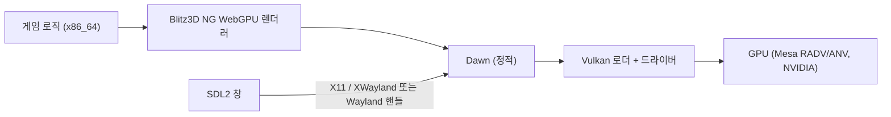

<!-- dev-docs-ai-translation: {"document":"docs/proposals/ubuntu-desktop.md","language":"ko","syncedHash":"ef5900265ea5e4b6559b5a73b8577fd7b4b9eb08e789ac0aad8316559556fea7"} -->

# Ubuntu Desktop 지원 가능성 조사

[English](ubuntu-desktop.md) · [한국어](ubuntu-desktop-ko.md)

[개발 가이드](../development-ko.md) · [macOS 구현 원리](../macos-architecture-ko.md) · [WebGPU 렌더러 이전](../wgpu-migration-ko.md)

이 문서는 조사와 제안이며 지원 플랫폼이 아닙니다. 저장소에는 아직 Linux 타깃이 없고, 이 문서의 어떤 내용도 Linux에서 빌드·렌더링·플레이해 보지 않았습니다. 줄 번호는 커밋 `3a9dfc7` 기준입니다.

## 결론

**조건부 가능합니다.** 기본판의 Ubuntu x86_64 네이티브 빌드는 macOS 포팅에서 이미 해결한 부분을 대부분 재사용할 수 있습니다. 남은 작업은 Linux 툴체인 고정, 엔진의 Linux 런타임·서피스 경로, Linux OS 서비스 구현, 실제 GPU 검증입니다.

| 대상 | 판단 | 예상 공수 |
| --- | --- | --- |
| Ubuntu 24.04 x86_64 네이티브, 기본판 | 아래 세 블로커 해소 후 가능 | 약 4–7인주 |
| Ubuntu arm64 네이티브 | 가능하나 Dawn을 소스에서 빌드해야 함 | x86_64 이후 +1–2주 |
| Proton/Wine으로 Windows 빌드 실행 | 지금도 동작할 가능성이 있으나 미검증·비공식 | 스모크 테스트 0.5–2일 |

핵심 블로커:

1. **Linux 툴체인 고정이 없습니다.** `blitz3d_toolchain.host()`가 Linux를 거부하고, 고정된 LLVM 19.1.5에는 Linux 아카이브가 없습니다. Ubuntu 24.04의 `llvm-19-dev`는 19.1.1이라 `find_package(LLVM 19.1.5)`가 거부합니다.
2. **엔진이 "Windows가 아니면 macOS 또는 Emscripten"으로 가정합니다.** 서피스 생성, 백엔드 선택, 런타임 선택, 테스트 타깃, Dawn 라이브러리 경로 모두 Linux 분기가 필요합니다.
3. **Linux OS 서비스와 검증이 필요합니다.** 레시피 검색 입력란, 데이터 디렉터리, 시간 측정, 클립보드, 파일 영속화를 macOS 서비스 프로토콜의 Linux 구현으로 제공해야 합니다. 렌더링·IME·Wayland 동작은 실제 하드웨어에서 확인해야 하며, CI에는 소프트웨어 Vulkan만 있습니다.

## 확인한 내용

| 확인 항목 | 방법 | 결과 |
| --- | --- | --- |
| 플랫폼 코드 경로 | `3a9dfc7` 소스 읽기 | 1–5절 |
| Ubuntu 패키지 가용성 | `ubuntu:24.04` 컨테이너(amd64, arm64)에서 `apt-cache policy` | 7절 |
| 고정된 Dawn Linux 아카이브 | 릴리스 에셋을 받아 `ar`/`nm`/`readelf`로 멤버·심볼 확인 | 2절 |
| 공식 데이터의 경로 대소문자 | CI 게임 의존성 아카이브 검사(SHA-256이 `config/ci-dependencies.json`과 일치) | 4절 |
| Wine API 지원 | Wine `kernelbase.spec` 확인 | 8절 |

하지 않은 것: Linux 컴파일·링크·렌더링·오디오·IME·게임 실행은 하지 않았습니다.

## 1. 현재 플랫폼 추상화

Python 진입점과 호스트 판별은 Windows, 웹, macOS만 압니다.

- `src/devtools/dev.py:125`는 `--platform windows|web|macos`를 제공하고, `dev.py:132-140`이 `macos_build` 또는 `web_build`로 넘깁니다.
- `src/devtools/blitz3d_toolchain.py:26-31`은 Windows나 Apple Silicon 호스트만 허용합니다. `llvm`, `dawn`과 컴파일러·런타임 옵션(`:105-141`, `:213-241`)은 `windows`/`macos` 키만 있고, `config/blitz3d-toolchain.json`도 마찬가지입니다.
- `src/devtools/editions.py:81-83`은 `windows|web|macos` 외의 소스 타깃을 거부합니다.

CMake 트리는 업스트림 Blitz3D-NG의 Linux 정의를 그대로 갖고 있습니다. `BB_LINUX`, `BB_POSIX`, `x86_64-linux-gnu` 트리플이 있습니다(`src/blitz3d/CMakeLists.txt:135-137`, `:188-191`, `:260-262`). 하지만 Stranded II 네이티브 선택은 둘 중 하나로만 갈립니다.

| 위치 | 비Windows 네이티브 빌드에서의 현재 동작 | Linux 변경 |
| --- | --- | --- |
| `src/blitz3d/src/runtime/CMakeLists.txt:238-243` | `s2macos` 선택 | `runtime/s2linux` 추가 |
| `graphics.webgpu/graphics.webgpu.cpp:227-245` | `#else`가 Emscripten 캔버스라 컴파일 불가 | `SDL_GetWindowWMInfo`로 Xlib/Wayland 서피스 생성 |
| `graphics.webgpu.cpp:258-264`, `:296-302` | 백엔드는 Metal 또는 D3D12, 프로파일러 표기는 "Dawn / D3D12"로 떨어짐 | `WGPUBackendType_Vulkan`, 표기 수정 |
| `graphics.webgpu/CMakeLists.txt:9-13` | 시스템 라이브러리가 macOS/Windows용만 있음 | `webgpu_dawn dl pthread rt m` |
| `src/blitz3d/CMakeLists.txt:484-493` | macOS가 아니면 프로파일러 검사가 `runtime.s2windows.static`에 링크 | Linux 분기 |
| `src/blitz3d/deps/CMakeLists.txt:55-61`, `blitz3d_toolchain.py:231` | `lib/libwebgpu_dawn.a`, `lib/cmake/Dawn`을 기대 | Dawn Linux 아카이브는 `lib64/` 사용 |
| `system/CMakeLists.txt:19-23`, `system/system.cpp:127-139` | 네이티브 서비스(`StrandedMac:` 요청, `AppDir`)가 macOS에서만 컴파일됨 | Linux 서비스 파일 |

### macOS 포팅이 이미 해결한 것

| 영역 | 기존 구현 | Linux 재사용 |
| --- | --- | --- |
| 32비트 Blitz 수치, 64비트 포인터 | `BB_LEGACY32`, 생성된 핸들 래퍼(`src/blitz3d/src/modules/legacy32.py`에는 플랫폼 분기가 없음), 비MSVC용 `-fwrapv -ffp-contract=off`(`CMakeLists.txt:411-417`) | 그대로. macOS ARM64와 Linux x86_64는 모두 LP64이며, x86_64 코드 생성은 Windows가 이미 사용 중 |
| ABI 회귀 검사 | `verify_macos.py:28-48`이 원본 Blitz3D 1.118 결과와 613바이트 비교 | 그대로 |
| 창·입력 | 정적 SDL 2.26.4(`deps/CMakeLists.txt:27-40`) | SDL의 X11/Wayland 드라이버 |
| 오디오 | `audio.openal`은 Apple/Windows가 아니면 이미 `openal`에 링크하고 `<AL/al.h>`를 포함(`audio.openal/CMakeLists.txt:6-12`, `audio.openal.cpp:8-14`) | 시스템 또는 동봉 OpenAL Soft |
| 파일·소켓·프로세스 진입 | `filesystem.posix`, `sockets.cpp:11-32`의 POSIX 분기, `stub.posix.cpp` | 그대로 |
| 게임 ↔ OS 어댑터 | `src/engine/platforms/macos/services.bb` + `src/native/macos/services.mm` | 같은 프로토콜. Cocoa 부분 외에는 대부분 POSIX 코드 |
| 리소스 준비 | Python 준비, CP1252 변환, FFmpeg WAV 변환(`macos_build.py:84-110`) | 그대로 |

## 2. 렌더링: Dawn → Vulkan

고정된 Dawn 리비전 `31e25af2…`에는 `Dawn-…-ubuntu-latest-Release.tar.gz`(29,177,560바이트, SHA-256 `ac76fac090162dc1ecea5ed0f28a557bb8f49efc47faab01886105ace82b7b64`)가 있습니다. `libwebgpu_dawn.a`를 확인한 결과는 다음과 같습니다.

- Vulkan 백엔드(`BackendVk`, `DeviceVk` 등), OpenGL/EGL 백엔드, null 백엔드의 x86-64 ELF 오브젝트가 있습니다.
- `SurfaceSourceXlibWindow`, `SurfaceSourceXCBWindow`, `SurfaceSourceWaylandSurface` 처리가 있습니다.
- `.comment`는 GCC 14.2.1(Red Hat), libstdc++ ABI(`std::__cxx11`)를 보여 주고 `__isoc23_*` 임포트가 없습니다. 따라서 이 아카이브만으로 glibc 하한이 2.38로 올라가지는 않습니다.
- `DawnTargets.cmake`의 인터페이스 라이브러리는 `dl`, `rt`, `Threads`뿐이라 링크 시점에 Vulkan·X11·Wayland 의존성이 없습니다.

릴리스에 Linux arm64 아카이브는 없습니다.



**렌더러 요구사항.** 렌더러는 코어 텍스처 포맷과 선택적 `TimestampQuery`(`graphics.webgpu.cpp:277`, `profiler_gpu.cpp:27`)만 쓰며, 타임스탬프가 없을 때의 대체 경로가 있습니다. Vulkan을 막는 추가 기능 요구는 없습니다. 다만 두 가지는 확인해야 합니다.

- 서피스 포맷은 `caps.formats[0]`을 씁니다(`graphics.webgpu.cpp:304-312`). 리드백은 BGRA8, RGBA8, RGB10A2를 처리합니다(`canvas.webgpu.cpp:345-352`). Vulkan 드라이버가 sRGB 포맷을 먼저 내놓으면 감마가 두 번 적용되므로 서피스 포맷을 명시적으로 고르는 것이 좋습니다.
- FPS 무제한 모드는 `Immediate`, 다음으로 `Mailbox`를 선호합니다(`graphics.webgpu.cpp:314-322`). 지원 여부는 드라이버와 컴포지터에 따라 다르며, Wayland 컴포지터는 보통 `Immediate`를 제공하지 않습니다.

**GPU·드라이버.** Dawn Vulkan 백엔드는 Vulkan 1.1 수준의 드라이버가 필요합니다. 예상 대상은 Mesa RADV(AMD GCN/RDNA, Steam Deck 포함), Mesa ANV(Intel Gen9 이후), NVIDIA 독점 드라이버, 그리고 경우에 따라 Mesa NVK입니다. `hasvk`를 쓰는 구형 Intel과 Vulkan 이전 GPU는 테스트 전까지 범위 밖입니다. CI에서는 Xvfb와 함께 Mesa lavapipe(Ubuntu 24.04의 `mesa-vulkan-drivers` 25.2.8)로 오프스크린 리드백을 할 수 있습니다. Dawn이 이를 CPU 어댑터로 분류할 수 있으므로 어댑터 옵션을 확인해야 합니다.

**X11과 Wayland.** 고정된 SDL은 2.26.4(커밋 `07d0f51f`, "Updated to version 2.26.4")입니다. 비디오 부트스트랩이 Wayland보다 X11을 먼저 시도하므로, Ubuntu 기본 Wayland 세션에서는 `SDL_VIDEODRIVER=wayland`를 지정하지 않는 한 XWayland로 실행됩니다. 두 서피스 유형을 모두 구현하되 X11/XWayland를 1차 대상으로 삼습니다. SDL은 기본적으로 X11/Wayland 라이브러리를 런타임에 불러옵니다. 빌드에는 여전히 헤더가 필요합니다(7절).

## 3. 컴파일러: Linux ELF 실행 파일 생성

컴파일러에는 이 포크에서 아직 쓰인 적 없는 업스트림 Linux 경로가 있습니다.

- `lldELF`가 링크되어 있고(`src/blitz3d/src/tools/compiler/CMakeLists.txt:200`), `linker_lld.cpp:32-34`는 `BB_LINUX`에서 ELF 드라이버를 고릅니다.
- 호스트 링크는 `/lib64/ld-linux-x86-64.so.2`, `crt1.o`, `crti.o`, `crtbeginT.o`, `-lstdc++ -lgcc -lgcc_eh -lc`, `crtend.o`, `crtn.o`를 추가하고(`linker_lld.cpp:455-481`), `--gc-sections`도 씁니다(`:156-158`).
- `LIBARCH_DIR`은 `/usr/lib/x86_64-linux-gnu`로 고정되어 있고, 컴파일러를 GCC로 빌드할 때만 정의됩니다(`CMakeLists.txt:146-151`). Linux에서 `blitzcc`는 `--dynamic-list`로 ORC 심볼 두 개를 내보냅니다(`:158-164`).

필요한 작업:

1. **Linux용 LLVM 19.1.5.** `blitz3d-ng/build-llvm` v19.1.5에는 macOS·Windows 에셋만 있습니다. Ubuntu 24.04는 amd64·arm64 모두 `llvm-19-dev`/`liblld-19-dev` 1:19.1.1을 제공합니다. `LLVMConfigVersion.cmake`는 major.minor가 같고 patch가 요청 값 이상일 때만 호환으로 판단하므로 `find_package(LLVM 19.1.5)`(`CMakeLists.txt:4`, `:16`)가 이를 거부합니다. 그러면 컴파일러 CMake가 `blitzcc`를 정의하지 않고 반환합니다(`:28-30`). 권장안은 LLVM 19.1.5 + LLD를 한 번 빌드해 다른 호스트처럼 체크섬을 가진 아카이브로 고정하는 것입니다. 대안은 apt.llvm.org의 19.1.x(.5 이상)를 고정하거나 버전 조건을 완화하는 것이며, 후자는 골든 ABI 테스트로 코드 생성이 그대로인지 확인해야 합니다.
2. **아키텍처별 링크 경로.** 로더 경로, `LIBARCH_DIR`, 에뮬레이션은 x86_64 전용입니다. arm64에서는 `/lib/ld-linux-aarch64.so.1`(`ubuntu:24.04` arm64에 존재), `/usr/lib/aarch64-linux-gnu`, `aarch64linux`가 됩니다.
3. **시작 오브젝트.** `crtbeginT.o`는 정적 링크용인데 여기서는 `-dynamic-linker`와 함께 쓰입니다. 동작을 확인하거나 `crtbegin.o`/`crtbeginS.o`(`-pie`와 함께)로 바꿔야 합니다.
4. **C++ 런타임.** 동적 `-lstdc++`는 `GLIBCXX` 버전을 빌드 호스트에 묶습니다. 배포 빌드는 libstdc++/libgcc를 정적으로 링크하는 것이 좋습니다.
5. **모듈 시스템 라이브러리.** Linux용 `toolchain.toml`에는 `dl pthread rt m`(Dawn, SDL)과 `openal`이 필요합니다. `system/CMakeLists.txt:10-11`은 Linux에서 `fontconfig`를 링크하지만 `src/blitz3d/src/modules`에서 이를 호출하는 곳이 없으므로 제거할 수 있습니다.

## 4. Windows 전용 의존성과 데이터

| 항목 | 확인 결과 | Linux 영향 |
| --- | --- | --- |
| 경로 대소문자(ext4는 대소문자 구분) | `BBFileSystem::openFile`은 POSIX에서 대소문자 무시 검색으로 재시도합니다(`filesystem/filesystem.cpp:16-52`, `:67-78`). 이미지·텍스처·폰트·`.3ds`·`.x`·`.md2`가 이 경로를 씁니다. B3D 로더는 `fopen`을 직접 쓰고(`blitz3d/loader_b3d.cpp:332`), 오디오 스트림은 `ifstream`을 쓰며(`audio/stream.cpp:71-73`), `FileType`/`FileSize`/`ReadDir`는 대소문자를 보정하지 않습니다(`filesystem.posix/filesystem.posix.cpp:110-142`). `loadEntity`는 Emscripten에서만 보정합니다(`blitz3d/blitz3d.cpp:136-147`) | 공식 데이터: `.inf`/`.s2s`/`.cfg`의 경로 참조 930개에서 대소문자 불일치 **0**건. B3D 321개의 `TEXS` 청크에 있는 텍스처 이름 531개 중 **1**건 불일치(`plane.b3d` → `plane.jpg`, 실제 파일 `plane.JPG`)이며 텍스처 로더의 보정 경로를 탑니다. 기본판 위험은 낮습니다. 사용자 모드·맵은 여전히 위험하므로 모든 POSIX 열기 경로에 보정을 적용하고 setup 단계에 대소문자 검사를 추가합니다 |
| 역슬래시 경로 | `canonicalpath`가 Windows 외에서 `\`를 `/`로 바꿉니다(`stdutil/stdutil.cpp:380-389`). macOS 서비스도 마찬가지입니다(`services.mm:37`) | 이미 처리됨 |
| CP1252 | Python 준비 단계에서 변환합니다(`locales.py:140`, `resource_spans.py:11`, `s2map.py:73`). 런타임은 UTF-8만 봅니다 | 이미 처리됨 |
| 게임 코드의 Win32 호출 | 시간·창·파일 영속화·검색 EDIT·클립보드 호출은 `platform.windows/commands.decls`의 함수 38개를 거칩니다(과거에는 `config/userlibs/*.decls`). macOS와 웹은 `platforms/*/services.bb`의 Blitz 함수로 대체합니다 | 새 `platforms/linux/services.bb`와 네이티브 서비스 |
| `ExecFile` URL | Emscripten, macOS, Windows만 구현되어 있습니다(`system/system.cpp:75-90`) | 0을 반환함. `xdg-open` 추가 |
| 동영상 | 공용 게임 코드는 `OpenMovie`/`PlayMovie`/`DrawMovie`를 호출하지 않습니다(`src/engine` grep). `Cmenu_if_movie`는 게임 내 시퀀스입니다 | 블로커 아님 |
| raw TCP/UDP | `sockets.cpp`에 POSIX 구현이 있지만 macOS 런타임은 모듈을 빼고 호출을 실패로 처리합니다(`platforms/macos/services.bb:203-246`) | 우선 macOS와 동일하게 처리 |
| `CreateTimer` | Windows 외에서는 `timer.noop.cpp`를 쓰지만 게임은 `CreateTimer`/`WaitTimer`를 호출하지 않습니다 | 블로커 아님 |

## 5. 입력·IME·오디오·저장·HiDPI

- **마우스 캡처.** 카메라 조작 중 상대 모드를 켜는 Windows 로직은 `runtime.sdl.cpp:82-97`에 있습니다. macOS는 `modern_mouse_capture`에서 `True`를 반환합니다(`services.bb:38-41`). Linux도 같은 SDL 상대 모드 정책을 적용할 수 있습니다. XWayland에서의 상대 이동은 확인이 필요합니다.
- **테두리 없는 전체 화면.** macOS처럼 테두리를 없애고 크기를 바꾸는 대신 Windows처럼 `SDL_WINDOW_FULLSCREEN_DESKTOP`을 씁니다(`platform.windows.cpp:100-111`). X11 창 관리자와 Wayland 컴포지터가 전체 화면 상태를 직접 관리하며, Wayland에는 독점 모드 전환이 없습니다.
- **IME.** SDL 2.26은 `libdbus-1-dev`와 `libibus-1.0-dev`로 빌드하면 D-Bus 기반 IBus·Fcitx 연동을 포함합니다. 게임 텍스트 입력은 확정된 `SDL_TEXTINPUT` 바이트만 받습니다(`runtime.sdl.cpp:279-287`). 레시피 검색은 macOS에서 `NSTextField`(`services.mm:104-125`), Windows에서 `EDIT` 컨트롤을 씁니다. Linux에는 SDL 창에 붙일 대응 컨트롤이 없습니다. Dear ImGui나 SDL로 그린 입력란이 유력합니다(ImGui는 이미 링크되어 있고 `SDL_TEXTEDITING`을 처리함, `debugui.cpp:137`). 한국어 조합은 IBus와 Fcitx5에서 수동으로 확인해야 합니다.
- **오디오.** OpenAL Soft는 LGPL-2.1이므로 별도 공유 라이브러리로 유지합니다. Ubuntu 24.04는 PipeWire/PulseAudio/ALSA 백엔드를 가진 `libopenal1` 1.23.1을 제공합니다. 휴대형 패키지는 Windows가 `soft_oal.dll`을 동봉하듯(`blitz3d_toolchain.py:259`, `:274-276`) `libopenal.so.1`과 라이선스를 함께 넣습니다.
- **저장.** macOS 앱은 지문이 붙은 매니페스트로 동봉 리소스를 Application Support에 설치하고 `.cfg`, `settings.inf`, `core/modern.ini`를 보존합니다(`services.mm:134-183`). Linux는 같은 `S2_NATIVE_DATA_DIR` 재정의를 유지하면서 `${XDG_DATA_HOME:-~/.local/share}/<app-id>/`를 씁니다. NSBundle/NSJSONSerialization은 `/proc/self/exe`(또는 `$APPDIR`)와 이미 의존성인 nlohmann_json(`deps/CMakeLists.txt:20-21`)으로 대체합니다. AppImage와 Flatpak의 페이로드는 읽기 전용이므로 이 복사 단계가 필수입니다.
- **시간·영속화.** `mach_absolute_time`/`mach_continuous_time`(`services.mm:39-42`)은 `CLOCK_MONOTONIC`/`CLOCK_BOOTTIME`에 대응합니다. `rename` 후 파일과 상위 디렉터리를 `fsync`하는 방식은 유지하고 `F_FULLFSYNC`만 뺍니다. `copyfile`은 `std::filesystem::copy_file`로, `st_mtimespec`은 `st_mtim`으로 바꿉니다. `MilliSecs`는 macOS와 마찬가지로 POSIX에서 이미 `gettimeofday`를 씁니다(`system.cpp:111-124`).
- **HiDPI.** 창은 `SDL_WINDOW_ALLOW_HIGHDPI` 없이 생성되고(`graphics.webgpu.cpp:1326-1329`), 드로어블 크기는 창 크기와 같습니다(`:1020-1021`). X11은 물리 픽셀로 렌더링하고, 배율이 적용된 Wayland 세션은 XWayland 창을 확대합니다. 네이티브 Wayland HiDPI에는 드로어블 크기 경로가 필요합니다. 새 프로필은 macOS처럼 1280×720 창 모드를 기본값으로 합니다(`macos_build.py:23-25`).

## 6. 배포

| 형식 | 장점 | 단점 | 권장 |
| --- | --- | --- | --- |
| `tar.gz` | 가장 단순하며 Windows ZIP과 같은 방식 | 업데이트는 사용자 몫이고 glibc 하한을 명시해야 함 | 1차 |
| AppImage | 파일 하나, 설치 불필요, OpenAL 동봉 가능 | 페이로드가 읽기 전용이라 실행 시 XDG로 복사해야 함. 구형 런타임은 `libfuse2`가 필요한데 Ubuntu 24.04는 기본 설치하지 않으며, 최신 정적 type2 런타임은 이를 피함 | `tar.gz`와 함께 1차 |
| Flatpak | 데스크톱 통합, 샌드박스, 런타임이 Mesa/Vulkan 제공 | 매니페스트 안에서 LLVM/Dawn/컴파일러를 오프라인 소스 빌드해야 함. 게임 데이터 라이선스에 대한 Flathub 심사 | 이후 |
| `.deb` | Ubuntu 기본 형식 | Ubuntu 전용이며 apt 저장소가 없으면 업데이트를 수동 설치해야 함 | 선택 |
| Steam Linux Runtime | Steam 배포일 때만 의미 있음 | 게임이 Steam에 없음 | 보수적인 glibc 하한을 위한 빌드 환경으로 "sniper" SDK 이미지만 활용 |

glibc, Mesa, `libvulkan`은 동봉하지 않습니다. Ubuntu 24.04는 glibc 2.39이므로 그곳에서 빌드하면 22.04(2.35)가 제외됩니다. Ubuntu 22.04 컨테이너나 Steam Runtime SDK처럼 지원 범위에서 가장 오래된 이미지에서 빌드합니다. Linux에는 표준 코드 서명이 없으므로 `.sha256` 파일과 선택적으로 GitHub artifact attestation을 제공합니다. 라이선스는 macOS와 같은 묶음에 OpenAL Soft를 더해 복사합니다.

## 7. `ubuntu-24.04` CI 설계

아래 패키지는 모두 Ubuntu 24.04 amd64에서 설치할 수 있습니다. 확인한 후보 버전은 `cmake` 3.28.3(트리 요구는 3.24 이상), `ninja-build` 1.11.1, `libopenal-dev` 1.23.1, `mesa-vulkan-drivers` 25.2.8, `ffmpeg` 6.1.1, `python3` 3.12.3입니다. 아래 스케치는 예시이며 실행해 보지 않았습니다.

```yaml
linux:
  runs-on: ubuntu-24.04          # later: matrix with ubuntu-24.04-arm
  steps:
    - uses: actions/checkout@v4
    - uses: actions/setup-python@v5
      with: { python-version: '3.13' }
    - run: >
        sudo apt-get install -y cmake ninja-build g++ zstd ffmpeg libopenal-dev
        libx11-dev libxext-dev libxrandr-dev libxcursor-dev libxi-dev libxss-dev
        libxkbcommon-dev libwayland-dev wayland-protocols libdecor-0-dev
        libdbus-1-dev libibus-1.0-dev libvulkan1 mesa-vulkan-drivers xvfb
    # Same pinned CI game dependency download/validation as macos.yml
    # Cache deps/blitz3d (LLVM 19.1.5 Linux archive, Dawn, libraries)
    - run: python src/devtools/dev.py setup --platform linux --game build/ci/deps/game --font build/ci/deps/fonts/NotoSansKR.ttf
    - run: python src/devtools/dev.py build --platform linux
    - run: python src/devtools/dev.py check --platform linux --suite core
    - run: xvfb-run -a python src/devtools/dev.py check --platform linux --suite full   # lavapipe readback, once stable
    - run: python src/devtools/linux_package.py   # tar.gz + AppImage + .sha256
```

`.md`만 바뀐 변경을 건너뛰는 기존 `paths-ignore` 규칙을 유지합니다. 수동 검증을 통과하기 전까지 Linux 산출물은 릴리스 게시에서 제외하고, 웹·macOS처럼 기본판만 대상으로 합니다. 저장소가 공개 상태이므로 Dawn 소스 빌드를 고정한 뒤에는 arm64용 `ubuntu-24.04-arm` 러너를 쓸 수 있습니다.

## 8. 대안: Windows 빌드를 Proton/Wine으로 실행

| 관점 | 평가 |
| --- | --- |
| 렌더링 | Windows 빌드는 D3D12를 명시적으로 요청합니다(`graphics.webgpu.cpp:262-263`). Proton에서는 VKD3D-Proton이 이를 Vulkan으로 변환합니다. DXC는 앱 폴더에 동봉되어 있습니다. VKD3D-Proton에서 Dawn D3D12 요구사항이 충족되는지는 미검증입니다 |
| 더 짧은 경로 | 고정된 Windows Dawn 라이브러리에도 Vulkan 백엔드 오브젝트(`VulkanBackend.obj`, `VulkanFunctions.obj` 등)가 있습니다. 환경 변수 같은 선택적 백엔드 재정의를 두면 winevulkan을 직접 쓸 수 있습니다. 작은 변경이지만 테스트하지 않았습니다 |
| OS API | Wine `kernelbase.spec`은 `platform.windows.cpp:66-68`이 임포트하는 `QueryUnbiasedInterruptTimePrecise`를 구현합니다(1263행). Wine에서의 Win32 `EDIT`/IMM 검색과 SDL 동작은 확인이 필요합니다 |
| Steam Deck | 위 조건이 맞으면 "비 Steam 게임 추가" + Proton으로 동작합니다. 네이티브 Linux 빌드도 gamescope 아래에서 XWayland로 실행됩니다 |
| 한계 | 네이티브 Ubuntu 지원이 아닙니다. 세이브는 Wine 프리픽스 안에 저장됩니다. Wine에서의 한국어 IME는 불확실하고, 변환 계층에 따른 오버헤드가 있습니다 |

권장: 한 번 스모크 테스트(M0)를 하고, 동작하면 비공식 방법으로 문서화합니다. 지원 대상은 네이티브 포팅으로 유지합니다.

## 9. 로드맵

| 마일스톤 | 범위 | 완료 기준 | 예상 공수 | 주요 위험 |
| --- | --- | --- | --- | --- |
| M0 (선택) | 릴리스 ZIP을 Proton과 Wine에서 실행 | 메뉴, 인트로, 첫 섬, 저장·불러오기 확인 | 0.5–2일 | VKD3D-Proton 지원 범위, IME |
| M1 컴파일러·런타임 | `blitz3d_toolchain.py`의 Linux 호스트; 고정된 LLVM 19.1.5 Linux 아카이브; Dawn `ubuntu-latest` 고정과 `lib64`; `s2linux` 런타임; 1절의 CMake 분기; ELF 링크 수정; `StrandedIILinux.bb`, `platforms/linux/services.bb`, `src/native/linux/services.cpp`; `dev.py --platform linux`, `linux_build.py`, `verify_linux.py` | `ubuntu-24.04`에서 `check --platform linux --suite core` 통과: 613바이트 골든 일치, `Type` 재사용, ELF 아키텍처와 동적 의존성 검사 | 1.5–3주 | LLVM 고정, 검증되지 않은 업스트림 Linux 링커 경로 |
| M2 렌더링·게임 검증 | Xlib/Wayland 서피스, Vulkan 백엔드, 명시적 서피스 포맷, 검색 입력란, IME, XDG 저장소; lavapipe 리드백 검사 | macOS `full`과 같은 메뉴/인트로/섬/저장 검사; AMD·Intel·NVIDIA와 X11·XWayland·Wayland에서 수동 확인; IBus/Fcitx5 한국어 IME; PipeWire 오디오 | 1.5–2.5주 + 테스트 하드웨어 | 드라이버 차이, Wayland 포커스·캡처, IME |
| M3 패키징·CI | `tar.gz` + AppImage, XDG 설치 단계, 라이선스, `.sha256`, glibc 하한 이미지, 워크플로 | 깨끗한 Ubuntu 22.04/24.04에서 설치되고 업데이트 후 기존 데이터 보존 | 1–1.5주 | glibc 하한, AppImage 런타임 |
| arm64 | Dawn 소스 빌드 고정, aarch64 링크 경로, `ubuntu-24.04-arm` 작업 | arm64에서 `core` 통과; arm64 기기에서 수동 실행 | +1–2주 | Dawn 빌드 시간, 적은 테스트 기기 |

세 번째 네이티브 플랫폼은 공용 엔진을 바꿀 때마다 CI 시간과 검증 작업을 늘립니다. AGENTS.md는 이미 플랫폼별 검증을 요구하며, Windows 성공이 Linux 검증을 의미하지는 않습니다.
