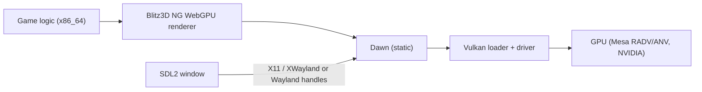

<!-- dev-docs-ai-translation: {"document":"docs/proposals/ubuntu-desktop.md","language":"en","syncedHash":"706a7f9f17a9db9e72f51102ca3c200cd2384f7da549e56a81e37937f89e2e6c"} -->

# Ubuntu Desktop support feasibility

[English](ubuntu-desktop.md) · [한국어](ubuntu-desktop-ko.md)

[Development guide](../development.md) · [How the macOS version works](../macos-architecture.md) · [WebGPU renderer migration](../wgpu-migration.md)

This is an investigation and proposal, not a supported platform. The repository has no Linux target yet, and nothing in this document was built, rendered or played on Linux. Line numbers refer to commit `3a9dfc7`.

## Conclusion

**Conditionally feasible.** A native Ubuntu x86_64 build of the base game can reuse most of what the macOS port already solved. The remaining work is a Linux toolchain pin, a Linux runtime/surface path in the engine, Linux OS services, and verification on real GPUs.

| Target | Verdict | Estimate |
| --- | --- | --- |
| Ubuntu 24.04 x86_64, native, base game | Feasible after the three blockers below | about 4–7 person-weeks |
| Ubuntu arm64, native | Feasible, but Dawn must be built from source | +1–2 weeks on top of x86_64 |
| Running the Windows build through Proton/Wine | Possibly works today; unverified and unofficial | 0.5–2 days to smoke-test |

Main blockers:

1. **No Linux toolchain pin.** `blitz3d_toolchain.host()` rejects Linux, and the pinned LLVM 19.1.5 has no Linux archive. Ubuntu 24.04's `llvm-19-dev` is 19.1.1, which `find_package(LLVM 19.1.5)` rejects.
2. **The engine treats "not Windows" as macOS or Emscripten.** Surface creation, backend selection, runtime selection, test targets and the Dawn library path all need a Linux branch.
3. **Linux OS services and verification.** The recipe search field, data directory, timing, clipboard and file durability need a Linux implementation of the macOS service protocol. Rendering, IME and Wayland behavior need checks on real hardware. CI has only software Vulkan.

## What was checked

| Check | Method | Result |
| --- | --- | --- |
| Platform code paths | Source reading at `3a9dfc7` | Sections 1–5 |
| Ubuntu package availability | `apt-cache policy` in `ubuntu:24.04` containers (amd64 and arm64) | Section 7 |
| Pinned Dawn Linux archive | Downloaded the release asset; listed members and symbols with `ar`/`nm`/`readelf` | Section 2 |
| Path case in official data | Scanned the CI game dependency archive (SHA-256 matches `config/ci-dependencies.json`) | Section 4 |
| Wine API coverage | Read Wine's `kernelbase.spec` | Section 8 |

Not done: no Linux compile, link, rendering, audio, IME or gameplay run.

## 1. Current platform abstraction

The Python entrypoint and host detection only know Windows, web and macOS:

- `src/devtools/dev.py:125` offers `--platform windows|web|macos`; `dev.py:132-140` dispatches to `macos_build` or `web_build`.
- `src/devtools/blitz3d_toolchain.py:26-31` accepts only Windows or Apple Silicon hosts. `llvm`, `dawn` and the compiler/runtime options (`:105-141`, `:213-241`) have `windows`/`macos` keys only, as does `config/blitz3d-toolchain.json`.
- `src/devtools/editions.py:81-83` rejects source targets other than `windows|web|macos`.

The CMake tree inherits upstream Blitz3D-NG Linux definitions: `BB_LINUX`, `BB_POSIX` and the `x86_64-linux-gnu` triple (`src/blitz3d/CMakeLists.txt:135-137`, `:188-191`, `:260-262`). The Stranded II native selections are binary, however:

| Location | Current behavior on a non-Windows native build | Linux change |
| --- | --- | --- |
| `src/blitz3d/src/runtime/CMakeLists.txt:238-243` | Selects `s2macos` | Add `runtime/s2linux` |
| `graphics.webgpu/graphics.webgpu.cpp:227-245` | `#else` is the Emscripten canvas, so it would not compile | Xlib/Wayland surface from `SDL_GetWindowWMInfo` |
| `graphics.webgpu.cpp:258-264`, `:296-302` | Backend is Metal or D3D12; profiler label falls back to "Dawn / D3D12" | `WGPUBackendType_Vulkan`, label |
| `graphics.webgpu/CMakeLists.txt:9-13` | System libraries for macOS/Windows only | `webgpu_dawn dl pthread rt m` |
| `src/blitz3d/CMakeLists.txt:484-493` | Profiler checks link `runtime.s2windows.static` when not macOS | Linux branch |
| `src/blitz3d/deps/CMakeLists.txt:55-61`, `blitz3d_toolchain.py:231` | Expect `lib/libwebgpu_dawn.a` and `lib/cmake/Dawn` | Dawn's Linux archive uses `lib64/` |
| `system/CMakeLists.txt:19-23`, `system/system.cpp:127-139` | Native services (`StrandedMac:` requests, `AppDir`) compiled for macOS only | Linux services file |

### What the macOS port already solved

| Area | Existing implementation | Reuse on Linux |
| --- | --- | --- |
| 32-bit Blitz numbers, 64-bit pointers | `BB_LEGACY32`, generated handle wrappers (`src/blitz3d/src/modules/legacy32.py` has no platform branches), `-fwrapv -ffp-contract=off` for non-MSVC (`CMakeLists.txt:411-417`) | Direct. macOS ARM64 and Linux x86_64 are both LP64; Windows already exercises x86_64 code generation |
| ABI regression check | `verify_macos.py:28-48` compares 613 bytes with the original Blitz3D 1.118 output | Direct |
| Windowing and input | Static SDL 2.26.4 (`deps/CMakeLists.txt:27-40`) | SDL's X11/Wayland drivers |
| Audio | `audio.openal` already links `openal` and includes `<AL/al.h>` off Apple/Windows (`audio.openal/CMakeLists.txt:6-12`, `audio.openal.cpp:8-14`) | System or bundled OpenAL Soft |
| Files, sockets, process entry | `filesystem.posix`, POSIX branch of `sockets.cpp:11-32`, `stub.posix.cpp` | Direct |
| Game ↔ OS adapter | `src/engine/platforms/macos/services.bb` + `src/native/macos/services.mm` | Same protocol; mostly POSIX code apart from Cocoa |
| Resource preparation | Python preparation, CP1252 conversion, FFmpeg WAV conversion (`macos_build.py:84-110`) | Direct |

## 2. Rendering: Dawn → Vulkan

The pinned Dawn revision `31e25af2…` publishes `Dawn-…-ubuntu-latest-Release.tar.gz` (29,177,560 bytes, SHA-256 `ac76fac090162dc1ecea5ed0f28a557bb8f49efc47faab01886105ace82b7b64`). Inspection of `libwebgpu_dawn.a` found:

- x86-64 ELF objects for the Vulkan backend (`BackendVk`, `DeviceVk`, …), the OpenGL/EGL backend and the null backend;
- `SurfaceSourceXlibWindow`, `SurfaceSourceXCBWindow` and `SurfaceSourceWaylandSurface` handling;
- `.comment` reporting GCC 14.2.1 (Red Hat), libstdc++ ABI (`std::__cxx11`) and no `__isoc23_*` imports, so the archive does not by itself raise the glibc floor to 2.38;
- `DawnTargets.cmake` interface libraries limited to `dl`, `rt` and `Threads`, so there is no link-time dependency on Vulkan, X11 or Wayland.

The release has no Linux arm64 archive.



**Renderer requirements.** The renderer uses core texture formats and optionally `TimestampQuery` (`graphics.webgpu.cpp:277`, `profiler_gpu.cpp:27`) and has a fallback for missing timestamps. No extra feature blocks Vulkan. Two items need checks:

- The surface format is `caps.formats[0]` (`graphics.webgpu.cpp:304-312`). Readback handles BGRA8, RGBA8 and RGB10A2 (`canvas.webgpu.cpp:345-352`). If a Vulkan driver lists an sRGB format first, gamma would be applied twice. The surface format should be chosen explicitly.
- Unlimited FPS prefers `Immediate`, then `Mailbox` (`graphics.webgpu.cpp:314-322`). Availability depends on the driver and compositor; Wayland compositors usually do not offer `Immediate`.

**GPU and drivers.** Dawn's Vulkan backend needs a Vulkan 1.1-class driver. Expected targets are Mesa RADV (AMD GCN/RDNA, including Steam Deck), Mesa ANV (Intel Gen9 and later), the NVIDIA proprietary driver and possibly Mesa NVK. Old Intel parts using `hasvk` and pre-Vulkan GPUs are out of scope until tested. CI can use Mesa lavapipe (`mesa-vulkan-drivers` 25.2.8 on Ubuntu 24.04) with Xvfb for offscreen readback. Dawn may classify it as a CPU adapter, so adapter options need checking.

**X11 and Wayland.** The pinned SDL is 2.26.4 (commit `07d0f51f`, "Updated to version 2.26.4"). Its video bootstrap tries X11 before Wayland, so on Ubuntu's default Wayland session the game would run through XWayland unless `SDL_VIDEODRIVER=wayland` is set. Implement both surface types, but treat X11/XWayland as the primary target. SDL loads X11/Wayland libraries at runtime by default. The build still needs their headers (Section 7).

## 3. Compiler: producing Linux ELF executables

The compiler contains upstream Linux code paths that this fork has not exercised:

- `lldELF` is linked (`src/blitz3d/src/tools/compiler/CMakeLists.txt:200`); `linker_lld.cpp:32-34` selects the ELF driver under `BB_LINUX`.
- Host linking adds `/lib64/ld-linux-x86-64.so.2`, `crt1.o`, `crti.o`, `crtbeginT.o`, `-lstdc++ -lgcc -lgcc_eh -lc`, `crtend.o` and `crtn.o` (`linker_lld.cpp:455-481`), plus `--gc-sections` (`:156-158`).
- `LIBARCH_DIR` is hard-coded to `/usr/lib/x86_64-linux-gnu` and is defined only when the compiler is built with GCC (`CMakeLists.txt:146-151`). `blitzcc` exports two ORC symbols with `--dynamic-list` on Linux (`:158-164`).

Required work:

1. **LLVM 19.1.5 for Linux.** `blitz3d-ng/build-llvm` v19.1.5 has only macOS and Windows assets. Ubuntu 24.04 provides `llvm-19-dev`/`liblld-19-dev` 1:19.1.1 on amd64 and arm64. `LLVMConfigVersion.cmake` accepts only matching major.minor with a patch not lower than requested, so `find_package(LLVM 19.1.5)` (`CMakeLists.txt:4`, `:16`) rejects it. The compiler CMake then returns without defining `blitzcc` (`:28-30`). Recommended: build LLVM 19.1.5 + LLD once and pin it as a checksummed archive like the other hosts. Alternatives are a pinned apt.llvm.org 19.1.x (≥ .5), or relaxing the version, which needs the golden ABI test to confirm unchanged code generation.
2. **Architecture-specific link paths.** The loader path, `LIBARCH_DIR` and emulation are x86_64-only. On arm64 they become `/lib/ld-linux-aarch64.so.1` (present in `ubuntu:24.04` arm64), `/usr/lib/aarch64-linux-gnu` and `aarch64linux`.
3. **Startup objects.** `crtbeginT.o` belongs to static links but is combined here with `-dynamic-linker`. Verify this or switch to `crtbegin.o`/`crtbeginS.o` (with `-pie`).
4. **C++ runtime.** Dynamic `-lstdc++` ties `GLIBCXX` versions to the build host. Distribution builds should link libstdc++/libgcc statically.
5. **Module system libraries.** The Linux `toolchain.toml` needs `dl pthread rt m` (Dawn and SDL) and `openal`. `system/CMakeLists.txt:10-11` links `fontconfig` on Linux, although nothing in `src/blitz3d/src/modules` calls it. That dependency can be removed.

## 4. Windows-specific dependencies and data

| Item | Finding | Linux impact |
| --- | --- | --- |
| Path case (ext4 is case-sensitive) | `BBFileSystem::openFile` falls back to a case-insensitive lookup on POSIX (`filesystem/filesystem.cpp:16-52`, `:67-78`). Images, textures, fonts, `.3ds`, `.x` and `.md2` use it. The B3D loader uses `fopen` directly (`blitz3d/loader_b3d.cpp:332`), audio streams use `ifstream` (`audio/stream.cpp:71-73`), and `FileType`/`FileSize`/`ReadDir` do not resolve case (`filesystem.posix/filesystem.posix.cpp:110-142`). `loadEntity` resolves case only for Emscripten (`blitz3d/blitz3d.cpp:136-147`) | Official data: 930 path references in `.inf`/`.s2s`/`.cfg` files had **0** case mismatches. Of 531 texture names in 321 B3D `TEXS` chunks, **1** mismatched (`plane.b3d` → `plane.jpg`, file `plane.JPG`), and it uses the texture loader's fallback. Low risk for the base game. User mods and maps remain a risk. Use the resolver on every POSIX open path and add a case check during setup |
| Backslash paths | `canonicalpath` converts `\` to `/` off Windows (`stdutil/stdutil.cpp:380-389`); so does the macOS service (`services.mm:37`) | Already handled |
| CP1252 | Converted during Python preparation (`locales.py:140`, `resource_spans.py:11`, `s2map.py:73`); the runtime sees UTF-8 | Already handled |
| Win32 calls from game code | Timing, window, file durability, search EDIT and clipboard calls go through the 38 functions in `platform.windows/commands.decls` (historically `config/userlibs/*.decls`); macOS and web replace them with Blitz functions in `platforms/*/services.bb` | New `platforms/linux/services.bb` plus native services |
| `ExecFile` URLs | Implemented for Emscripten, macOS and Windows only (`system/system.cpp:75-90`) | Returns 0; add `xdg-open` |
| Movies | The shared game calls no `OpenMovie`/`PlayMovie`/`DrawMovie` (grep of `src/engine`); `Cmenu_if_movie` is an in-game sequence | Not a blocker |
| Raw TCP/UDP | `sockets.cpp` has a POSIX implementation, but the macOS runtime omits the module and stubs the calls to fail (`platforms/macos/services.bb:203-246`) | Follow macOS first |
| `CreateTimer` | Non-Windows uses `timer.noop.cpp`; the game does not call `CreateTimer`/`WaitTimer` | Not a blocker |

## 5. Input, IME, audio, storage and HiDPI

- **Mouse capture.** The Windows logic for relative mode during camera control is in `runtime.sdl.cpp:82-97`. macOS returns `True` from `modern_mouse_capture` (`services.bb:38-41`). Linux can apply the same SDL relative-mode policy. Verify relative motion under XWayland.
- **Borderless fullscreen.** Use `SDL_WINDOW_FULLSCREEN_DESKTOP` as Windows does (`platform.windows.cpp:100-111`) instead of the macOS approach of removing the border and resizing. X11 window managers and Wayland compositors handle fullscreen state themselves; Wayland has no exclusive mode switches.
- **IME.** SDL 2.26 includes IBus and Fcitx bridges over D-Bus when built with `libdbus-1-dev` and `libibus-1.0-dev`. Game text fields receive only committed `SDL_TEXTINPUT` bytes (`runtime.sdl.cpp:279-287`). The recipe search uses a native control: `NSTextField` on macOS (`services.mm:104-125`) and an `EDIT` control on Windows. Linux has no equivalent control that attaches to an SDL window. The likely approach is a Dear ImGui or SDL-drawn field (ImGui is already linked and handles `SDL_TEXTEDITING`, `debugui.cpp:137`). Korean composition needs manual checks with IBus and Fcitx5.
- **Audio.** OpenAL Soft is LGPL-2.1 and should stay a separate shared library. Ubuntu 24.04 ships `libopenal1` 1.23.1 with PipeWire/PulseAudio/ALSA backends. Portable packages should bundle `libopenal.so.1` with its license, as Windows already does for `soft_oal.dll` (`blitz3d_toolchain.py:259`, `:274-276`).
- **Storage.** The macOS app installs bundled resources into Application Support with a fingerprinted manifest and keeps `.cfg`, `settings.inf` and `core/modern.ini` (`services.mm:134-183`). On Linux use `${XDG_DATA_HOME:-~/.local/share}/<app-id>/` with the same `S2_NATIVE_DATA_DIR` override. Replace NSBundle/NSJSONSerialization with `/proc/self/exe` (or `$APPDIR`) and nlohmann_json, which is already a dependency (`deps/CMakeLists.txt:20-21`). AppImage and Flatpak payloads are read-only, so this copy step is required there.
- **Timing and durability.** `mach_absolute_time`/`mach_continuous_time` (`services.mm:39-42`) map to `CLOCK_MONOTONIC`/`CLOCK_BOOTTIME`. Keep `fsync` of the file and parent directory after `rename`, without `F_FULLFSYNC`. `copyfile` becomes `std::filesystem::copy_file`, and `st_mtimespec` becomes `st_mtim`. `MilliSecs` already uses `gettimeofday` on POSIX (`system.cpp:111-124`), as on macOS.
- **HiDPI.** Windows are created without `SDL_WINDOW_ALLOW_HIGHDPI` (`graphics.webgpu.cpp:1326-1329`), and the drawable size equals the window size (`:1020-1021`). X11 renders at physical pixels; scaled Wayland sessions upscale XWayland windows. Native Wayland HiDPI would need the drawable-size path. Default new profiles to windowed 1280×720 as macOS does (`macos_build.py:23-25`).

## 6. Distribution

| Format | Strengths | Weaknesses | Recommendation |
| --- | --- | --- | --- |
| `tar.gz` | Simplest; matches the Windows ZIP | Users manage updates; needs a documented glibc floor | First |
| AppImage | One file, no installation, can bundle OpenAL | Read-only payload (copy to XDG on launch). Older runtimes need `libfuse2`, which Ubuntu 24.04 does not install by default; the newer static type2 runtime avoids this | First, together with `tar.gz` |
| Flatpak | Desktop integration, sandbox, Mesa/Vulkan from the runtime | Offline source build of LLVM/Dawn/compiler in a manifest; Flathub review of game-data licensing | Later |
| `.deb` | Native to Ubuntu | Ubuntu-only; without an apt repository, users must install updates by hand | Optional |
| Steam Linux Runtime | Matters only for Steam distribution | The game is not on Steam | Use the "sniper" SDK image only as a build environment for a conservative glibc floor |

Do not bundle glibc, Mesa or `libvulkan`. Ubuntu 24.04 has glibc 2.39, so building there would exclude 22.04 (2.35). Build in the oldest supported image, such as an Ubuntu 22.04 container or the Steam Runtime SDK. Linux has no standard code signing. Ship `.sha256` files and optionally GitHub artifact attestations. Copy the same license set as macOS plus OpenAL Soft.

## 7. CI design for `ubuntu-24.04`

All packages below are available on Ubuntu 24.04 amd64. Candidate versions observed: `cmake` 3.28.3 (the tree requires ≥ 3.24), `ninja-build` 1.11.1, `libopenal-dev` 1.23.1, `mesa-vulkan-drivers` 25.2.8, `ffmpeg` 6.1.1, `python3` 3.12.3. The sketch is illustrative and has not been run.

```yaml
linux:
  runs-on: ubuntu-24.04          # later: matrix with ubuntu-24.04-arm
  steps:
    - uses: actions/checkout@v4
    - uses: actions/setup-python@v5
      with: { python-version: '3.13' }
    - run: >
        sudo apt-get install -y cmake ninja-build g++ zstd ffmpeg libopenal-dev
        libx11-dev libxext-dev libxrandr-dev libxcursor-dev libxi-dev libxss-dev
        libxkbcommon-dev libwayland-dev wayland-protocols libdecor-0-dev
        libdbus-1-dev libibus-1.0-dev libvulkan1 mesa-vulkan-drivers xvfb
    # Same pinned CI game dependency download/validation as macos.yml
    # Cache deps/blitz3d (LLVM 19.1.5 Linux archive, Dawn, libraries)
    - run: python src/devtools/dev.py setup --platform linux --game build/ci/deps/game --font build/ci/deps/fonts/NotoSansKR.ttf
    - run: python src/devtools/dev.py build --platform linux
    - run: python src/devtools/dev.py check --platform linux --suite core
    - run: xvfb-run -a python src/devtools/dev.py check --platform linux --suite full   # lavapipe readback, once stable
    - run: python src/devtools/linux_package.py   # tar.gz + AppImage + .sha256
```

Keep the existing `paths-ignore` rule for `.md`-only changes. Keep Linux artifacts out of release publication until manual verification passes, and limit this platform to the base game as on web and macOS. The repository is public, so `ubuntu-24.04-arm` runners are available for arm64 after a Dawn source build is pinned.

## 8. Alternative: Proton/Wine with the Windows build

| Aspect | Assessment |
| --- | --- |
| Rendering | The Windows build explicitly requests D3D12 (`graphics.webgpu.cpp:262-263`). Under Proton, VKD3D-Proton translates it to Vulkan. DXC is shipped app-locally. Dawn's D3D12 requirements under VKD3D-Proton are unverified |
| Shorter path | The pinned Windows Dawn library also contains Vulkan backend objects (`VulkanBackend.obj`, `VulkanFunctions.obj`, …). An opt-in backend override, such as an environment variable, could use winevulkan directly. This is a small change and untested |
| OS APIs | Wine's `kernelbase.spec` implements `QueryUnbiasedInterruptTimePrecise` (line 1263), which `platform.windows.cpp:66-68` imports. Win32 `EDIT`/IMM search and SDL under Wine still need checks |
| Steam Deck | Works through "Add a Non-Steam Game" + Proton, if the above holds. A native Linux build would also run under gamescope through XWayland |
| Limits | Not native Ubuntu support. Saves live inside the Wine prefix. Korean IME under Wine is uncertain. Translation adds overhead |

Recommendation: smoke-test once (M0) and, if it works, document it as unofficial. Keep the native port as the supported target.

## 9. Roadmap

| Milestone | Scope | Exit criteria | Estimate | Main risks |
| --- | --- | --- | --- | --- |
| M0 (optional) | Run the release ZIP under Proton and Wine | Menu, intro, first island, save/load observed | 0.5–2 days | VKD3D-Proton coverage, IME |
| M1 compiler and runtime | Linux host in `blitz3d_toolchain.py`; pinned LLVM 19.1.5 Linux archive; Dawn `ubuntu-latest` pin and `lib64`; `s2linux` runtime; CMake branches from Section 1; ELF link fixes; `StrandedIILinux.bb`, `platforms/linux/services.bb`, `src/native/linux/services.cpp`; `dev.py --platform linux`, `linux_build.py`, `verify_linux.py` | `check --platform linux --suite core` passes on `ubuntu-24.04`: 613-byte golden match, `Type` reuse, ELF architecture and dynamic-dependency checks | 1.5–3 weeks | LLVM pin, untested upstream Linux linker path |
| M2 rendering and game verification | Xlib/Wayland surfaces, Vulkan backend, explicit surface format, search field, IME, XDG storage; lavapipe readback check | Same menu/intro/island/save checks as macOS `full`; manual checks on AMD, Intel and NVIDIA, on X11, XWayland and Wayland; Korean IME with IBus/Fcitx5; audio on PipeWire | 1.5–2.5 weeks + test hardware | Driver differences, Wayland focus/capture, IME |
| M3 packaging and CI | `tar.gz` + AppImage, XDG install step, licenses, `.sha256`, glibc floor image, workflow | Artifact installs on a clean Ubuntu 22.04/24.04; existing data preserved after update | 1–1.5 weeks | glibc floor, AppImage runtime |
| arm64 | Dawn source build pin, aarch64 link paths, `ubuntu-24.04-arm` job | `core` passes on arm64; manual run on an arm64 device | +1–2 weeks | Dawn build time, fewer test devices |

A third native platform also adds CI time and verification work for every shared-engine change. AGENTS.md already requires per-platform verification; Windows success does not prove Linux.
