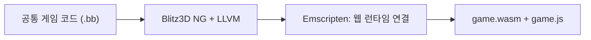
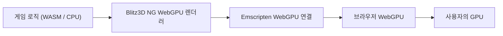

<!-- dev-docs-ai-translation: {"document":"docs/web-architecture.md","language":"ko","syncedHash":"81d8923fe7329b521cdafff95aab67331d7f06064937ff5cf499fdfc0c484d84"} -->

# 웹 버전 구현 원리

[English](web-architecture.md) · [한국어](web-architecture-ko.md)

[개발 가이드](development-ko.md#실험용-webgpu-빌드) · [macOS 구현 원리](macos-architecture-ko.md)

**웹 버전은 공통 게임 코드를 WebAssembly로 컴파일해 브라우저에서 실행하는 실험용 버전입니다.** 게임 로직은 사용자의 CPU에서 실행하고, 화면은 WebGPU를 통해 GPU에서 그립니다. 배포 서버는 실행 파일과 리소스를 제공하며, 게임 계산·렌더링·세이브 처리는 사용자의 브라우저에서 수행합니다.

이 문서는 [웹에서 플레이](https://shlifedev.github.io/Stranded-II-Modern/)의 내부 구조를 설명합니다. 빌드 명령과 게시 절차는 [개발 가이드](development-ko.md#실험용-webgpu-빌드)를 참고하세요.

## 1. 공통 게임 코드를 WebAssembly로 컴파일합니다

웹 진입점인 [`StrandedIIWeb.bb`](../src/engine/StrandedIIWeb.bb)는 브라우저용 연결 함수와 공통 `StrandedII.bb`를 포함합니다. 게임플레이는 기존 `.bb` 소스로 유지하고, 웹용 컴파일러와 런타임을 선택합니다.

수정 가능한 [내장 Blitz3D 엔진](../src/blitz3d/)을 Windows·웹·macOS·Studio가 공유합니다. [버전을 고정한 외부 SDK·라이브러리](../config/blitz3d-toolchain.json)와 Emscripten으로 게임과 엔진을 **WebAssembly(WASM)**로 빌드합니다. 엔진 소스를 직접 수정하며 준비 과정에서 패치를 덮어쓰지 않습니다. 브라우저가 로컬 CPU에서 게임을 실행하고 JavaScript는 로딩·브라우저 연동을 담당합니다.

배포 파일은 다음 역할로 나뉩니다.

| 파일 | 역할 |
| --- | --- |
| `game.wasm` | 컴파일된 게임 코드와 엔진 런타임입니다. |
| `game.js` | Emscripten이 만드는 WASM 로더와 브라우저 연결 코드입니다. |
| `assets.data` | 맵·모델·이미지·소리·언어팩 등 준비한 게임 리소스입니다. |
| `assets.js` | 리소스를 가상 파일시스템의 `/game/`에 준비하는 로더입니다. |
| `index.html` | 게임 화면, 검색 입력창, 전체화면 버튼 등 페이지 구조입니다. |
| `shell.js` | 초기화, 저장소, 포커스·입력, 게임과 브라우저 사이의 서비스 연결입니다. |
| `defaults.json` | 저장할 설정 파일 목록과 언어 정보를 담습니다. |
| `version.json` | 배포본의 버전·빌드 정보를 담습니다. |

리소스는 검증한 공식 원본과 공통 언어팩에서 준비합니다. 개인 세이브·로그·스크린샷과 Windows 실행 파일은 웹 리소스 패키지에서 제외합니다.

## 2. WASM의 그래픽 호출을 브라우저 WebGPU에 연결합니다

게임 코드가 Blitz의 2D·3D 그래픽 명령을 호출하면 WebGPU 렌더러가 버퍼·텍스처·그리기 명령으로 처리합니다. Emscripten의 `emdawnwebgpu` 연결 계층이 C/C++ WebGPU 호출을 브라우저의 WebGPU API로 전달합니다. 화면의 출력 대상은 HTML `canvas`입니다.

렌더러의 셰이더(GPU에서 실행하는 그래픽 프로그램)는 WGSL로 작성돼 있습니다. 브라우저가 이를 GPU에서 실행할 수 있게 처리하고, 운영체제에 맞는 그래픽 백엔드를 선택합니다. 웹 빌드는 특정 OS의 Metal 같은 백엔드를 직접 고정하지 않습니다. [macOS 앱](macos-architecture-ko.md)은 네이티브 Dawn 라이브러리에 연결하고 Metal을 명시적으로 선택합니다.

프레임을 표시한 뒤에는 `requestAnimationFrame` 또는 Emscripten의 대기로 브라우저에 제어권을 돌려줍니다. 그동안 브라우저가 화면 갱신과 입력 이벤트를 처리할 수 있습니다. 실제 프레임 속도는 GPU·브라우저·화면 주사율·게임 설정의 영향을 받습니다.

## 3. JSPI로 비동기 작업을 기다리고 게임을 이어갑니다

기존 게임 코드는 파일 저장처럼 결과를 즉시 받는 방식으로 작성돼 있습니다. 브라우저의 GPU 준비나 IndexedDB 기록은 비동기로 완료되므로, 기다리는 동안 브라우저가 다른 일을 처리할 수 있어야 합니다.

**JSPI(JavaScript Promise Integration)**는 WASM의 호출 흐름을 잠시 멈추고, JavaScript의 Promise가 완료되면 같은 지점에서 이어가게 합니다. 웹 런타임은 `-sJSPI=1`로 빌드하며, 브라우저 서비스 연결의 `EM_ASYNC_JS`가 이 방식을 사용합니다. JSPI는 저장소나 그래픽 API가 아니라, WASM과 비동기 JavaScript 사이의 실행 연결 기능입니다.

공통 게임의 `SystemProperty("StrandedWeb:…")` 호출은 [`bridge.cpp`](../src/native/web/bridge.cpp)를 거쳐 [`shell.js`](../src/web/shell.js)의 `Module.s2Bridge`로 전달됩니다. 저장 동기화 같은 작업의 Promise를 기다린 뒤 결과를 게임에 돌려줍니다.

페이지를 열면 다음 순서로 시작합니다.

1. `navigator.gpu`, `WebAssembly.Suspending`, 사용 가능한 GPU adapter를 확인합니다.
2. `assets.js`·`game.js`를 불러오고, WASM 런타임과 리소스를 준비합니다.
3. 기존 IndexedDB 데이터를 가상 파일시스템에 복원하고 설정·세이브 경로를 연결합니다.
4. `Module.callMain([])`로 공통 게임을 자동 실행합니다.

별도 시작 버튼이나 웹 언어 선택 화면은 없습니다. 게임 언어는 원래 게임의 설정에서 선택하고 재시작하면 적용됩니다. 첫 화면 클릭은 마우스 제어와 오디오 활성화에 사용합니다.

## 4. 파일 형태의 세이브를 IndexedDB에 보관합니다

게임은 기존처럼 파일 경로로 맵과 세이브를 읽고 씁니다. 브라우저에서는 Emscripten의 **가상 파일시스템**이 그 경로를 제공하고, **IDBFS**가 파일 내용을 브라우저의 **IndexedDB**에 동기화합니다.

| 가상 경로 | 용도 |
| --- | --- |
| `/game/` | 배포 리소스가 로드되며, 게임이 사용하는 기본 경로입니다. |
| `/persist/` | IndexedDB와 연결한 IDBFS 영역입니다. |
| `/persist/classic/saves/` | 기본판의 세이브와 백업을 보관합니다. |
| `/persist/classic/config/` | 설정 파일을 보관합니다. |

게임이 사용하는 세이브·설정 경로는 이 보관 영역에 심볼릭 링크로 연결합니다. 기본 설정은 아직 해당 파일이 없을 때만 복사해, 다시 접속하거나 배포본을 갱신해도 기존 선택을 유지합니다.

**메모리에 파일을 썼다고 IndexedDB 기록이 끝난 것은 아닙니다.** 설정 파일을 닫으면 변경을 추적하고 동기화를 예약합니다. 중요한 저장 파일 교체는 `FS.syncfs`가 완료될 때까지 기다린 뒤 성공을 반환합니다. 동기화 요청은 순서대로 처리하고, 교체 중 동기화에 실패하면 메모리의 기존 저장 내용을 복원하고 실패를 게임에 알립니다.

Web Locks API를 사용할 수 있는 환경에서는 같은 사이트의 저장소를 두 탭이 동시에 사용하는 것을 막습니다. 저장은 브라우저·프로필·사이트 주소(프로토콜·호스트·포트)에 묶입니다. 사이트 데이터를 지우면 세이브도 삭제되며, 다른 브라우저·로컬 개발 주소·Windows·macOS 앱으로 자동 이전되지 않습니다.

## 5. 입력·전체화면·소리를 브라우저 기능에 연결합니다

| 기능 | 구현 |
| --- | --- |
| 키보드·마우스 | SDL2가 브라우저 이벤트를 게임 입력으로 전달합니다. 플레이 중 마우스 이동은 Pointer Lock으로 처리합니다. |
| 포커스·일시정지 | 탭의 표시 상태, 창 포커스, 마우스 잠금·검색 입력 상태를 공통 게임에 전달합니다. |
| 전체화면 | Fullscreen API로 페이지를 전환합니다. 지원·허용되는 환경에서는 Keyboard Lock으로 짧은 `Esc`를 게임에 전달합니다. |
| 검색 입력창 | HTML `input`을 게임의 검색창 위치에 배치해 브라우저의 문자 입력을 사용합니다. |
| 시간 측정 | `performance.now()`를 공통 게임의 시간 측정 함수에 연결합니다. |
| 소리 | Web Audio로 출력하며, 사용자 클릭 시 중지된 오디오 컨텍스트를 재개합니다. |

메인 메뉴는 마우스 잠금 없이 표시할 수 있습니다. 플레이 중 창 전환이나 마우스 잠금 해제가 발생하면 공통 게임의 포커스 처리로 일시정지합니다. 화면을 다시 클릭해 복귀할 때는 그 클릭을 소비해 공격이나 메뉴 선택으로 함께 전달하지 않습니다.

브라우저 창 크기를 바꿀 때는 CSS로 화면을 비율에 맞게 확대·축소합니다. 게임의 실제 그리기 버퍼 해상도는 게임 설정이 결정합니다. 지원하지 않는 원본 WAV 인코딩은 빌드 준비 중 FFmpeg로 PCM WAV로 변환하며, 원본 파일을 보존하고 FFmpeg는 배포하지 않습니다.

## 6. 정적 파일로 배포하며, 실제 플레이는 별도로 검증합니다

GitHub Pages에는 앞에서 설명한 배포 파일 8개를 게시합니다. [`web_pages.py`](../scripts/web_pages.py)는 현재 소스·빌드·검사 결과가 일치하는 파일만 모으고, 배포별 캐시 키를 파일 URL에 붙여 이전 코드와 새 리소스가 섞이는 것을 줄입니다. 게임을 실행하는 서버 프로세스는 필요하지 않습니다.

현재 대상은 **WebGPU와 JSPI를 지원하는 데스크톱 Chrome/Edge**입니다. WebGPU를 사용할 수 있는 HTTPS 또는 로컬 개발 주소에서 실행해야 합니다. 두 기능이나 GPU adapter를 사용할 수 없으면 시작 단계에서 안내하고 중단합니다. 모바일·웹 Extended·에디터·전체 캠페인은 지원 완료 범위에 포함하지 않으며, 원시 TCP/UDP 호출은 연결 실패로 반환합니다.

| 검사 | 확인하는 범위 |
| --- | --- |
| `check --platform web` | 산출물·리소스·오디오, Windows/WASM의 숫자·문자열·바이너리 일치, 스크립트 처리와 CPU 버퍼 동작을 검사합니다. 실제 Emscripten 가상 파일시스템에 모의 저장 거래를 연결하고, 입력·초기화는 모의 DOM으로 검사합니다. |
| 브라우저의 `/checks/` | 실제 WebGPU에서 글꼴·이미지·화면 복사·오디오 디코딩과 메뉴·인트로·섬 시나리오를 비교합니다. 게임 시간은 가상으로 진행합니다. |
| 수동 플레이 | 실제 FPS·소리·입력, 게임 진행, 저장·불러오기, 새로고침·브라우저 재시작 후 복구, 포커스·전체화면 복귀를 확인합니다. |

표는 구현된 검사 범위입니다. 자동 검사의 성공은 실제 GPU·IndexedDB·전체 플레이 검증을 뜻하지 않습니다. `/checks/`는 별도로 준비하는 로컬 검사 페이지이며 공개 Pages 배포에 포함하지 않습니다.

구현을 따라가려면 [웹 빌드·리소스 패키징](../scripts/web_build.py) → [페이지 구조](../src/web/index.html) → [브라우저 서비스](../src/web/shell.js) → [공통 게임 연결](../src/engine/platforms/web/services.bb) → [호환성 검사](../scripts/verify_web.py) 순서로 읽으면 됩니다.
