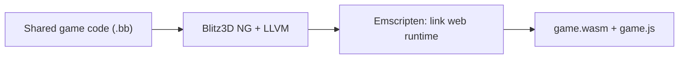
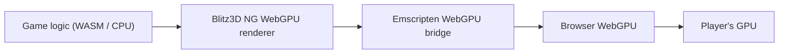
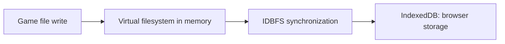

<!-- dev-docs-ai-translation: {"document":"docs/web-architecture.md","language":"en","syncedHash":"9357acb6586a4fc9907d6580c594f7a28f19395e573d56da47ba35aec4228cd6"} -->

# How the web version works

[English](web-architecture.md) · [한국어](web-architecture-ko.md)

[Development guide](development.md#experimental-webgpu-build) · [How the macOS version works](macos-architecture.md)

**The experimental web version compiles shared game code to WebAssembly and runs it in the browser.** Game logic executes on the player's CPU, and WebGPU draws graphics on the GPU. The distribution server provides executable files and resources; game computation, rendering, and save handling happen in the player's browser.

This document explains the internals of [Play on the web](https://shlifedev.github.io/Stranded-II-Modern/). See the [development guide](development.md#experimental-webgpu-build) for build commands and publication procedures.

## 1. Shared game code compiles to WebAssembly

The web entrypoint, [`StrandedIIWeb.bb`](../src/engine/StrandedIIWeb.bb), includes browser adapters and the shared `StrandedII.bb`. Gameplay remains in the existing `.bb` sources, with the web compiler and runtime selected for this target.

The editable [embedded Blitz3D engine](../src/blitz3d/) is shared by Windows, web, macOS and Studio. [Pinned external SDKs/libraries](../config/blitz3d-toolchain.json) and Emscripten build it with the game as **WebAssembly (WASM)**. Edit the engine sources directly; setup never overlays patches. The browser executes gameplay on the local CPU; JavaScript handles loading and browser integration.

The distribution files have these roles:

| File | Role |
| --- | --- |
| `game.wasm` | Compiled game code and engine runtime. |
| `game.js` | The WASM loader and browser integration code generated by Emscripten. |
| `assets.data` | Prepared game resources, including maps, models, images, audio, and language packs. |
| `assets.js` | Loads resources into `/game/` in the virtual filesystem. |
| `index.html` | Page structure, including the game display, search field, and fullscreen button. |
| `shell.js` | Initialization, storage, focus/input, and services connecting the game to the browser. |
| `debugui.js` | Browser text/IME integration for the shared Dear ImGui developer menu. |
| `defaults.json` | Lists settings files to persist and language information. |
| `version.json` | Distribution version and build information. |

Resources come from verified official originals and shared language packs. Personal saves, logs, screenshots, and Windows executables are excluded from the web resource package.

## 2. WASM graphics calls connect to browser WebGPU

When game code calls Blitz 2D and 3D graphics commands, the WebGPU renderer handles them using buffers, textures, and draw commands. Emscripten's `emdawnwebgpu` bridge passes C/C++ WebGPU calls to the browser's WebGPU API. An HTML `canvas` is the presentation target.

The renderer's shaders, graphics programs that run on the GPU, are written in WGSL. The browser processes them for GPU execution and selects a graphics backend suitable for the operating system. The web build does not directly pin an OS-specific backend such as Metal. The [macOS app](macos-architecture.md) links to a native Dawn library and explicitly selects Metal.

After presenting a frame, the renderer yields control to the browser through `requestAnimationFrame` or an Emscripten wait. This lets the browser update the display and handle input events. Actual frame rates depend on the GPU, browser, display refresh rate, and game settings.

## 3. JSPI waits for asynchronous work and resumes the game

Existing game code expects immediate results from operations such as file saving. Browser GPU preparation and IndexedDB writes complete asynchronously, so the browser must be able to handle other work while the game waits.

**JSPI (JavaScript Promise Integration)** suspends a WASM call flow and resumes it at the same point once a JavaScript Promise completes. The web runtime is built with `-sJSPI=1`, and the browser service bridge uses this mechanism through `EM_ASYNC_JS`. JSPI connects WASM execution to asynchronous JavaScript; it is not a storage or graphics API.

The shared game's `SystemProperty("StrandedWeb:…")` calls pass through [`bridge.cpp`](../src/native/web/bridge.cpp) to `Module.s2Bridge` in [`shell.js`](../src/web/shell.js). The bridge waits for the Promise from operations such as storage synchronization, then returns the result to the game.

Opening the page starts this sequence:

1. Check `navigator.gpu`, `WebAssembly.Suspending`, and an available GPU adapter.
2. Load `assets.js` and `game.js`, preparing the WASM runtime and resources.
3. Restore existing IndexedDB data into the virtual filesystem and connect settings/save paths.
4. Automatically run the shared game with `Module.callMain([])`.

There is no separate start button or web language-selection screen. Select a language in the original game's Settings and restart to apply it. The first canvas click enables mouse controls and audio.

## 4. File-based saves persist in IndexedDB

The game reads and writes maps and saves using file paths, as before. Emscripten's **virtual filesystem** provides those paths in the browser, and **IDBFS** synchronizes file contents with the browser's **IndexedDB**.

| Virtual path | Purpose |
| --- | --- |
| `/game/` | Loaded distribution resources and the game's base directory. |
| `/persist/` | IDBFS area connected to IndexedDB. |
| `/persist/classic/saves/` | Base-game saves and backups. |
| `/persist/classic/config/` | Settings files. |

The game's save and settings paths are connected to this storage area with symbolic links. Defaults are copied only when the corresponding file is missing, retaining existing selections across visits and distribution updates.

**Writing a file in memory does not mean its IndexedDB write has finished.** Closing a settings file tracks the change and schedules synchronization. Important save-file replacements wait for `FS.syncfs` to complete before returning success. Synchronization requests run in sequence; if synchronization fails during replacement, the previous in-memory save contents are restored and the game receives a failure result.

Where Web Locks is available, it prevents two tabs from using the same site's storage simultaneously. Saves belong to a browser, profile, and site address (scheme, host, and port). Clearing site data deletes saves. They are not automatically transferred to another browser, a local development address, Windows, or the macOS app.

## 5. Input, fullscreen, and audio use browser facilities

| Feature | Implementation |
| --- | --- |
| Keyboard and mouse | SDL2 passes browser events to game input. Pointer Lock handles mouse movement during play. |
| Focus and pause | Tab visibility, window focus, pointer lock, and search-field state are passed to the shared game. |
| Fullscreen | The Fullscreen API switches the page. Where supported and allowed, Keyboard Lock passes short `Esc` presses to the game. |
| Search field | An HTML `input` is positioned over the game's search area and uses browser text input. |
| Timing | `performance.now()` connects to the shared game's timing functions. |
| Audio | Web Audio output, with a suspended audio context resumed on a user click. |

The main menu can appear without pointer lock. During play, switching windows or releasing pointer lock pauses the game through its shared focus handling. A click to return is consumed so it does not also trigger an attack or menu selection.

Resizing the browser window scales the image proportionally with CSS. Game settings determine the actual drawing-buffer resolution. Unsupported original WAV encodings are converted to PCM WAV with FFmpeg during build preparation; original files are preserved and FFmpeg is not distributed.

## 6. Static-file distribution and separate gameplay verification

GitHub Pages hosts the nine distribution files described above. [`web_pages.py`](../src/devtools/web_pages.py) stages only files matching the current sources, build, and verification results, and adds a deployment-specific cache key to file URLs to reduce mixing old code with new resources. No server process running the game is required.

The current target is **desktop Chrome/Edge with WebGPU and JSPI support**. Run it over HTTPS or a local development address where WebGPU is available. Startup displays an error and stops if either feature or a GPU adapter is unavailable. Mobile, web Extended, the editor, and the full campaign are outside the verified support scope; raw TCP/UDP calls return connection failure.

| Check | What it covers |
| --- | --- |
| `check --platform web` | Artifacts, resources, audio, Windows/WASM numeric/string/binary parity, script processing, and CPU buffer behavior. It connects simulated storage transactions to the real Emscripten virtual filesystem and tests input/initialization with a simulated DOM. |
| Browser `/checks/` | Compares glyphs, images, frame copies, audio decoding, and menu/intro/island scenarios using actual WebGPU. Game time advances synthetically. |
| Manual gameplay | Actual FPS, audible sound, input, progression, save/load, recovery after refresh/browser restart, and focus/fullscreen recovery. |

The table describes implemented checks. Passing automated checks does not verify actual GPU, IndexedDB, or full gameplay behavior. `/checks/` is a separately prepared local check page and is excluded from the public Pages deployment.

To follow the implementation, read [web building and resource packaging](../src/devtools/web_build.py) → [page structure](../src/web/index.html) → [browser services](../src/web/shell.js) → [shared game adapters](../src/engine/platforms/web/services.bb) → [compatibility checks](../src/devtools/verify_web.py).
