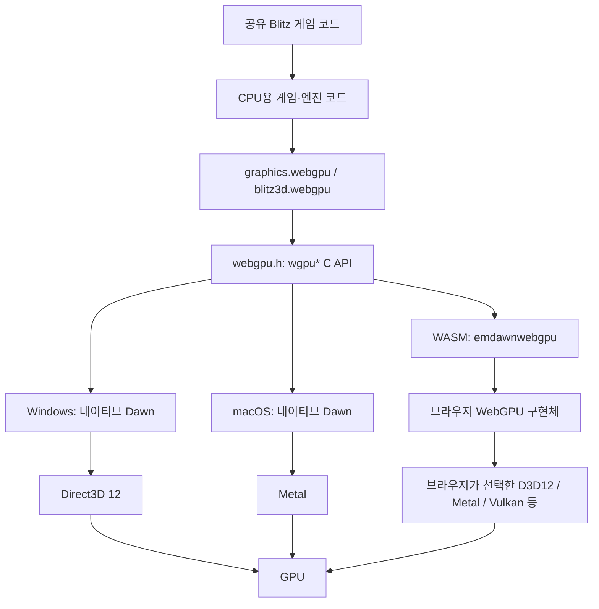
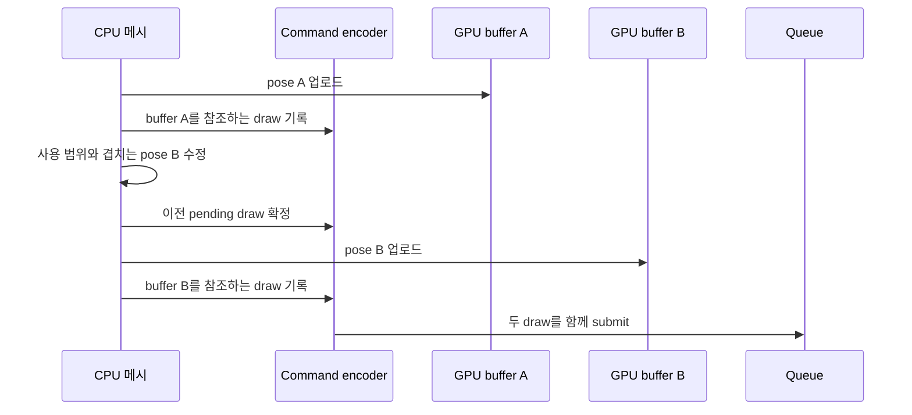

<!-- dev-docs-ai-translation: {"document":"docs/wgpu-migration.md","language":"ko","syncedHash":"ed095de3a4793e56f9ade8e29a30d886163e3d487e63ad14207caa57c7385f00"} -->

# Stranded II의 wgpu/WebGPU 크로스플랫폼 렌더러 마이그레이션

[English](wgpu-migration.md) · [한국어](wgpu-migration-ko.md)

[개발 가이드](development-ko.md) · [웹 버전 구현 원리](web-architecture-ko.md) · [macOS 구현 원리](macos-architecture-ko.md)

이 문서는 이 저장소의 실제 C++·WGSL·Blitz 소스를 기준으로, Stranded II의 D3D7 고정 기능 렌더링을 공통 WebGPU 렌더러로 옮긴 구조를 설명합니다. 장치 생성, 셰이더, 버퍼 배치, 명령 제출, 투명도, 화면 복사까지 구현을 추적합니다. 예시로 표시한 코드는 설명용 축약이며, 새로운 마이그레이션을 구현했다거나 모든 플랫폼의 게임 진행을 검증했다는 의미는 아닙니다.

## 1. 먼저 구분할 이름: WebGPU, `wgpu*`, Dawn, Rust `wgpu`

**이 프로젝트는 Rust의 `wgpu` 크레이트를 사용하지 않습니다.** `<webgpu/webgpu.h>`의 `WGPUDevice`, `WGPUBuffer`, `wgpuQueueSubmit()` 같은 C API를 사용하는 C++ 렌더러입니다. 네이티브에서는 Dawn을 연결하고, 웹에서는 Emscripten의 `emdawnwebgpu` 연결 계층을 사용합니다. 여기서 “wgpu 마이그레이션”은 이 `wgpu*` API 기반 WebGPU 렌더러로의 전환을 가리킵니다.

| 이름 | 책임 | 이 프로젝트에서의 위치 |
| --- | --- | --- |
| WebGPU | 리소스·파이프라인·명령·검증에 대한 공통 그래픽 API | 렌더러가 따르는 객체·실행 모델 |
| `webgpu.h` / `wgpu*` | WebGPU 구현체를 호출하는 C 인터페이스 | `graphics.webgpu`와 `blitz3d.webgpu`의 호출 경계 |
| WGSL | GPU 프로그램의 입력 언어와 메모리 배치 규칙 | `default.wgsl`, `default3d.wgsl` |
| Dawn | 네이티브 WebGPU 구현체; 백엔드·검증·셰이더 처리를 담당 | Windows D3D12, macOS Metal |
| Tint | Dawn의 셰이더 처리 계층 | WGSL을 백엔드용 표현으로 처리하는 구현체 내부 |
| Rust `wgpu` | 별도의 Rust WebGPU 구현·라이브러리 생태계 | 현재 런타임의 의존성에 없음 |
| Emscripten `emdawnwebgpu` | WASM의 C API 호출을 브라우저 WebGPU에 연결 | 웹·Studio 빌드 |

`wgpu`라는 함수 접두사만으로 구현체를 식별할 수는 없습니다. 실제 선택은 [모듈 CMake](../src/blitz3d/src/modules/bb/graphics.webgpu/CMakeLists.txt)의 `dawn::webgpu_dawn` 연결과 `--use-port=emdawnwebgpu`, 그리고 [툴체인 설정](../config/blitz3d-toolchain.json)의 Dawn 고정 리비전으로 확인합니다.

### 1.1 플랫폼별 실제 경로



| 타깃 | 게임·엔진의 CPU 실행 | 화면 연결 | GPU 백엔드 선택 |
| --- | --- | --- | --- |
| Windows | LLVM 기반 x64 네이티브 실행 파일 | SDL 창의 `HWND` | `WGPUBackendType_D3D12` 명시 |
| macOS | Apple Silicon ARM64 네이티브 실행 파일 | SDL Metal view의 레이어 | `WGPUBackendType_Metal` 명시 |
| 웹 | WASM을 브라우저가 CPU 코드로 실행 | HTML `#canvas` | 프로젝트가 네이티브 API를 고정하지 않음; 브라우저가 결정 |
| Studio의 3D 화면 | Electron에서 WASM 실행 | 브라우저형 canvas | Electron의 WebGPU 구현체가 결정 |

Vulkan은 WebGPU 구현체가 사용할 수 있는 백엔드입니다. **이 저장소에 독립적인 Linux/Vulkan 네이티브 게임 타깃이 완성돼 있다는 뜻은 아닙니다.** 현재 `dev.py --platform`은 `windows|web|macos`를 제공하며 웹과 Mac 게임 빌드는 기본판만 허용합니다. Windows의 두 에디션은 같은 렌더러 소스를 사용합니다. Studio의 Extended 장면 실행은 별도 개발 도구 경로입니다.

## 2. D3D7에서 옮긴 것은 호출 이름보다 렌더링 의미입니다

기존 [D3D7 `scene.cpp`](../src/blitz3d/src/modules/bb/blitz3d.d3d7/scene.cpp)는 `SetRenderState()`, `SetTextureStageState()`, `D3DMATERIAL7` 등의 고정 기능 상태로 조명·안개·텍스처 합성·광택을 설정합니다. 최신 WebGPU에는 이 고정 기능 조명기를 그대로 호출하는 API가 없습니다. 같은 시각적 의미를 WGSL 계산과 파이프라인 상태로 표현해야 합니다.

| 기존 의미 | WebGPU에서의 표현 | 실제 구현 |
| --- | --- | --- |
| 월드·뷰·투영 변환 | uniform / instance 데이터와 정점 셰이더 행렬 곱 | `setWorldMatrix()`, `setViewMatrix()`, `vs_main()` |
| 고정 기능 조명·재질 광택 | WGSL 정점 조명 계산, 광택 보간 후 합성 | `BBFrameState`, `BBEntityState`, `default3d.wgsl` |
| 다중 텍스처 stage | 8개 texture/sampler 쌍과 fragment 합성 | bind group 2, `combine()` |
| 선형 안개 | 정점에서 안개 계수 계산, fragment에서 RGB 혼합 | `fogFactorLinear()`, `fog_mode` |
| alpha test | fragment `discard` | `alpha_ref`, `alpha_test` |
| blend / Z / culling 상태 | 불변 render pipeline의 캐시 키 | `getScenePipeline()` |
| DirectDraw 이미지 복사·color key | 텍스처 quad, 정확한 RGB key 판정 | `WebGPUCanvas::blit()`, `default.wgsl` |
| 화면 버퍼 lock/read | 명시적 GPU readback와 CPU 복사본 | `readbackInto()`, `lock()`, `unlock()` |

게임 수준의 `Graphics3D`, `RenderWorld`, `DrawImage`, `Text`, `CopyRect`, `Flip` 인터페이스는 유지됩니다. 하위 그래픽 드라이버를 바꿔 기존 게임과 공유 월드·카메라·모델 코드를 활용하는 방식입니다. 원본 EXE의 D3D7 명령을 실행 중에 가로채 번역하는 구조는 아닙니다.

### 2.1 유지하는 계층과 교체한 계층

```text
src/engine/**/*.bb
  게임 규칙, 맵, 메뉴, 물 효과, 프레임 제어
          |
          v
bb/blitz3d
  World / Camera / Model / Surface / RenderState / BBScene 추상화
          |
          v
bb/blitz3d.webgpu
  WebGPUScene / WebGPUMesh / WebGPULight / default3d.wgsl
          |
          v
bb/graphics.webgpu
  WebGPUContextResources / WebGPUGraphics / WebGPUCanvas / default.wgsl
          |
          v
WebGPU 구현체와 플랫폼 surface
```

`BBScene`·`BBMesh`·`BBCanvas`가 게임 의미와 GPU 실행을 연결하는 경계입니다. 3D 월드 열거·가시성·정렬은 공통 엔진에 남고, 리소스·셰이더·draw encoding은 WebGPU 모듈이 맡습니다.

## 3. 실제로 빌드에 연결하는 방법

[런타임 선택](../src/blitz3d/src/runtime/CMakeLists.txt)은 네이티브 게임에서 `s2windows` 또는 `s2macos`를 선택합니다. 두 런타임의 모듈 목록에 `graphics.webgpu`, `blitz3d.webgpu`, `runtime.sdl`이 들어갑니다.

```cmake
# src/blitz3d/src/modules/bb/graphics.webgpu/CMakeLists.txt 발췌
if(BB_EMSCRIPTEN)
  target_compile_options(bb.graphics.webgpu PUBLIC "--use-port=emdawnwebgpu")
else()
  target_link_libraries(bb.graphics.webgpu dawn::webgpu_dawn)
endif()
```

네이티브 게임 설정에서는 `find_package(Dawn CONFIG REQUIRED)`로 Dawn을 찾고 `BB_WEBGPU`를 켭니다. Windows는 `webgpu_dawn`, `d3d12`, `dxgi`, `dxguid` 등을 연결하며, Mac은 Metal·QuartzCore·IOSurface·Foundation 프레임워크를 연결합니다. WGSL은 `bin2h()`로 빌드 디렉터리의 헤더에 포함되므로 실행 중 외부 셰이더 파일을 찾아야 하는 구조가 아닙니다.

웹에서는 `BB_WEBGPU=ON`인 `runtime.opengl.static`을 빌드합니다. `opengl`이라는 타깃 이름과 `bbCreateOpenGLRuntime`이라는 factory 이름은 남아 있지만, 활성 모듈이 WebGPU이면 실제 그리기는 WebGPU로 수행됩니다. 이름만 보고 OpenGL 경로라고 판단하면 안 됩니다. 웹 linker에도 `--use-port=emdawnwebgpu`와 `-sJSPI=1`이 적용됩니다.

외부 Dawn·LLVM·DXC·SDL 버전은 [공유 툴체인 설정](../config/blitz3d-toolchain.json)에 고정합니다. 엔진을 바꿀 때는 추적된 `src/blitz3d/`를 수정하며, 생성 헤더·라이브러리·실행 파일은 `build/engine/`에 둡니다. 예전 엔진 생성기나 upstream 소스 재복원으로 이 렌더러를 덮어쓰지 않습니다.

## 4. Blitz 호출 하나가 draw까지 내려가는 예

아래는 호출 경계를 보여주는 독립적인 Blitz 예시입니다. 실제 게임의 타이밍 루프를 대체하는 코드는 아닙니다.

```blitzbasic
Graphics3D 800,600,32,2
SetBuffer BackBuffer()
camera=CreateCamera()
CameraClsColor camera,16,24,32
AmbientLight 64,64,64
light=CreateLight(1)
RotateEntity light,45,30,0
cube=CreateCube()
PositionEntity cube,0,0,5
EntityColor cube,80,180,90
While Not KeyHit(1)
    RenderWorld()
    Text 8,8,"WebGPU renderer"
    Flip False
Wend
End
```

실제 [게임 루프](../src/engine/includes/game.bb)도 `RenderWorld()`를 호출합니다. 호출은 [Blitz 명령 구현](../src/blitz3d/src/modules/bb/blitz3d/blitz3d.cpp)의 `bbRenderWorld(tween)` → `World::render(tween)` → `prepareRender()` / `renderPrepared()` → `BBScene` → `WebGPUScene::render()`로 이어집니다.

| 단계 | CPU에서 하는 일 | GPU에 전달되는 것 |
| --- | --- | --- |
| 게임 / 월드 | 모델·카메라·조명 상태 및 보간 준비 | 아직 GPU 명령 없음 |
| 카메라별 월드 렌더링 | frustum 검사, 거리 fade, 불투명·투명 queue 구성 | 그릴 모델·surface의 순서 |
| `setRenderState()` | 재질을 entity 상태·instance 색·texture group으로 변환 | 셰이더 입력과 pipeline 선택 자료 |
| `WebGPUMesh::upload()` | 변경된 CPU 메시 범위를 GPU buffer에 업로드 | vertex/index buffer 데이터 |
| `WebGPUScene::render()` | uniform·instance staging, 상태 캐시, 인접 draw 병합 | bind/set 명령, indexed draw |
| `Text` 등 | 2D quad / glyph 정점과 uniform 준비 | framebuffer의 2D pass |
| `present()` / `flush()` | framebuffer를 surface에 그리는 pass와 명령 제출 | GPU가 실행할 command buffer |

`RenderWorld()` 호출 완료는 GPU 실행 완료를 뜻하지 않습니다. CPU는 명령을 기록하고, GPU 실행은 제출된 queue 작업으로 진행됩니다. readback처럼 결과가 CPU에 필요할 때에만 별도 완료 대기가 들어갑니다.

## 5. instance·adapter·device·surface 생성

구현은 [그래픽 컨텍스트](../src/blitz3d/src/modules/bb/graphics.webgpu/graphics.webgpu.cpp)의 `WebGPUContextResources::initDevice()`에 있습니다.

1. `wgpuCreateInstance()`로 WebGPU 진입 객체를 생성합니다.
2. 플랫폼 창 또는 HTML canvas를 `WGPUSurface`에 연결합니다.
3. 그 surface에 호환되는 adapter를 요청합니다.
4. adapter에서 device를 요청하고 오류·device loss callback을 설정합니다.
5. `wgpuDeviceGetQueue()`로 제출 queue를 얻습니다.
6. surface capabilities에서 포맷·present mode를 선택하고 surface를 configure합니다.
7. 공통 2D 셰이더·bind layout·sampler·arena를 준비합니다.

플랫폼별 surface descriptor는 다음과 같습니다.

| 플랫폼 | surface source | 가져오는 원시 객체 |
| --- | --- | --- |
| Windows | `WGPUSurfaceSourceWindowsHWND` | `SDL_GetWindowWMInfo()`의 `HWND`, `GetModuleHandleW()`의 instance |
| macOS | `WGPUSurfaceSourceMetalLayer` | `SDL_Metal_CreateView()`, `SDL_Metal_GetLayer()` |
| 웹 | `WGPUEmscriptenSurfaceSourceCanvasHTMLSelector` | `#canvas` selector |

아래는 adapter 선택 부분의 축약입니다. 나머지 callback·오류 처리는 원본 함수를 따릅니다.

```cpp
WGPURequestAdapterOptions aopts = {};
aopts.compatibleSurface = surface;
#ifdef BB_MACOS
aopts.backendType = WGPUBackendType_Metal;
#elif defined(BB_WINDOWS)
aopts.backendType = WGPUBackendType_D3D12;
#endif
wgpuInstanceRequestAdapter(instance, &aopts, acb);
```

네이티브 callback은 `WGPUCallbackMode_AllowProcessEvents`로 `wgpuInstanceProcessEvents()`를 통해 진행합니다. 웹은 `AllowSpontaneous`를 사용하고 기다리는 동안 `emscripten_sleep()`로 브라우저에 실행권을 돌려줍니다. JSPI는 동기식으로 작성된 WASM 호출 흐름이 비동기 브라우저 작업을 기다렸다가 재개하도록 돕습니다. WGSL이나 GPU 실행을 대신하는 기능은 아닙니다.

현재 device descriptor에는 별도의 optional feature 목록이나 확대된 required limits를 요청하는 코드가 없습니다. WebGPU가 제공하는 기본 계약과 실제 adapter 제약 안에서 동작해야 합니다. `gfxDriverCaps3D()`의 기존 호환성 숫자를 실제 GPU 기능 조회로 해석해서는 안 됩니다.

## 6. WGSL이 D3D12·Metal에서 실행되는 과정

프로젝트는 두 WGSL 소스를 C++에 포함하고 `WGPUShaderSourceWGSL`을 `wgpuDeviceCreateShaderModule()`에 전달합니다. 자체 HLSL/MSL 셰이더 세트를 별도로 유지하지 않습니다.

```text
프로젝트 WGSL
  -> WebGPU 구현체의 WGSL 검증·내부 표현·백엔드 변환
  -> 플랫폼 셰이더 컴파일러
  -> 드라이버가 처리하는 GPU 프로그램
```

Dawn의 일반적인 D3D12 경로는 Tint의 HLSL 처리와 DXC의 DXIL 컴파일을 사용합니다. Metal 경로는 MSL과 Metal 컴파일 과정을 사용합니다. Vulkan 구현체는 SPIR-V 경로를 사용할 수 있습니다. 이 변환은 구현체 내부 책임이며, 프로젝트의 `WebGPUScene`이 HLSL·MSL·SPIR-V를 직접 생성하는 것은 아닙니다. 구체적인 내부 최적화와 캐시는 구현체 버전에 따라 달라집니다.

프로젝트가 Windows EXE 옆에 `dxcompiler.dll`, `dxil.dll`을 배치하는 이유도 네이티브 D3D12 셰이더 경로의 의존성입니다. 웹은 브라우저의 구현체·드라이버·셰이더 컴파일 환경을 사용하므로 이 네이티브 DLL을 WASM에 넣지 않습니다.

파이프라인 생성은 셰이더와 고정 상태를 준비하는 상대적으로 무거운 작업입니다. `prewarmPipelines()`는 `RGBA8Unorm`, `RGB10A2Unorm`에 대해 blend·Z·front face·double-sided 조합과 clear pipeline을 미리 만듭니다. 매 프레임 WGSL을 다시 변환하는 구조가 아닙니다. wireframe 등 나머지 조합은 캐시를 통해 필요할 때 생성합니다.

## 7. C++와 WGSL 사이의 메모리 계약

GPU는 C++ 필드 이름을 알지 못합니다. byte offset, stride, 정수/실수 타입, 행렬 배치, WGSL alignment가 일치해야 합니다. [3D 헤더](../src/blitz3d/src/modules/bb/blitz3d.webgpu/blitz3d.webgpu.h)는 `static_assert()`로 핵심 크기와 offset을 검증합니다. CPU 숫자 ABI와 GPU uniform ABI는 별개의 계약입니다.

### 7.1 정점과 인스턴스

| `BBWebGPU3DVertex` 필드 | byte offset | GPU vertex format | shader location |
| --- | --- | --- | --- |
| `coords[3]` | 0 | `Float32x3` | 0 |
| `normal[3]` | 12 | `Float32x3` | 1 |
| `color[4]` | 24 | `Unorm8x4` | 2 |
| `tex_coord0[2]` | 28 | `Float32x2` | 3 |
| `tex_coord1[2]` | 36 | `Float32x2` | 4 |

정점 stride는 **44 byte**입니다. `Unorm8x4`는 CPU의 0~255 색을 셰이더의 0~1 값으로 변환합니다. CPU 입력 ARGB는 업로드 전에 RGBA byte 순서로 나눕니다. `float3`의 uniform alignment 규칙을 vertex buffer에 그대로 적용하지 않습니다. 정점 fetch의 배치는 pipeline descriptor의 offset·stride가 정합니다.

| `BBWebGPUInstance` 필드 | byte offset | 크기 | shader locations |
| --- | --- | --- | --- |
| `world[16]` | 0 | 64 | 5~8: 행렬의 4개 column |
| `normal[12]` | 64 | 48 | 9~11: `vec4`로 패딩한 3개 column |
| `color[4]` | 112 | 16 | 12: RGB tint와 alpha/fade |

인스턴스 stride는 **128 byte**이며 두 번째 vertex buffer의 `stepMode=Instance`를 사용합니다. normal 데이터는 셰이더에서 각 `vec4.xyz`로 3×3 행렬을 구성합니다. world 행렬·normal 행렬·색이 instance마다 달라져도 같은 material uniform을 공유할 수 있습니다.

### 7.2 uniform과 bind groups

| 자료 | C++ 크기 | 핵심 배치 | 사용하는 binding |
| --- | --- | --- | --- |
| `BBWebGPUFrameState` | 656 byte | proj 0, view 64, lights 128, lights_used 640, lod_bias 644 | group 0 / binding 0 |
| `BBWebGPUEntityState` | 720 byte | ambient 0, fog_color 16, fog_range 32, alpha_ref 64, texs 80 | group 1 / binding 0 |
| `BBWebGPUClearState` | 32 byte | color 0, z 16, 끝 padding | clear pipeline의 group 0 / binding 0 |
| `BBWebGPURenderState` | 64 byte | 2D 좌표·해상도·색·image mode | 2D group 0 / binding 0 |

`LightData`는 `vec4` 4개로 **64 byte**, `TexState`는 `mat4x4` 64 byte와 정수 4개로 **80 byte**입니다. 프레임은 최대 조명 8개, entity는 최대 texture stage 8개를 보관합니다. `vec3`·행렬·구조체 배열의 padding은 WGSL 규칙으로 확인해야 하며 단순히 C++ 필드 크기를 더하는 방식으로 결정하지 않습니다.

3D group 2에는 binding `2*i`의 `texture_2d<f32>`와 binding `2*i+1`의 sampler를 8쌍 배치합니다. 미사용 슬롯에도 흰색 texture와 sampler를 넣어 완전한 bind group을 구성합니다. bind group은 texture view/sampler handle 배열을 키로 캐시하며 view가 사라지면 관련 캐시를 무효화합니다.

### 7.3 dynamic offset과 arena

3D uniform arena와 instance arena는 각각 **4 MiB**로 생성됩니다. uniform allocation은 다음 계산으로 256-byte 경계에 맞춥니다.

```cpp
size_t offset = (uniform_used + 255) & ~(size_t)255;
size_t extent = size > bind_size ? size : bind_size;
if (offset + extent > uniform_capacity) {
    flushAll();
    offset = 0;
}
memcpy(uniform_stage.data() + offset, data, size);
```

656-byte frame 또는 전체 720-byte entity 뒤의 다음 시작점은 768-byte 간격이 됩니다. 이는 데이터 구조가 768 byte라는 뜻이 아니라 다음 allocation의 정렬 결과입니다. clear payload는 32 byte라도 다음 allocation은 256-byte 경계에서 시작합니다.

entity는 `usedSize(n)=80+80*n`으로 실제 사용 texture stage까지만 CPU staging을 갱신합니다. GPU binding의 크기는 여전히 720 byte이므로 arena 끝의 capacity 검사는 `bind_size`까지 포함합니다. 셰이더는 `texs_used`를 통해 미사용 stage를 읽지 않습니다. `pushCached()`는 같은 상태 byte의 offset을 재사용하고, 제출 후 cache를 무효화해 이전 arena offset이 새 데이터에 잘못 연결되지 않게 합니다.

## 8. 좌표계·깊이·normal 변환

WebGPU로 바꾸면서 행렬을 복사하는 것만으로는 충분하지 않습니다. 카메라 방향, clip depth, front face, 2D 원점이 기존 의미와 맞아야 합니다.

`setViewMatrix()`는 Blitz view 변환의 Z 성분을 반전합니다. `setPerspProj()`는 `w_clip=-z_eye`인 투영을 구성하고, WebGPU의 clip depth 조건 `0 <= z_clip <= w_clip`에 맞게 near를 0, far를 1로 매핑합니다. `default3d.wgsl`에서 `ndc.z = ndc.z*2-1`을 수행하는 부분은 sphere-map 좌표 계산용입니다. 실제 `@builtin(position)`은 변환 전의 clip position을 유지합니다.

```text
position_clip = projection * view * world * position_local
normal_eye    = transpose(inverse((view * world).upper3x3)) * normal_local
```

`bbNormalMatrix()`는 cross product와 determinant로 inverse-transpose를 구성합니다. 비균일 scale에서 normal을 world 행렬로만 변환하면 조명이 틀어집니다. 거의 특이한 행렬은 `abs(det)<=1e-20`인 fallback을 사용합니다.

메시의 `setTriangle()`은 입력 `(v0,v1,v2)`를 `(v2,v1,v0)` 순서로 저장합니다. pipeline은 기본 `CCW`, 반전 시 `CW`를 사용하고 양면 또는 wireframe이면 culling을 끕니다. mirror 경로에서도 `setFlippedTris()`가 반영됩니다. 이런 처리를 백엔드별로 중복 추가하면 두 번 반전될 수 있으므로 공통 좌표 계약을 기준으로 판단합니다.

2D 정점 셰이더는 좌상단 픽셀 좌표에서 `p.y=res.y-p.y`, `p=p/res`, `p=p*2-1`로 clip 좌표를 만듭니다. 화면·텍스처 복사에서 위아래가 맞는지는 이 좌표 변환, UV, CPU 이미지 row 순서를 함께 봐야 합니다.

## 9. 고정 기능 조명·텍스처·안개를 WGSL로 재현

[실제 3D 셰이더](../src/blitz3d/src/modules/bb/blitz3d.webgpu/default3d.wgsl)는 호환성을 위한 정점 조명을 계산합니다. 물리 기반 PBR 재질로 바꾸는 설계가 아닙니다.

### 9.1 diffuse와 광택의 순서

정점 색 또는 brush 색을 선택한 뒤 ambient와 diffuse를 계산합니다. 방향광·점광·spotlight는 frame의 `LightData`로 전달합니다. 점광은 거리 감쇠를 적용하고 spotlight는 cone 각도의 cosine 범위로 추가 감쇠합니다.

광택은 기존 D3D7 재질의 의미를 따릅니다.

```text
power     = shininess * 128
strength  = min(shininess, 1)
H         = normalize(L + V)
specular += pow(max(dot(N,H),0), power) * attenuation * strength
```

`shininess<=0`이면 광택을 계산하지 않습니다. view vector는 eye position에 따른 local viewer이고 광택 색은 흰색입니다. diffuse와 광택은 정점에서 계산해 fragment로 보간합니다. specular는 텍스처 처리 **후**, 안개와 framebuffer blending **전**에 더합니다. 광택을 diffuse에 미리 더한 뒤 텍스처와 곱하면 어두운 texture가 highlight를 억제하여 기존 재질과 달라집니다.

### 9.2 texture stage와 framebuffer blend는 서로 다릅니다

`combine()`은 현재 색 `t0`와 texture 색 `t1`을 합성합니다.

| texture blend 번호 | RGB 계산 |
| --- | --- |
| 1 | `mix(t0.rgb,t1.rgb,t1.a)` |
| 2 | `t0.rgb*t1.rgb` |
| 3 | `t0.rgb+t1.rgb` |
| 4 | `dot(t0.rgb*2-1,t1.rgb*2-1)`을 RGB에 복제 |
| 5 | `t0.rgb*t1.rgb*2` |

texture에 alpha 사용 flag가 있으면 stage alpha를 곱합니다. 결과는 clamp합니다. 각 texture는 UV0/UV1 또는 sphere-map 좌표를 선택하고 자체 texture transform을 적용합니다. sample에는 frame의 LOD bias를 전달합니다.

이 계산은 fragment 내부의 texture stage 합성입니다. framebuffer에 쓰는 source/destination blend는 뒤에서 pipeline이 별도로 처리합니다. 두 blend를 혼동하면 같은 material로도 결과가 달라집니다.

### 9.3 안개·alpha test·fade

선형 안개 계수는 `abs(eye_pos.z)`를 이용해 계산합니다.

```text
fog = 1 - clamp((end-distance)/(end-start), 0, 1)
RGB = mix(lit_textured_specular_RGB, fog_RGB, fog)
```

안개 색을 구성할 때 원래 alpha를 보존합니다. `FX_NOFOG` 재질은 안개를 적용하지 않습니다.

alpha-tested 재질은 `alpha_ref=128` 등을 사용하고 fragment에서 `color.a*255 <= alpha_ref`이면 discard합니다. instance의 fade alpha를 정점에서 threshold에도 곱하므로 풀처럼 컷아웃된 texture가 fade될 때 silhouette가 불필요하게 줄어드는 문제를 피합니다. 이 threshold 처리와 거리 fade·투명 blend의 조합은 실제 GPU fixture가 다루는 호환성 항목입니다.

## 10. 고정 상태는 pipeline 캐시로, 변동 자료는 bind로

3D pipeline key는 실제 코드에서 다음 비트 조합입니다.

```cpp
uint32_t key = (uint32_t)blend_mode
    | ((uint32_t)zmode << 3)
    | ((flipped_tris ? 1u : 0u) << 5)
    | ((doublesided ? 1u : 0u) << 6)
    | ((wireframe ? 1u : 0u) << 7)
    | ((uint32_t)format << 8);
```

blend·depth·topology·front face·culling·target format은 pipeline에 들어갑니다. 카메라·조명·재질·변환은 buffer/bind group에 들어갑니다. viewport·scissor는 pass 명령으로 설정합니다. 이 구분으로 재질 색을 바꿀 때마다 새 GPU pipeline을 만들지 않습니다.

| Z mode | compare | depth write | 용도 |
| --- | --- | --- | --- |
| `ZMODE_NORMAL` | `LessEqual` | 켬 | 일반 불투명 그리기 |
| `ZMODE_DISABLE` | `Always` | 끔 | order가 지정된 그리기 등 |
| `ZMODE_CMPONLY` | `LessEqual` | 끔 | 불투명 깊이를 검사하는 투명 그리기 |

| framebuffer blend | RGB 결과 |
| --- | --- |
| `BLEND_REPLACE` | source; blend state 없음 |
| `BLEND_ALPHA` | `src.rgb*src.a + dst.rgb*(1-src.a)` |
| `BLEND_MULTIPLY` | `src.rgb*dst.rgb` |
| `BLEND_ADD` | `src.rgb*src.a + dst.rgb` |

alpha channel의 blend factor는 RGB와 별도로 설정합니다. `BLEND_ALPHA`의 alpha는 `src.a + dst.a*(1-src.a)`입니다. depth texture는 canvas별 `Depth24Plus`를 생성·재사용합니다. `Depth24Plus`는 특정 플랫폼의 고정 24-bit 저장 형식을 애플리케이션에 보장하는 이름으로 해석하지 않습니다.

3D sample count는 **1**입니다. `setAntialias()`는 공통 presentation의 FXAA 선택에 연결되므로 현재 anti-alias 설정을 MSAA라고 설명하면 부정확합니다. wireframe은 native polygon mode를 요구하지 않고 triangle마다 3개 edge를 line-list index buffer로 생성합니다.

## 11. command encoder와 GPU queue의 순서를 구분합니다

`WebGPUContextResources`는 공통 command encoder를 보관하고 2D·3D pass를 그 위에 기록합니다. 카메라가 바뀌거나 2D에서 3D로 바뀌면 기존 pass를 끝내지만, 매번 queue submit을 하지는 않습니다. mipmap은 별도의 `mip_encoder`에 기록합니다.

`flush()`의 실제 순서는 다음과 같습니다.

```text
2D pending draw / pass 종료
  -> 2D vertex·uniform staging을 queue write
  -> listener.pre_flush: 3D pass 종료, 3D uniform·instance 업로드
  -> mip_encoder finish
  -> 공통 encoder finish
  -> [mip commands, main commands] 순서로 queue submit
  -> arena 사용량 초기화
  -> listener.post_flush: 3D cache 초기화, submit_marker 증가
```

`endPass()`는 render pass의 끝, `flushPendingDraw()`는 묶어 둔 draw를 encoder에 기록하는 시점, `flush()`는 command buffer 제출 경계입니다. 이 셋은 GPU 완료 대기를 의미하지 않습니다.

WebGPU 구현체는 합법적인 리소스 사용을 위해 D3D12 resource state transition, Metal encoder 처리, Vulkan synchronization 등을 백엔드에 맞게 구성합니다. 애플리케이션은 D3D12 barrier를 직접 기록하지 않습니다. 그렇더라도 같은 pass에서 attachment를 동시에 sample하거나 이전 draw에 필요한 데이터를 제출 전에 덮어쓰는 식의 논리적 충돌은 애플리케이션이 해결해야 합니다.

### 11.1 흔한 오류: “draw를 먼저 encode했으니 이전 데이터가 보존된다”

다음은 메시 pose A와 B를 하나의 GPU buffer에 쓰는 **잘못된 개념 예시**입니다.

```text
queue.writeBuffer(buffer, pose_A)
encoder.draw(buffer)                  # 아직 제출하지 않음
queue.writeBuffer(buffer, pose_B)
queue.submit(encoder.finish())
```

queue write는 encoder 안의 해당 draw 바로 뒤에 삽입되는 명령이 아닙니다. 위 순서에서 두 write가 모두 draw command buffer보다 먼저 queue에 들어가면 첫 draw도 B를 볼 수 있습니다. draw encoding은 buffer handle을 참조하며 vertex byte 전체를 snapshot하지 않습니다.

해결은 첫 draw를 먼저 submit하고 다음 write를 수행하거나, 첫 draw가 참조하는 buffer A를 유지하면서 새 buffer B에 다음 pose를 업로드하는 것입니다. 이 프로젝트는 메시 범위 충돌을 검사한 뒤 두 방법을 선택합니다.

## 12. 동적 메시: dirty range와 buffer versioning

[`WebGPUMesh`](../src/blitz3d/src/modules/bb/blitz3d.webgpu/blitz3d.webgpu.cpp)는 CPU 정점·삼각형 배열을 보관합니다. `unlock()`에서 바로 전체 업로드하지 않고 실제 draw 직전 `upload()`까지 변경을 모읍니다. 같은 byte로 설정한 정점·삼각형은 dirty 범위를 늘리지 않습니다.

| 상태 | 의미 |
| --- | --- |
| `dirty_v0..dirty_v1`, `dirty_t0..dirty_t1` | 아직 업로드할 변경 범위; 끝은 exclusive |
| `drawn_v0..drawn_v1`, `drawn_t0..drawn_t1` | 현재 제출 구간의 앞선 draw가 참조하는 범위 |
| `drawn_marker`, `submit_marker` | 앞선 사용이 현재 제출 구간에 속하는지 구분 |
| `uploaded_v1`, `uploaded_t1` | 버전 교체 시 복구할 살아 있는 데이터 prefix |
| `BufferVersion::used_marker` | 해당 buffer 쌍이 어느 제출 구간에서 사용됐는지 구분 |

변경 범위와 앞선 draw 범위가 겹치지 않으면 같은 buffer에 부분 업로드합니다. 겹치면 `renameBuffers()`로 다른 vertex/index buffer 쌍을 선택합니다. 이전 buffer의 pending instance draw를 먼저 encode하고 handle을 바꾸므로 이전 draw는 이전 pose를, 다음 draw는 새 pose를 참조합니다.



재활용 buffer에는 예전 pose가 남아 있을 수 있습니다. 따라서 rename 이후에는 이번에 수정한 작은 범위뿐 아니라 `uploaded_v1`, `uploaded_t1`까지의 CPU 데이터 prefix를 다시 업로드합니다. 변경하지 않은 정점이 이전 버전으로 돌아가는 문제를 막는 절차입니다.

### 12.1 제한과 재사용의 정확한 의미

- 메시당 vertex/index buffer 쌍은 **최대 16개**입니다.
- 최초 buffer 쌍을 제외한 **추가 buffer 용량**은 전체 **32 MiB**로 제한합니다.
- 이 제한은 CPU 배열, uniform arena, texture, 최초 buffer, 드라이버 내부 임시 메모리를 포함한 전체 VRAM 상한이 아닙니다.
- 한도에 도달하거나 별도 wireframe index cache가 있으면 기존 `flushAll()` 경로로 순서를 보장합니다.
- 메시를 해제하면 추가 버전의 용량을 예산에서 반환합니다.

`submit_marker`는 GPU fence 완료 번호가 아닙니다. 제출 후 같은 queue에 이어지는 write는 이전 제출의 draw 뒤에 정렬되므로 버전을 재사용할 수 있습니다. GPU가 이미 idle 상태라고 가정하거나 매번 CPU에서 완료를 기다리는 구조가 아닙니다.

정점 수가 65,536 이하면 16-bit index를 사용하며 그보다 크면 32-bit를 사용합니다. 16-bit 부분 업로드는 시작·끝을 짝수 index 경계로 확장해 `writeBuffer`의 4-byte 정렬 요구를 지킵니다. 예를 들어 index 3개만 바뀌어도 6 byte를 무조건 쓰는 대신 정렬된 8-byte 범위 등을 구성합니다.

## 13. 인스턴싱과 투명도 순서 보존

같은 mesh/material을 사용하는 나무·풀·모델 복제본은 world/normal/color를 `BBWebGPUInstance`에 넣어 indexed instancing으로 그립니다. 다만 모든 같은 texture를 전역으로 모으면 투명도 결과가 달라집니다.

`World::render()`는 카메라마다 불투명과 투명 경로를 나눕니다. 불투명 deferred draw는 `stable_sort()`로 정렬합니다. 투명 draw는 모델과 카메라 사이 거리를 한 번 계산해 priority queue에 넣고 먼 것부터 처리합니다. 투명 pass는 `ZMODE_CMPONLY`로 불투명 깊이를 검사하되 자체 depth를 쓰지 않습니다. 정렬 단위는 모델 거리이므로 triangle 단위로 교차하는 모든 투명 표면을 정확히 해결하는 OIT는 아닙니다.

WebGPU draw 병합은 **인접한 draw만** 대상으로 합니다. 다음 항목이 일치해야 합니다.

| 비교 항목 | 필요한 이유 |
| --- | --- |
| pipeline | blend·depth·culling 등 동일 |
| frame/entity dynamic offset | 카메라·조명·재질 상태 동일 |
| texture bind group | texture·sampler 동일 |
| vertex/index buffer handle | 메시와 pose 버전 동일 |
| index 시작·개수, base vertex | 같은 geometry 범위 |
| instance staging의 연속성 | 원래 instance 순서 유지 |

조건이 유지되면 `pending_instances`를 늘린 뒤 `wgpuRenderPassEncoderDrawIndexed(..., instanceCount, ...)` 한 번으로 기록합니다. 다른 투명 draw가 사이에 있으면 배치를 끝냅니다. 서로 다른 tint·alpha/fade는 instance 데이터에 있으므로 그것만으로 material uniform을 분리할 필요가 없습니다. wireframe은 이 인스턴싱 병합 경로에서 제외합니다.

CPU frustum 검사는 공통 [frustum 구현](../src/blitz3d/src/modules/bb/blitz3d/frustum.cpp)과 [meshmodel](../src/blitz3d/src/modules/bb/blitz3d/meshmodel.cpp)에 있습니다. GPU occlusion query나 compute culling으로 바뀐 것이 아닙니다. 현재 최적화는 카메라의 평면·변환된 box 계산을 재사용하는 CPU 작업입니다.

## 14. 2D UI·글꼴·이미지의 기존 의미 보존

`graphics.webgpu`는 `BBCanvas`의 화면·이미지·texture를 `WebGPUCanvas`로 구현합니다. 2D 정점은 position/UV의 **16 byte**, render state는 **64 byte**입니다. 정점과 uniform을 CPU staging에 모으고 pipeline·bind group·scissor·buffer가 같은 연속 draw를 합칩니다. strip topology는 별도로 draw하여 인접 strip 사이에 의도하지 않은 연결이 생기지 않게 합니다.

### 14.1 bitmap 이미지와 color key

원래 DirectDraw의 `DrawImage`/`DrawBlock` 의미는 일반적인 RGBA alpha blending과 완전히 같지 않습니다. 2D WGSL은 sampled RGB를 8-bit 정수로 round하고 `image_mask`에서 꺼낸 RGB key와 비교합니다. keyed mode에서는 일치하는 fragment를 버리고, 나머지는 `alpha=1`로 복사합니다. block/solid mode는 key 없이 RGB를 복사합니다.

texture material의 mask/alpha 처리와 2D image의 key 처리는 서로 다른 경로입니다. 이미지 파일에 alpha가 있다고 해서 모든 Blitz 이미지 호출이 그 alpha를 그대로 blend한다고 가정하면 bitmap UI 결과가 달라집니다. mask 변경·이미지 복제·프레임 이미지에서도 이 규칙을 유지해야 합니다.

### 14.2 글꼴 atlas

일반 `Text` 경로는 UTF-8 codepoint를 순회하고 glyph atlas를 `R8Unorm` texture로 올립니다. fragment는 atlas의 R을 alpha로, 현재 텍스트 색을 RGB로 사용합니다. glyph마다 quad를 생성하고 가능한 draw를 묶습니다. atlas가 같은 크기로 갱신될 때에도 앞선 draw가 기존 glyph를 읽을 수 있으므로 업로드 전에 `flush()`합니다.

게임의 한국어 bitmap 글꼴 리소스는 일반 glyph atlas와 별개로 image/key 호환성을 요구합니다. [현지화 가이드](localization-ko.md)의 준비 절차를 유지하며, 글꼴 생성이나 번역을 GPU API가 자동으로 해결하는 것은 아닙니다.

## 15. `CopyRect`·물 왜곡·motion blur의 read/write hazard

[물 효과](../src/engine/includes/e_environment.bb)는 같은 화면 buffer 안에서 여러 가로·세로 strip을 `CopyRect`로 이동합니다. [motion blur](../src/engine/includes/motionblur.bb)는 framebuffer를 texture에 복사합니다. WebGPU에서는 렌더 attachment에 쓰면서 같은 texture를 동시에 sample하는 방식으로 처리할 수 없습니다.

`WebGPUCanvas::blitSelf()`는 원본을 임시 texture로 복사하고 그 snapshot을 sample하여 대상에 quad를 그립니다. 이전 pass를 끝내고 copy와 다음 pass를 같은 encoder에 기록하므로 pass 전환만으로 처리 가능한 구간에서 매 strip마다 queue submit하지 않습니다.

snapshot 재사용에는 엄격한 조건이 있습니다. 크기·포맷이 같고, scale이 1이고, 같은 canvas pass 안이며, 다음 source rectangle이 snapshot 이후 기록한 destination 범위와 겹치지 않아야 합니다. 구현은 destination들의 bounding rectangle을 보관하므로 일부 경우에는 보수적으로 새 snapshot을 만들 수 있습니다.

```text
첫 strip:       현재 texture -> snapshot -> destination A
독립 strip:     같은 snapshot -> destination B
source가 A/B와 겹침:
               앞선 draw 종료 -> 갱신된 texture의 새 snapshot -> destination C
```

모든 `CopyRect`를 프레임 시작의 snapshot 하나로 바꾸면, 뒤의 복사가 앞선 복사 결과를 읽는 원래 순서를 잃습니다. 현재 최적화는 독립 source만 묶고 의존성이 생기면 새 snapshot으로 전환합니다. scaled/clamped source는 원래 일반 경로로 처리합니다.

일반 canvas texture는 `TextureBinding|RenderAttachment|CopySrc|CopyDst` usage로 생성합니다. 이것이 모든 용도를 한 pass에서 동시에 사용할 수 있다는 뜻은 아닙니다. mipmap은 하위 level별 render pass로 생성하며 sample이 필요할 때 dirty 상태에 따라 갱신합니다.

## 16. 물 반사의 6방향 처리와 현재 큐브 텍스처 한계

`RenderWorldCube camera,texture[,tween]`는 [`World::renderCubeMap()`](../src/blitz3d/src/modules/bb/blitz3d/world.cpp)에서 6개 카메라 방향을 한 호출 안에서 처리합니다. `tween=1`이고 카메라에 자식이 없으면 객체 열거·보간·변환 준비를 한 번 공유합니다. 카메라 자식은 방향마다 이동할 수 있고 다른 tween 값은 기존 반복 준비 의미가 있으므로 그때는 6번 준비합니다.

각 방향의 frustum 검사·거리 fade·투명 정렬·render/copy는 계속 수행합니다. 선택된 반사 카메라만 렌더하고 호출 사이의 준비 상태를 재사용하지 않습니다. 게임은 호출 전에 반사 texture 크기로 camera viewport를 지정합니다.

**현재 WebGPU canvas는 cube face 번호를 보관하지만 면별 GPU texture storage와 `texture_cube` sampling을 구현하지 않습니다.** 생성 texture는 2D이고 layer 수는 1이며, 셰이더도 `texture_2d`로 bind합니다. 따라서 마지막으로 복사한 면의 2D 이미지가 남습니다. 6방향 준비 공유는 이 기존 출력 의미를 유지한 최적화이지 완전한 cubemap 구현이 아닙니다.

완전한 cubemap을 구현하는 후속 설계에는 6-layer texture, face별 2D attachment view, cube sampling view, texture bind layout·셰이더 변경, reflection 방향과 face orientation 검증이 필요합니다. 이 항목들은 현재 구현에 포함됐다는 뜻이 아닙니다. fixture가 6방향 픽셀을 검사할 때도 각 면의 copy 직후 읽어 비교하므로 최종 texture에 6면이 유지되는지 검증하는 시험과 구분해야 합니다.

## 17. readback·수명·오류 처리

### 17.1 GPU 픽셀을 CPU로 가져오기

`readbackInto()`는 앞선 draw를 flush한 후 `MapRead|CopyDst` buffer를 만들고 `CopyTextureToBuffer`를 별도 제출합니다. row pitch는 다음처럼 256-byte 경계에 맞춥니다.

```cpp
size_t bytes_per_row = ((size_t)width * 4 + 255) & ~(size_t)255;
size_t readback_size = bytes_per_row * height;
```

너비 300이면 실제 RGBA row는 1,200 byte지만 copy buffer의 row pitch는 1,280 byte입니다. `mapAsync` 완료 후 padding을 제거해 CPU row에 복사합니다. `BGRA8Unorm`이면 R/B를 교환하고 `RGB10A2Unorm`이면 10/10/10/2-bit 값을 8-bit RGBA로 변환합니다.

이 row pitch 규칙은 encoded texture-to-buffer copy의 제약입니다. `wgpuQueueWriteTexture()`의 업로드에 동일한 256-byte padding을 무조건 추가해야 한다는 뜻은 아닙니다. 현재 RGBA 업로드는 `width*4`, R8 atlas 업로드는 `width`를 bytesPerRow로 사용합니다.

readback은 CPU/GPU 동기화 지점이며 실제 렌더링 throughput을 바꿀 수 있습니다. `getPixel()` 중심의 correctness fixture 결과를 정상 게임 FPS로 보고하면 안 됩니다. `pixmap_stale`, `dirty`, `gpu_written` 등은 CPU/GPU 복사본의 소유 상태를 추적해 `LockBuffer` 계열 의미를 유지합니다.

### 17.2 객체 해제와 cache 무효화

texture view를 해제하기 전에 관련 bind group cache를 제거합니다. canvas destruction listener는 scene의 depth target과 texture 참조를 정리합니다. context 종료에서는 scene·pass·buffer·pipeline·sampler·texture·surface·queue·device·adapter·instance 등의 소유 handle을 해제합니다. Mac Metal view의 수명도 SDL window와 함께 관리합니다.

handle release와 GPU 실행 완료는 별개입니다. 제출된 명령의 내부 리소스 참조는 구현체가 관리하지만, 애플리케이션 cache에 남은 해제된 handle은 직접 정리해야 합니다. mesh generation 변화도 draw의 buffer binding cache를 무효화합니다.

uncaptured error와 device loss callback은 원인을 로그에 남깁니다. surface texture 획득 실패 시 configure하고 한 번 다시 시도합니다. 이것을 모든 device loss 이후 장치·리소스·게임 상태를 자동 복구하는 완성된 경로라고 설명하면 안 됩니다.

## 18. framebuffer presentation과 프레임 시간

게임은 offscreen framebuffer에 3D 장면과 2D UI를 그린 뒤 `WebGPUGraphics::present()`에서 surface에 전체 화면 quad를 그립니다. 게임의 선택 해상도와 실제 Windows borderless 창 크기가 다르면 surface를 창 크기로 configure하고 linear sampling으로 확대합니다. 게임 내부의 좌표·렌더 해상도와 출력 surface 크기를 분리한 구조입니다.

presentation에서는 선택에 따라 FXAA와 dithering을 적용합니다. Windows의 기본 bitmap UI 출력은 불필요한 dithering을 더하지 않는 경로를 사용합니다. 네이티브는 submit 후 `wgpuSurfacePresent()`를 호출하고 surface texture/view를 해제합니다. 웹은 브라우저 canvas presentation 경로를 사용하며 명시적인 네이티브 `wgpuSurfacePresent()` 호출을 하지 않습니다.

`Flip`의 native present mode는 vsync 요청이면 `Fifo`, 아니면 capabilities에서 지원하는 `Immediate`·`Mailbox` 등의 선택 결과를 사용합니다. 지원되는 unsynced mode가 없으면 `Fifo`가 남습니다. 웹 `Flip`은 필요할 때 `requestAnimationFrame`을 기다리거나 `emscripten_sleep(0)`으로 yield합니다. 브라우저와 OS의 실제 presentation scheduling까지 게임이 독점하는 구조는 아닙니다.

게임의 [modern_runtime.bb](../src/engine/includes/modern_runtime.bb)는 `modern_frame()`과 `modern_present()`에서 전체 프레임 elapsed time, 100ms cap, fractional accumulation, focus pause와 frame pacing을 관리합니다. `modern_present()`는 최종적으로 `Flip False`를 호출합니다. GPU command batching을 변경해도 이 게임 시간 계약을 변경하지 않아야 합니다. CPU encode 시간, GPU 실행 시간, 화면에 실제 표시되는 FPS는 구분해서 측정합니다.

## 19. 검증 방법과 현재 문서의 검증 범위

아래는 저장소에 있는 검증 경로입니다. **이 문서 작성 작업에서는 소스를 읽고 문서 구조·링크·언어 동기화를 검사했으며, 게임 빌드나 GPU·브라우저·Mac 테스트를 새로 실행하지 않았습니다.** 시험이 존재한다는 사실과 현재 환경에서 통과했다는 사실을 구분합니다.

| 경로 | 검사하는 것 | 이 결과만으로 확인할 수 없는 것 |
| --- | --- | --- |
| `dev.py check` | 리소스·catalog·컴파일된 함수·ABI·시간 등 | 실제 렌더링 FPS, presentation, 전체 진행 |
| `verify_engine.py --render` | 실제 D3D12 offscreen 장치와 production scene/WGSL로 픽셀·순서 검사 | OS 창·Alt-Tab·Metal·브라우저 동작 |
| `verify_engine.py --graphics` | 격리된 창의 그리기·readback·context 수명 | 모든 PC의 화면 복구, 장시간 진행 |
| 웹 `check`의 C++ CPU fixture | 실제 canvas copy 메서드의 pixel/key/clipping/순서 의미 | 실제 GPU 속도 |
| `verify_web_game.py`와 브라우저 `/checks/` | 원본 비교와 실제 WebGPU 글꼴·이미지·게임 시나리오 | 가상 시간 시험으로 실제 playback/FPS 확인 |
| Mac `check --suite core` / `full` | core 비그래픽 검사와 full의 그래픽 관련 경로 | 실행하지 않은 suite나 다른 Mac의 동작 |
| `profile_web.py --serve` | 격리된 실제 WebGPU·실제 clock 비교 | CPU phase mark만으로 GPU 실행 시간 측정 |

[`runtime_render.cpp`](../src/blitz3d/tests/runtime_render.cpp)의 offscreen fixture는 matte/specular, texture, fog, fade, alpha-test silhouette, instancing, 투명 depth·카메라별 정렬, frustum, 6방향 capture를 다룹니다. 동적 mesh version 시험은 16/32-bit index 변경, 이전 pose 보존, 버전 재활용, 버전·용량 한도 fallback, arena overflow 등을 확인하도록 작성돼 있습니다. `checkCubeCapture()`의 “기존 렌더링” 비교는 같은 fixture 안의 개별 view 경로이며 실제 D3D7 GPU 렌더러 전체와 픽셀 일치를 증명하는 시험은 아닙니다.

아래 명령은 해당 호스트와 개발 의존성을 준비한 다음 필요한 검증을 실행하는 예입니다. 실행 준비·출력 위치·suite 상세는 [개발 가이드](development-ko.md)를 따릅니다.

```powershell
# Windows: 공유 엔진 변경은 두 에디션의 실제 빌드·check로 확인
python scripts/dev.py build --edition classic
python scripts/dev.py check --edition classic
python scripts/dev.py build --edition extended
python scripts/dev.py check --edition extended

# Windows: 실제 production shader의 offscreen D3D12 검사
python scripts/verify_engine.py --render
# 창을 사용하는 추가 그래픽 검사
python scripts/verify_engine.py --graphics

# 웹: 빌드·정적/CPU 검사와 실제 브라우저 검사는 구분
python scripts/dev.py build --platform web
python scripts/dev.py check --platform web
python scripts/verify_web_game.py
python scripts/dev.py run --platform web
```

```sh
# Apple Silicon Mac에서 실행
python scripts/dev.py build --platform macos
python scripts/dev.py check --platform macos --suite core
python scripts/dev.py check --platform macos --suite full
```

실제 GPU 성능을 비교할 때는 adapter·driver·빌드 설정·해상도·물 품질·시야·FPS cap·focus 조건을 기록합니다. queue submit이나 draw 수 감소는 CPU overhead를 줄일 수 있지만 GPU pixel workload 감소를 자동으로 의미하지 않습니다. 시험은 별도 runtime·빈 저장 폴더에서 수행하고 사용자의 실행 중 게임·세이브를 사용하지 않습니다.

## 20. 같은 형태의 레거시 엔진을 옮길 때의 작업 순서

이 프로젝트에서 재사용할 수 있는 접근은 다음과 같습니다. 현재 구현을 읽기 위한 순서이자 다른 엔진의 마이그레이션에 적용할 수 있는 예입니다.

1. **게임 API 경계 보존:** world·material·canvas 인터페이스를 찾고 공유 게임 호출을 유지합니다.
2. **최소 장치·surface 경로:** 각 플랫폼 창 연결, adapter 선택, 오류 callback, configure·present를 만듭니다.
3. **GPU 자료 계약 명시:** vertex/uniform/instance의 byte offset·stride·padding을 정하고 C++ assert와 WGSL을 맞춥니다.
4. **고정 기능 의미 이식:** 조명·광택·texture stage·fog·alpha test의 수학과 순서를 shader로 옮깁니다.
5. **2D 호환성 이식:** RGB key·block copy·글꼴·픽셀 lock·texture copy의 원래 의미를 유지합니다.
6. **정확성 먼저 확인:** 작은 offscreen 픽셀 검사와 기존 reference 시나리오를 만들어 좌표·색·깊이·순서를 확인합니다.
7. **제출·업로드 최적화:** dirty range, dynamic-offset arena, 상태 캐시, 버퍼 versioning을 적용합니다.
8. **순서를 지키는 batching:** 불투명은 안전한 정렬을 적용하고 투명은 인접 draw만 병합합니다.
9. **플랫폼별 실제 검증:** D3D12 성공을 Metal·브라우저 성공으로 간주하지 않고 각 경로를 실행합니다.
10. **미완성 기능 분리:** cubemap, device-loss recovery, 신규 native backend는 구현·시험 전까지 완료로 기록하지 않습니다.

WebGPU가 여러 native API를 연결하는 이유는 공통 리소스·파이프라인·셰이더 모델을 제공하고 구현체가 백엔드 차이를 처리하기 때문입니다. 기존 게임의 의미를 그 공통 모델로 표현하는 일은 엔진이 맡습니다. 이 저장소의 마이그레이션은 그 역할을 `graphics.webgpu`와 `blitz3d.webgpu`에 모으고 게임·월드 계층을 공유하는 구체적인 사례입니다.

## 21. 구현 근거와 추가 자료

| 확인할 주제 | 소스 |
| --- | --- |
| 플랫폼 장치·surface·submit·present | [graphics.webgpu.cpp](../src/blitz3d/src/modules/bb/graphics.webgpu/graphics.webgpu.cpp) |
| 공통 context 객체·2D CPU 배치 | [graphics.webgpu.h](../src/blitz3d/src/modules/bb/graphics.webgpu/graphics.webgpu.h) |
| texture·readback·copy·font·cube face | [canvas.webgpu.cpp](../src/blitz3d/src/modules/bb/graphics.webgpu/canvas.webgpu.cpp) |
| 3D pipeline·arena·instance·mesh versions | [blitz3d.webgpu.cpp](../src/blitz3d/src/modules/bb/blitz3d.webgpu/blitz3d.webgpu.cpp) |
| 3D CPU/GPU 구조체 | [blitz3d.webgpu.h](../src/blitz3d/src/modules/bb/blitz3d.webgpu/blitz3d.webgpu.h) |
| 3D 조명·texture stage·fog·discard | [default3d.wgsl](../src/blitz3d/src/modules/bb/blitz3d.webgpu/default3d.wgsl) |
| 2D 변환·key·글꼴·FXAA | [default.wgsl](../src/blitz3d/src/modules/bb/graphics.webgpu/default.wgsl) |
| 기존 고정 기능 재질·stage 의미 | [D3D7 scene.cpp](../src/blitz3d/src/modules/bb/blitz3d.d3d7/scene.cpp) |
| 모델 열거·정렬·6방향 반사 | [world.cpp](../src/blitz3d/src/modules/bb/blitz3d/world.cpp) |
| 네이티브 Windows 모듈 | [s2windows/CMakeLists.txt](../src/blitz3d/src/runtime/s2windows/CMakeLists.txt) |
| 네이티브 Mac 모듈 | [s2macos/CMakeLists.txt](../src/blitz3d/src/runtime/s2macos/CMakeLists.txt) |
| 웹 linker·JSPI·WebGPU port | [linker_lld.cpp](../src/blitz3d/src/tools/compiler/linker_lld/linker_lld.cpp) |
| 의존성·빌드 라우팅 | [blitz3d_toolchain.py](../scripts/blitz3d_toolchain.py), [config](../config/blitz3d-toolchain.json) |
| 실제 offscreen GPU fixture | [runtime_render.cpp](../src/blitz3d/tests/runtime_render.cpp), [verify_engine.py](../scripts/verify_engine.py) |

일반 API·언어 규칙은 [WebGPU 사양](https://www.w3.org/TR/webgpu/), [WGSL alignment와 size](https://www.w3.org/TR/WGSL/#alignment-and-size), [Dawn 프로젝트](https://dawn.googlesource.com/dawn/), [Rust wgpu 프로젝트](https://github.com/gfx-rs/wgpu)를 참고합니다. 외부 구현체가 제공할 수 있는 기능과 이 프로젝트가 실제로 연결·구현·검증한 기능은 구분해야 합니다.
