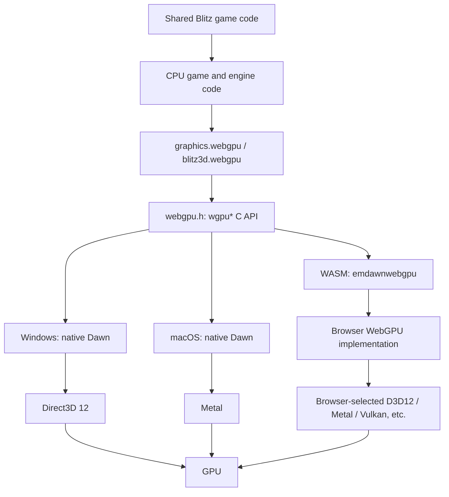
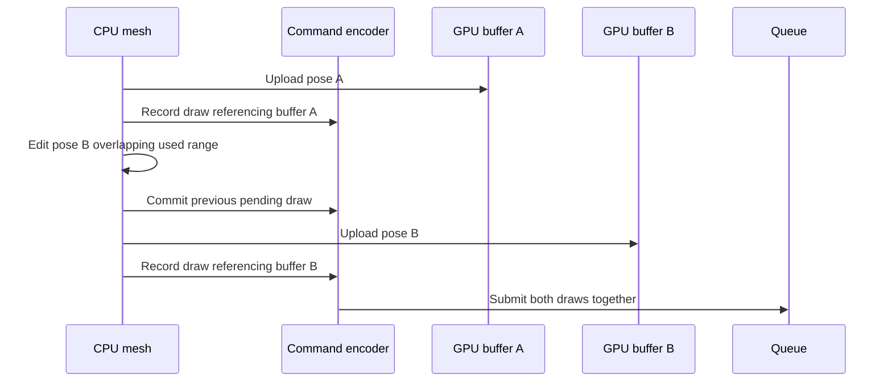

<!-- dev-docs-ai-translation: {"document":"docs/wgpu-migration.md","language":"en","syncedHash":"2e8a6fbcc1ff8d49fe4b26f41510ada43c43cc9ee4f048330ce1195b9c8b57e0"} -->

# Stranded II's wgpu/WebGPU cross-platform renderer migration

[English](wgpu-migration.md) · [한국어](wgpu-migration-ko.md)

[Development guide](development.md) · [How the web version works](web-architecture.md) · [How the macOS version works](macos-architecture.md)

This document follows the actual C++, WGSL and Blitz sources in this repository to explain how Stranded II's D3D7 fixed-function rendering is expressed through a shared WebGPU renderer. It traces device creation, shaders, buffer layouts, command submission, transparency and framebuffer copies. Examples explicitly labelled as such are explanatory reductions; this document does not claim to implement a new migration or verify full gameplay on every platform.

## 1. Distinguishing WebGPU, `wgpu*`, Dawn and Rust `wgpu`

**This project does not use the Rust `wgpu` crate.** Its C++ renderer calls the C API from `<webgpu/webgpu.h>`, including `WGPUDevice`, `WGPUBuffer` and `wgpuQueueSubmit()`. Native targets link Dawn; web targets use Emscripten's `emdawnwebgpu` bridge. Here, “wgpu migration” means the transition to this `wgpu*` API-based WebGPU renderer.

| Name | Responsibility | Role in this project |
| --- | --- | --- |
| WebGPU | Shared graphics API for resources, pipelines, commands and validation | The renderer's object and execution model |
| `webgpu.h` / `wgpu*` | C interface to a WebGPU implementation | Call boundary used by `graphics.webgpu` and `blitz3d.webgpu` |
| WGSL | Input language for GPU programs, including memory layout rules | `default.wgsl`, `default3d.wgsl` |
| Dawn | Native WebGPU implementation handling backends, validation and shaders | Windows D3D12 and macOS Metal |
| Tint | Dawn's shader processing layer | Implementation internals processing WGSL for a backend |
| Rust `wgpu` | A separate Rust WebGPU implementation/library ecosystem | Not a dependency of the current runtime |
| Emscripten `emdawnwebgpu` | Connects WASM C API calls to browser WebGPU | Web and Studio builds |

The `wgpu` function prefix alone does not identify the implementation. The [module CMake file](../src/blitz3d/src/modules/bb/graphics.webgpu/CMakeLists.txt) selects `dawn::webgpu_dawn` or `--use-port=emdawnwebgpu`; the [toolchain configuration](../config/blitz3d-toolchain.json) pins the native Dawn revision.

### 1.1 Actual platform paths



| Target | CPU execution of game/engine | Presentation connection | GPU backend selection |
| --- | --- | --- | --- |
| Windows | LLVM-based native x64 executable | SDL window's `HWND` | Explicit `WGPUBackendType_D3D12` |
| macOS | Native Apple Silicon ARM64 executable | Layer from an SDL Metal view | Explicit `WGPUBackendType_Metal` |
| Web | Browser executes WASM as CPU code | HTML `#canvas` | Project does not fix a native API; the browser decides |
| Studio 3D viewport | WASM running in Electron | Browser canvas | Electron's WebGPU implementation decides |

Vulkan is a possible backend of a WebGPU implementation. **This does not establish a completed standalone native Linux/Vulkan game target in this repository.** `dev.py --platform` currently exposes `windows|web|macos`; web and Mac game builds accept only the base game. Both Windows editions use the same renderer sources. Studio's Extended scene execution is a separate development-tool route.

## 2. Migrating rendering semantics from D3D7

The legacy [D3D7 `scene.cpp`](../src/blitz3d/src/modules/bb/blitz3d.d3d7/scene.cpp) configures lighting, fog, texture combination and specular materials through fixed-function state such as `SetRenderState()`, `SetTextureStageState()` and `D3DMATERIAL7`. WebGPU does not expose this fixed-function lighting unit. Its visual semantics must be expressed through WGSL calculations and pipeline state.

| Legacy semantic | WebGPU representation | Actual implementation |
| --- | --- | --- |
| World/view/projection transforms | Uniform/instance data and vertex shader matrix multiplication | `setWorldMatrix()`, `setViewMatrix()`, `vs_main()` |
| Fixed-function lighting and material specular | WGSL vertex lighting, interpolated specular and subsequent combination | `BBFrameState`, `BBEntityState`, `default3d.wgsl` |
| Multiple texture stages | Eight texture/sampler pairs and fragment combination | Bind group 2, `combine()` |
| Linear fog | Vertex fog-factor calculation and fragment RGB mixing | `fogFactorLinear()`, `fog_mode` |
| Alpha test | Fragment `discard` | `alpha_ref`, `alpha_test` |
| Blend/Z/culling state | Cached immutable render pipelines | `getScenePipeline()` |
| DirectDraw image copy and colour key | Textured quads with exact RGB-key comparison | `WebGPUCanvas::blit()`, `default.wgsl` |
| Screen-buffer locking/reading | Explicit GPU readback and a retained CPU copy | `readbackInto()`, `lock()`, `unlock()` |

The game-facing `Graphics3D`, `RenderWorld`, `DrawImage`, `Text`, `CopyRect` and `Flip` interfaces remain available. Replacing the lower graphics driver lets the game retain shared world, camera and model code. The implementation does not intercept D3D7 commands from the original executable at runtime.

### 2.1 Retained and replaced layers

```text
src/engine/**/*.bb
  Game rules, maps, menus, water effects, frame control
          |
          v
bb/blitz3d
  World / Camera / Model / Surface / RenderState / BBScene abstractions
          |
          v
bb/blitz3d.webgpu
  WebGPUScene / WebGPUMesh / WebGPULight / default3d.wgsl
          |
          v
bb/graphics.webgpu
  WebGPUContextResources / WebGPUGraphics / WebGPUCanvas / default.wgsl
          |
          v
WebGPU implementation and platform surface
```

`BBScene`, `BBMesh` and `BBCanvas` form the boundary between game semantics and GPU execution. World enumeration, visibility and sorting remain in the shared engine; resource management, shaders and draw encoding belong to the WebGPU modules.

### 2.2 Optional graphics enhancements

Both editions share independent, default-off options in [remaster.bb](../src/engine/includes/remaster.bb):

- Water: `RenderWorldPlanar` reflects the source camera across a horizontal plane, clips submerged geometry, and retains its aspect ratio without moving the camera or its children. The water shader uses projective sampling and procedural wave distortion. Fresnel opacity uses the mean horizontal surface, preventing wave slopes from alternating reflections into bright and dark bands at grazing angles. Reflection quality and update cadence still follow the existing water setting; qualities without reflections use only the wave shading.
- Lighting: optional per-pixel diffuse/specular lighting and a time-dependent directional sun. Atmospheric shading adds hemispheric ambient light and per-pixel linear fog using the game's existing colours.
- Shadows: `RenderWorldShadows` renders two 1024×1024 `Depth32Float` layers for the selected directional light. The game uses a 1000-unit range, a 30% split, overlapping cascades, texel-snapped translation, 3×3 PCF and distance fade. Alpha-tested foliage casts cutout shadows; blended effects and water do not. Ambient light remains unshadowed. No night shadow capture runs.

The game's object culling records when the main camera hides an otherwise in-range model or sets its alpha to zero for collision. Shadow capture temporarily restores those models with their object alpha, then restores the prior hidden and material-alpha states before other rendering or world updates. Collision-only meshes are untouched; objects beyond their configured view distance and script-invisible objects stay excluded. This keeps off-screen trees casting shadows as the camera turns. `verify_visibility.py` checks the actual game culling/capture functions with entity doubles; the offscreen GPU fixture also checks shadowed ground during small camera turns with its caster outside the main view.

Shader overrides specialize disabled lighting/atmosphere/shadow paths out of the pipeline. Main 3D pipelines bind the shadow depth array and comparison sampler in group 3; depth-only capture pipelines use groups 0–2 and never sample their own attachments. Each pass retains its own staged uniforms until submission. `FX_WATER` uses transparent sorting/blending even at entity alpha 1; `FX_NOSHADOW` excludes a material from shadow capture.

These additions reuse existing assets. Windows checks cover the production WGSL through offscreen D3D12; Metal/browser execution still needs verification in those environments. The options do not promise a fixed rendering FPS.

## 3. Connecting the renderer to the build

[Runtime selection](../src/blitz3d/src/runtime/CMakeLists.txt) chooses `s2windows` or `s2macos` for a native game. Both runtime module lists include `graphics.webgpu`, `blitz3d.webgpu` and `runtime.sdl`.

```cmake
# Excerpt: src/blitz3d/src/modules/bb/graphics.webgpu/CMakeLists.txt
if(BB_EMSCRIPTEN)
  target_compile_options(bb.graphics.webgpu PUBLIC "--use-port=emdawnwebgpu")
else()
  target_link_libraries(bb.graphics.webgpu dawn::webgpu_dawn)
endif()
```

Native game configuration uses `find_package(Dawn CONFIG REQUIRED)` and enables `BB_WEBGPU`. Windows links libraries including `webgpu_dawn`, `d3d12`, `dxgi` and `dxguid`; Mac links Metal, QuartzCore, IOSurface and Foundation frameworks. `bin2h()` embeds WGSL in generated headers under the build directory, so the application does not need external shader files at runtime.

The web build compiles `runtime.opengl.static` with `BB_WEBGPU=ON`. The `opengl` target name and `bbCreateOpenGLRuntime` factory name remain, but active WebGPU modules perform the rendering. Those historical names do not identify an OpenGL rendering path. The web linker also applies `--use-port=emdawnwebgpu` and `-sJSPI=1`.

External Dawn, LLVM, DXC and SDL versions are pinned in the [shared toolchain configuration](../config/blitz3d-toolchain.json). Edit tracked engine sources in `src/blitz3d/`; generated headers, libraries and executables belong under `build/engine/`. Old engine generators or restoration of upstream sources must not overwrite this renderer.

## 4. Following a Blitz call down to a draw

This standalone Blitz example illustrates the call boundaries. It is not a replacement for the actual game's timing loop.

```blitzbasic
Graphics3D 800,600,32,2
SetBuffer BackBuffer()
camera=CreateCamera()
CameraClsColor camera,16,24,32
AmbientLight 64,64,64
light=CreateLight(1)
RotateEntity light,45,30,0
cube=CreateCube()
PositionEntity cube,0,0,5
EntityColor cube,80,180,90
While Not KeyHit(1)
    RenderWorld()
    Text 8,8,"WebGPU renderer"
    Flip False
Wend
End
```

The actual [game loop](../src/engine/includes/game.bb) also calls `RenderWorld()`. The path continues through the [Blitz command implementation](../src/blitz3d/src/modules/bb/blitz3d/blitz3d.cpp): `bbRenderWorld(tween)` → `World::render(tween)` → `prepareRender()` / `renderPrepared()` → `BBScene` → `WebGPUScene::render()`.

| Stage | CPU work | Data/commands passed towards the GPU |
| --- | --- | --- |
| Game/world | Prepare model, camera, light and interpolation state | No GPU commands yet |
| Per-camera world rendering | Frustum tests, distance fade, opaque/transparent queues | Ordered model/surface draws |
| `setRenderState()` | Convert materials into entity state, instance colour and texture groups | Shader inputs and pipeline selection data |
| `WebGPUMesh::upload()` | Upload changed CPU mesh ranges | Vertex/index buffer data |
| `WebGPUScene::render()` | Stage uniforms/instances, cache state and merge adjacent draws | Bind/set commands and indexed draws |
| `Text`, etc. | Prepare 2D quad/glyph vertices and uniforms | Framebuffer 2D pass |
| `present()` / `flush()` | Encode framebuffer-to-surface pass and submit commands | Command buffers for GPU execution |

Returning from `RenderWorld()` does not establish GPU completion. The CPU records commands; GPU execution follows submitted queue work. Operations such as readback introduce a separate completion wait when the CPU needs a result.

## 5. Creating instance, adapter, device and surface

The implementation is `WebGPUContextResources::initDevice()` in the [graphics context source](../src/blitz3d/src/modules/bb/graphics.webgpu/graphics.webgpu.cpp).

1. Create a WebGPU entry object with `wgpuCreateInstance()`.
2. Connect a platform window or HTML canvas to a `WGPUSurface`.
3. Request an adapter compatible with that surface.
4. Request a device and install error/device-loss callbacks.
5. Obtain its submission queue with `wgpuDeviceGetQueue()`.
6. Choose a format/present mode from surface capabilities and configure the surface.
7. Prepare shared 2D shader, bind layouts, samplers and arenas.

| Platform | Surface source | Native object obtained |
| --- | --- | --- |
| Windows | `WGPUSurfaceSourceWindowsHWND` | `HWND` from `SDL_GetWindowWMInfo()`, instance from `GetModuleHandleW()` |
| macOS | `WGPUSurfaceSourceMetalLayer` | `SDL_Metal_CreateView()`, `SDL_Metal_GetLayer()` |
| Web | `WGPUEmscriptenSurfaceSourceCanvasHTMLSelector` | `#canvas` selector |

This is a reduced excerpt of adapter selection. The original function supplies callbacks and error handling.

```cpp
WGPURequestAdapterOptions aopts = {};
aopts.compatibleSurface = surface;
#ifdef BB_MACOS
aopts.backendType = WGPUBackendType_Metal;
#elif defined(BB_WINDOWS)
aopts.backendType = WGPUBackendType_D3D12;
#endif
wgpuInstanceRequestAdapter(instance, &aopts, acb);
```

Native callbacks use `WGPUCallbackMode_AllowProcessEvents` and advance through `wgpuInstanceProcessEvents()`. Web callbacks use `AllowSpontaneous`, with `emscripten_sleep()` yielding to the browser during waits. JSPI helps a synchronously written WASM call flow suspend for asynchronous browser work and resume afterwards. It does not replace WGSL or GPU execution.

The current device descriptor does not request a separate optional-feature list or expanded required limits. Rendering must fit the baseline WebGPU contract and actual adapter constraints. The legacy compatibility number returned by `gfxDriverCaps3D()` must not be interpreted as an actual GPU feature query.

## 6. Executing WGSL on D3D12 and Metal

The project embeds two WGSL sources in C++ and passes `WGPUShaderSourceWGSL` to `wgpuDeviceCreateShaderModule()`. It does not maintain separate application HLSL/MSL shader sets.

```text
Project WGSL
  -> Implementation WGSL validation / internal representation / backend conversion
  -> Platform shader compiler
  -> GPU program handled by the driver
```

Dawn's usual D3D12 path processes HLSL through Tint and compiles DXIL through DXC. Its Metal path uses MSL and Metal compilation. A Vulkan implementation can use SPIR-V. These conversions belong to the implementation: `WebGPUScene` does not generate HLSL, MSL or SPIR-V itself. Internal optimizations and caches depend on the implementation version.

The native D3D12 shader path also explains why the project places `dxcompiler.dll` and `dxil.dll` beside the Windows executable. Web builds use the browser's implementation, driver and shader compiler environment; those native DLLs are not embedded in WASM.

Pipeline creation prepares shaders and fixed state and is comparatively expensive. `prewarmPipelines()` prepares blend/Z/front-face/double-sided combinations and clear pipelines for `RGBA8Unorm` and `RGB10A2Unorm`. The renderer does not retranslate WGSL every frame. Other combinations, including wireframe, are created on demand and cached.

## 7. The C++/WGSL memory contract

The GPU does not know C++ field names. Byte offsets, strides, integer/float types, matrix layouts and WGSL alignment must agree. The [3D header](../src/blitz3d/src/modules/bb/blitz3d.webgpu/blitz3d.webgpu.h) uses `static_assert()` to check key sizes and offsets. The CPU numeric ABI and GPU uniform ABI are separate contracts.

### 7.1 Vertices and instances

| `BBWebGPU3DVertex` field | Byte offset | GPU vertex format | Shader location |
| --- | --- | --- | --- |
| `coords[3]` | 0 | `Float32x3` | 0 |
| `normal[3]` | 12 | `Float32x3` | 1 |
| `color[4]` | 24 | `Unorm8x4` | 2 |
| `tex_coord0[2]` | 28 | `Float32x2` | 3 |
| `tex_coord1[2]` | 36 | `Float32x2` | 4 |

The vertex stride is **44 bytes**. `Unorm8x4` converts CPU colour channels from 0–255 to shader values from 0–1. CPU ARGB input is separated into RGBA bytes before upload. Uniform `float3` alignment rules do not directly determine vertex-buffer layout: pipeline offsets and stride specify vertex fetch.

| `BBWebGPUInstance` field | Byte offset | Size | Shader locations |
| --- | --- | --- | --- |
| `world[16]` | 0 | 64 | 5–8: four matrix columns |
| `normal[12]` | 64 | 48 | 9–11: three columns padded as `vec4` |
| `color[4]` | 112 | 16 | 12: RGB tint and alpha/fade |

The instance stride is **128 bytes**, with `stepMode=Instance` on the second vertex buffer. The shader constructs a 3×3 normal matrix from each `vec4.xyz`. Different world matrices, normal matrices and colours can therefore share material uniforms.

### 7.2 Uniforms and bind groups

| Data | C++ size | Key layout | Binding |
| --- | --- | --- | --- |
| `BBWebGPUFrameState` | 928 bytes | proj 0, view 64, lights 128, clip_plane 656, reflection 672, eye 736, effects 752, shadow 768, shadow_depth 896, shadow_params 912 | Group 0 / binding 0 |
| `BBWebGPUEntityState` | 720 bytes | ambient 0, fog_color 16, fog_range 32, alpha_ref 64, water 68, clip_enabled 72, texs 80 | Group 1 / binding 0 |
| `BBWebGPUClearState` | 32 bytes | color 0, z 16, trailing padding | Clear pipeline group 0 / binding 0 |
| `BBWebGPURenderState` | 64 bytes | 2D coordinates, resolution, colour and image mode | 2D group 0 / binding 0 |

`LightData` consists of four `vec4` values: **64 bytes**. `TexState` contains a 64-byte `mat4x4` and four integers: **80 bytes**. A frame stores up to eight lights; an entity stores up to eight texture stages. Padding for `vec3`, matrices and structure arrays follows WGSL rules, not simply the sum of C++ member sizes.

3D group 2 contains eight pairs: a `texture_2d<f32>` at binding `2*i` and its sampler at binding `2*i+1`. Unused slots receive white textures and samplers to provide a complete bind group. Texture-view/sampler handle arrays form the cache key; disappearing views invalidate related cached groups.

### 7.3 Dynamic offsets and arenas

The 3D uniform and instance arenas are each **4 MiB**. Uniform allocation uses the device's minimum uniform-buffer offset alignment, at least 256 bytes:

```cpp
size_t offset = (uniform_used + uniform_alignment - 1) & ~(uniform_alignment - 1);
size_t extent = size > bind_size ? size : bind_size;
if (offset + extent > uniform_capacity) {
    flushAll();
    offset = 0;
}
memcpy(uniform_stage.data() + offset, data, size);
```

With 256-byte alignment, a 928-byte frame advances the next allocation by 1024 bytes; a full 720-byte entity advances it by 768 bytes. These are allocation strides, not structure sizes. A 32-byte clear payload advances it by 256 bytes.

Entities use `usedSize(n)=80+80*n` to update CPU staging only through the active texture stages. The GPU binding remains 720 bytes, so the capacity check includes `bind_size`. The shader uses `texs_used` to avoid reading inactive stages. `pushCached()` reuses offsets for identical state bytes; submission invalidates caches so an old arena offset cannot accidentally reference new data.

## 8. Coordinate, depth and normal transformations

Copying matrices alone is insufficient: camera direction, clip depth, front-face orientation and 2D origin must preserve existing semantics.

`setViewMatrix()` reverses the Z components of the Blitz view transform. `setPerspProj()` constructs a projection with `w_clip=-z_eye`, mapping near to 0 and far to 1 for WebGPU's clip-depth condition `0 <= z_clip <= w_clip`. The `ndc.z = ndc.z*2-1` operation in `default3d.wgsl` is for sphere-map coordinate calculations; the actual `@builtin(position)` retains the original clip position.

```text
position_clip = projection * view * world * position_local
normal_eye    = transpose(inverse((view * world).upper3x3)) * normal_local
```

`bbNormalMatrix()` constructs the inverse transpose using cross products and a determinant. Transforming normals only by the world matrix produces incorrect lighting under nonuniform scale. Nearly singular matrices use the fallback at `abs(det)<=1e-20`.

`setTriangle()` stores input `(v0,v1,v2)` as `(v2,v1,v0)`. Pipelines use `CCW` by default and `CW` for flipped triangles; double-sided and wireframe paths disable culling. Mirrors also apply `setFlippedTris()`. Adding duplicate backend-specific adjustments can reverse orientation twice, so changes must follow the shared coordinate contract.

The 2D vertex shader converts top-left pixel coordinates using `p.y=res.y-p.y`, `p=p/res` and `p=p*2-1`. Screen/texture-copy orientation must be assessed across coordinate transformation, UVs and CPU image row order together.

## 9. Reproducing fixed-function lighting, textures and fog in WGSL

The [actual 3D shader](../src/blitz3d/src/modules/bb/blitz3d.webgpu/default3d.wgsl) computes vertex lighting for compatibility. It does not replace legacy materials with a physically based PBR model.

### 9.1 Diffuse and specular ordering

After choosing vertex or brush colour, the shader computes ambient and diffuse lighting. Directional, point and spot lights arrive through frame `LightData`. Point lights apply distance attenuation; spot lights also attenuate across the cosine range of their cone angles.

Specular follows the original D3D7 material semantics:

```text
power     = shininess * 128
strength  = min(shininess, 1)
H         = normalize(L + V)
specular += pow(max(dot(N,H),0), power) * attenuation * strength
```

`shininess<=0` disables specular calculation. The view vector uses eye position for a local viewer, and specular colour is white. Diffuse and specular are computed at vertices and interpolated into fragments. Specular is added **after** texturing and **before** fog and framebuffer blending. Adding it to diffuse before multiplying by a texture would suppress highlights on dark textures and change legacy material behaviour.

### 9.2 Texture-stage combination differs from framebuffer blending

`combine()` combines current colour `t0` with texture colour `t1`:

| Texture blend number | RGB calculation |
| --- | --- |
| 1 | `mix(t0.rgb,t1.rgb,t1.a)` |
| 2 | `t0.rgb*t1.rgb` |
| 3 | `t0.rgb+t1.rgb` |
| 4 | Replicate `dot(t0.rgb*2-1,t1.rgb*2-1)` into RGB |
| 5 | `t0.rgb*t1.rgb*2` |

The stage multiplies alpha if the texture's alpha-use flag is set, then clamps the result. Each texture selects UV0, UV1 or sphere-map coordinates and applies its own texture transform. Sampling receives the frame LOD bias.

These calculations combine texture stages inside the fragment shader. The pipeline separately blends source and destination framebuffer values. Confusing these operations changes the output even for the same material.

### 9.3 Fog, alpha test and fade

Linear fog uses `abs(eye_pos.z)`:

```text
fog = 1 - clamp((end-distance)/(end-start), 0, 1)
RGB = mix(lit_textured_specular_RGB, fog_RGB, fog)
```

The fog colour preserves the original alpha. `FX_NOFOG` materials bypass fog.

Alpha-tested materials use thresholds such as `alpha_ref=128`, discarding fragments when `color.a*255 <= alpha_ref`. The vertex shader also scales the threshold by the instance fade alpha, preventing cutout textures such as grass from unnecessarily losing their silhouette during fading. This threshold/fade/transparency combination is covered by the actual GPU fixture's compatibility checks.

## 10. Cache fixed state in pipelines and bind variable data

The actual 3D pipeline key combines these bits:

```cpp
uint32_t key = (uint32_t)blend_mode
    | ((uint32_t)zmode << 3)
    | ((flipped_tris ? 1u : 0u) << 5)
    | ((doublesided ? 1u : 0u) << 6)
    | ((wireframe ? 1u : 0u) << 7)
    | ((uint32_t)format << 8);
```

Blend, depth, topology, front face, culling and target format belong to the pipeline. Camera, lighting, material and transforms belong to buffers/bind groups. Viewport and scissor are pass commands. Changing a material colour therefore does not require a new GPU pipeline.

| Z mode | Compare | Depth write | Use |
| --- | --- | --- | --- |
| `ZMODE_NORMAL` | `LessEqual` | Enabled | Ordinary opaque rendering |
| `ZMODE_DISABLE` | `Always` | Disabled | Explicitly ordered rendering, etc. |
| `ZMODE_CMPONLY` | `LessEqual` | Disabled | Transparency tested against opaque depth |

| Framebuffer blend | RGB result |
| --- | --- |
| `BLEND_REPLACE` | Source; no blend state |
| `BLEND_ALPHA` | `src.rgb*src.a + dst.rgb*(1-src.a)` |
| `BLEND_MULTIPLY` | `src.rgb*dst.rgb` |
| `BLEND_ADD` | `src.rgb*src.a + dst.rgb` |

Alpha-channel factors are configured separately from RGB. `BLEND_ALPHA` produces `src.a + dst.a*(1-src.a)` for alpha. Each canvas creates/reuses a `Depth24Plus` depth texture; `Depth24Plus` does not promise one fixed 24-bit physical storage format on every platform.

The 3D sample count is **1**. `setAntialias()` selects FXAA in shared presentation, so describing the current anti-alias option as MSAA would be incorrect. Wireframe generates a line-list index buffer with three edges per triangle instead of requiring a native polygon mode.

## 11. Command encoding and GPU queue order

`WebGPUContextResources` retains a shared command encoder for 2D and 3D passes. Camera changes and 2D/3D transitions end the previous pass without necessarily submitting the queue. Mipmaps use a separate `mip_encoder`.

The actual `flush()` sequence is:

```text
End pending 2D draw/pass
  -> Queue-write 2D vertex/uniform staging
  -> listener.pre_flush: end 3D pass, upload 3D uniforms/instances
  -> Finish mip_encoder
  -> Finish shared encoder
  -> Submit [mip commands, main commands] in that order
  -> Reset arena usage
  -> listener.post_flush: reset 3D caches, increment submit_marker
```

`endPass()` ends a render pass; `flushPendingDraw()` records a batched draw into the encoder; `flush()` marks a command-buffer submission boundary. None of these means waiting for GPU completion.

The WebGPU implementation arranges backend-specific D3D12 resource-state transitions, Metal encoder operations or Vulkan synchronization for valid resource use. The application does not encode D3D12 barriers directly. It must still resolve logical conflicts such as sampling an attachment in the same pass or overwriting data needed by earlier unsubmitted draws.

### 11.1 A common mistake: encoding a draw does not snapshot its data

This is an **incorrect conceptual example** using one GPU buffer for poses A and B:

```text
queue.writeBuffer(buffer, pose_A)
encoder.draw(buffer)                  # Not submitted yet
queue.writeBuffer(buffer, pose_B)
queue.submit(encoder.finish())
```

A queue write is not inserted immediately after that draw inside the encoder. If both writes enter the queue before the draw command buffer, the first draw can also see B. Encoding a draw references buffer handles; it does not snapshot all vertex bytes.

The solution is to submit the first draw before the next write, or retain buffer A for the first draw while uploading the next pose into buffer B. This project detects mesh-range conflicts and selects between those approaches.

## 12. Dynamic meshes: dirty ranges and buffer versioning

[`WebGPUMesh`](../src/blitz3d/src/modules/bb/blitz3d.webgpu/blitz3d.webgpu.cpp) retains CPU vertex/triangle arrays. It accumulates edits until `upload()` immediately before drawing instead of uploading everything on `unlock()`. Writing identical vertex/triangle bytes does not expand the dirty range.

| State | Meaning |
| --- | --- |
| `dirty_v0..dirty_v1`, `dirty_t0..dirty_t1` | Changed ranges awaiting upload; end is exclusive |
| `drawn_v0..drawn_v1`, `drawn_t0..drawn_t1` | Ranges referenced by earlier draws in the current submission interval |
| `drawn_marker`, `submit_marker` | Whether earlier use belongs to the current submission interval |
| `uploaded_v1`, `uploaded_t1` | Live data prefixes restored when switching versions |
| `BufferVersion::used_marker` | Submission interval in which that buffer pair was used |

Changes outside earlier draw ranges can be uploaded in place. Overlapping changes select another vertex/index buffer pair through `renameBuffers()`. The old buffer's pending instance draw is encoded before changing handles, so the earlier draw references the old pose and the next draw references the new pose.



A recycled buffer may contain an older pose. After renaming, upload the CPU data prefixes through `uploaded_v1` and `uploaded_t1`, not merely the small range changed this time. This prevents untouched vertices from reverting to an older version.

### 12.1 Exact limits and reuse semantics

- A mesh retains at most **16** vertex/index buffer pairs.
- **Additional buffer capacity**, excluding the initial pair, is capped at **32 MiB** overall.
- This is not a total VRAM cap covering CPU arrays, uniform arenas, textures, initial buffers or driver-internal temporary memory.
- Reaching a limit or having a separate wireframe index cache uses the existing `flushAll()` path to preserve ordering.
- Destroying a mesh returns its additional-version capacity to the budget.

`submit_marker` is not a GPU-fence completion number. After submission, subsequent writes on the same queue are ordered after the earlier submitted draws, allowing versions to be reused. The code neither assumes GPU idleness nor waits for completion on every update.

Meshes with at most 65,536 vertices use 16-bit indices; larger meshes use 32-bit indices. Partial 16-bit uploads expand to even index boundaries to satisfy `writeBuffer`'s 4-byte alignment. Changing three indices, for example, requires an aligned range such as eight bytes rather than blindly writing six bytes.

## 13. Instancing while preserving transparency order

Trees, grass and model copies sharing a mesh/material carry world/normal/colour data in `BBWebGPUInstance` and use indexed instancing. Globally grouping all draws sharing a texture would alter transparency results.

`World::render()` separates opaque and transparent paths per camera. Deferred opaque draws use `stable_sort()`. Transparent draws compute model-to-camera distance once, enter a priority queue and render farthest first. Transparency uses `ZMODE_CMPONLY` to test opaque depth without writing its own depth. Sorting is by model distance, not an OIT solution that resolves every intersecting transparent triangle.

WebGPU batching merges **adjacent draws only**, requiring these matches:

| Compared state | Reason |
| --- | --- |
| Pipeline | Same blend/depth/culling state |
| Frame/entity dynamic offsets | Same camera/lighting/material state |
| Texture bind group | Same textures/samplers |
| Vertex/index buffer handles | Same geometry and pose version |
| Index start/count and base vertex | Same geometry range |
| Consecutive instance staging | Preserve original instance order |

Compatible draws increment `pending_instances` and become one `wgpuRenderPassEncoderDrawIndexed(..., instanceCount, ...)`. An intervening incompatible transparent draw ends the batch. Different tint and alpha/fade values live in instance data and need not split material uniforms. Wireframe is excluded from this instancing merge path.

CPU frustum tests remain in the shared [frustum implementation](../src/blitz3d/src/modules/bb/blitz3d/frustum.cpp) and [meshmodel](../src/blitz3d/src/modules/bb/blitz3d/meshmodel.cpp). They were not replaced by GPU occlusion queries or compute culling. Current optimization reuses camera planes and transformed-box calculations on the CPU.

[Grass placement](../src/engine/includes/grasspread.bb) keeps terrain-eligible patches available to the renderer. Visibility is tested separately for each render view every frame, without a timed main-camera `HideEntity` cache. Gameplay updates placement before shadow, reflection and main rendering; density and distance fading retain the selected settings. Changing the height mask invalidates placement even with a stationary camera. Orthographic shadow frusta use parallel side planes and retain that projection through world transforms.

## 14. Preserving 2D UI, font and image semantics

`graphics.webgpu` implements `BBCanvas` screens, images and textures as `WebGPUCanvas`. A 2D position/UV vertex occupies **16 bytes** and render state occupies **64 bytes**. CPU staging accumulates vertices/uniforms; consecutive draws sharing pipeline, bind group, scissor and buffer are merged. Strip topologies use separate draws to avoid unintended connections between adjacent strips.

### 14.1 Bitmap images and colour keys

Original DirectDraw `DrawImage`/`DrawBlock` semantics differ from ordinary RGBA alpha blending. The 2D WGSL rounds sampled RGB to 8-bit integers and compares against the RGB key extracted from `image_mask`. Keyed mode discards matching fragments and copies the remaining pixels with `alpha=1`. Block/solid mode copies RGB without key rejection.

Material texture mask/alpha handling and 2D image-key handling are separate paths. Alpha in an image file does not imply every Blitz image call blends that alpha. Mask changes, image copies and animated frames must also retain these semantics.

### 14.2 Font atlases

Ordinary `Text` iterates UTF-8 codepoints and uploads the glyph atlas as an `R8Unorm` texture. Fragments use atlas R for alpha and the current text colour for RGB. Glyphs generate quads that can be batched. Updating an atlas at unchanged dimensions still requires `flush()` before upload because earlier draws may read its old contents.

The game's Korean bitmap font resources separately depend on image/key compatibility. Preserve the preparation process in the [localization guide](localization.md); the GPU API does not generate fonts or translate text automatically.

## 15. Read/write hazards in `CopyRect`, water distortion and motion blur

[Water effects](../src/engine/includes/e_environment.bb) shift horizontal/vertical strips within the same screen buffer using `CopyRect`. [Motion blur](../src/engine/includes/motionblur.bb) copies the framebuffer into a texture. These operations cannot be implemented by simultaneously sampling and writing the same render attachment in a WebGPU pass.

`WebGPUCanvas::blitSelf()` copies the original into a temporary texture, then samples that snapshot while drawing a destination quad. Ending the old pass and recording the copy/new pass in the same encoder avoids per-strip submissions where pass transitions suffice.

Snapshot reuse requires matching dimensions/format, scale 1, the same canvas pass and a source rectangle that does not overlap destinations written since the snapshot. Destination bounds are retained as one bounding rectangle, so some cases conservatively create another snapshot.

```text
First strip:        Current texture -> snapshot -> destination A
Independent strip:  Same snapshot -> destination B
Source overlaps A/B:
                    End earlier draws -> updated snapshot -> destination C
```

Replacing all `CopyRect` calls with one frame-start snapshot would lose the original ordering when later copies read earlier copy results. The optimization batches only independent sources and switches snapshots when dependencies appear. Scaled/clamped sources retain the general path.

Ordinary canvas textures use `TextureBinding|RenderAttachment|CopySrc|CopyDst`. Declaring these usages does not permit all of them simultaneously in one pass. Mipmaps are generated through per-level render passes and updated according to dirty state when sampling requires them.

## 16. Six-view water reflection and current cube-texture limitations

`RenderWorldCube camera,texture[,tween]` handles six camera directions within one call to [`World::renderCubeMap()`](../src/blitz3d/src/modules/bb/blitz3d/world.cpp). With `tween=1` and no camera children, it shares enumeration, interpolation and transform preparation once. Camera children may move with each view, and other tween values preserve repeated-preparation semantics; those cases prepare six times.

Each view still performs frustum tests, distance fading, transparency sorting and rendering/copying. Only the selected reflection camera renders; preparation is not reused across calls. The game sets its camera viewport to the reflection texture dimensions before calling.

**The current WebGPU canvas stores a cube-face number but does not implement per-face GPU texture storage or `texture_cube` sampling.** Texture creation is 2D with one layer, and shaders bind `texture_2d`. The final copied face therefore remains as a 2D image. Shared six-view preparation optimizes this existing output behaviour; it does not complete cubemap support.

A future complete cubemap design would need a six-layer texture, per-face 2D attachment views, a cube sampling view, texture bind-layout/shader changes, and reflection-direction/face-orientation verification. These are requirements for future work, not current features. The fixture reads each face immediately after its copy, so its six-view comparison must be distinguished from a test proving all six faces remain in the final texture.

## 17. Readback, lifetime and error handling

### 17.1 Reading GPU pixels on the CPU

`readbackInto()` flushes previous draws, creates a `MapRead|CopyDst` buffer and separately submits `CopyTextureToBuffer`. Row pitch is aligned to 256 bytes:

```cpp
size_t bytes_per_row = ((size_t)width * 4 + 255) & ~(size_t)255;
size_t readback_size = bytes_per_row * height;
```

At width 300, an RGBA row contains 1,200 bytes but the copy buffer's row pitch is 1,280 bytes. After `mapAsync` completes, the CPU copy removes padding. `BGRA8Unorm` requires R/B exchange; `RGB10A2Unorm` requires conversion from 10/10/10/2-bit values into 8-bit RGBA.

This pitch restriction applies to encoded texture-to-buffer copies. It does not mean every `wgpuQueueWriteTexture()` upload needs 256-byte padding. Current RGBA uploads use `width*4` and R8 atlas uploads use `width` as bytesPerRow.

Readback is a CPU/GPU synchronization point and can change rendering throughput. Correctness fixtures centred on `getPixel()` do not measure normal gameplay FPS. Flags including `pixmap_stale`, `dirty` and `gpu_written` track CPU/GPU copy ownership to preserve `LockBuffer` semantics.

### 17.2 Releasing objects and invalidating caches

Related bind-group caches are invalidated before texture views are released. Canvas-destruction listeners remove scene depth targets and texture references. Context destruction releases owned scene, pass, buffer, pipeline, sampler, texture, surface, queue, device, adapter and instance handles. The SDL window lifecycle also manages the Mac Metal view.

Releasing a handle and completing GPU execution are separate events. The implementation retains internal resource references for submitted commands, but application caches must remove released handles themselves. Mesh generation changes also invalidate cached draw-buffer bindings.

Uncaptured-error and device-loss callbacks log causes. Failure to acquire a surface texture triggers configuration and one retry. This does not constitute a completed automatic recovery path rebuilding every device/resource and restoring game state after arbitrary device loss.

## 18. Framebuffer presentation and frame timing

The game draws 3D scenes and 2D UI into an offscreen framebuffer. `WebGPUGraphics::present()` then draws a fullscreen quad onto the surface. If the game's selected resolution differs from the actual Windows borderless-window size, the surface is configured for the window and linear sampling performs the scaling. Internal game coordinates/render resolution and output surface dimensions are separate.

Presentation selects FXAA and dithering as appropriate. The default Windows bitmap-UI path avoids unnecessary additional dithering. Native targets call `wgpuSurfacePresent()` after submission and release the surface texture/view. Web targets use browser canvas presentation and do not explicitly call native `wgpuSurfacePresent()`.

Native `Flip` uses `Fifo` for vsync requests; otherwise it uses the supported `Immediate`, `Mailbox` or other selected unsynced result from capabilities. Without a supported unsynced mode it remains `Fifo`. Web `Flip` waits for `requestAnimationFrame` when needed or yields through `emscripten_sleep(0)`. The game does not exclusively control browser/OS presentation scheduling.

The game's [modern_runtime.bb](../src/engine/includes/modern_runtime.bb) manages full-frame elapsed time, the 100ms cap, fractional accumulation, focus pause and pacing through `modern_frame()` and `modern_present()`. `modern_present()` ultimately calls `Flip False`. GPU command-batching changes must preserve this game-time contract. Measure CPU encoding time, GPU execution time and actually displayed FPS separately.

## 19. Verification paths and this document's verification scope

These are existing repository verification paths. **This documentation task inspected sources and checked document structure, links and language synchronization; it did not run new game builds, GPU tests, browser tests or Mac tests.** The existence of a test must be distinguished from a passing execution in the current environment.

| Path | What it checks | What the result alone cannot establish |
| --- | --- | --- |
| `dev.py check` | Resources, catalogs, compiled functions, ABI, timing, etc. | Actual rendering FPS, presentation or full progression |
| `verify_engine.py --render` | Pixels/order using an actual offscreen D3D12 device and production scene/WGSL | OS-window/Alt-Tab, Metal or browser behaviour |
| `verify_engine.py --graphics` | Drawing, readback and context lifetime in an isolated window | Display recovery on every PC or long gameplay |
| Web `check` C++ CPU fixture | Actual canvas-copy methods' pixel/key/clipping/order semantics | Actual GPU speed |
| `verify_web_game.py` and browser `/checks/` | Original reference comparison and actual WebGPU fonts/images/game scenarios | Actual playback speed/FPS from synthetic-time tests |
| Mac `check --suite core` / `full` | Non-graphical core checks and full's graphics-related paths | Unexecuted suites or behaviour on another Mac |
| `profile_web.py --serve` | Isolated actual-WebGPU/real-clock comparisons | GPU execution duration from CPU phase marks alone |

The offscreen fixture in [`runtime_render.cpp`](../src/blitz3d/tests/runtime_render.cpp) covers matte/specular materials, textures, fog, fade, alpha-test silhouettes, instancing, transparent depth/per-camera sorting, frustum tests and six-view capture. Mesh-version tests cover 16/32-bit index changes, earlier-pose preservation, recycling, version/capacity-limit fallbacks and arena overflow. The “legacy rendering” comparison in `checkCubeCapture()` uses individual views within the same fixture; it does not establish full pixel equality against an actual D3D7 GPU renderer.

These commands illustrate relevant verification after preparing the corresponding host and development dependencies. Follow the [development guide](development.md) for setup, outputs and suite details.

```powershell
# Windows: check shared engine changes with real builds/checks of both editions
python scripts/dev.py build --edition classic
python scripts/dev.py check --edition classic
python scripts/dev.py build --edition extended
python scripts/dev.py check --edition extended

# Windows: offscreen D3D12 checks using actual production shaders
python scripts/verify_engine.py --render
# Additional checks using a window
python scripts/verify_engine.py --graphics

# Web: distinguish build/static/CPU checks from actual browser checks
python scripts/dev.py build --platform web
python scripts/dev.py check --platform web
python scripts/verify_web_game.py
python scripts/dev.py run --platform web
```

```sh
# Run on an Apple Silicon Mac
python scripts/dev.py build --platform macos
python scripts/dev.py check --platform macos --suite core
python scripts/dev.py check --platform macos --suite full
```

Record adapter, driver, build configuration, resolution, water quality, view distance, FPS cap and focus conditions when comparing actual GPU performance. Fewer queue submissions/draws can reduce CPU overhead without automatically reducing GPU pixel workload. Use separate runtimes and empty save directories; do not use the player's running game or saves.

## 20. Applying this approach to another legacy engine

The following sequence captures the reusable approach in this project. It is both a reading order for the implementation and an example migration sequence for another engine.

1. **Preserve the game API boundary:** identify world/material/canvas interfaces and retain shared game calls.
2. **Establish device/surface paths:** connect each platform window, select adapters, install error callbacks and configure/present.
3. **Specify GPU data contracts:** define vertex/uniform/instance byte offsets, strides and padding; align C++ assertions with WGSL.
4. **Port fixed-function semantics:** move lighting, specular, texture-stage, fog and alpha-test mathematics and ordering into shaders.
5. **Port 2D compatibility:** retain RGB keys, block copies, fonts, pixel locking and texture-copy semantics.
6. **Verify correctness first:** use small offscreen pixel tests and existing reference scenarios for coordinates, colours, depth and ordering.
7. **Optimize submission/uploads:** apply dirty ranges, dynamic-offset arenas, state caches and buffer versioning.
8. **Batch while preserving order:** safely sort opaque draws and merge only adjacent transparent draws.
9. **Verify actual platform paths:** execute Metal and browser checks independently of D3D12 success.
10. **Separate unfinished features:** do not mark cubemaps, device-loss recovery or new native backends complete before implementation/testing.

WebGPU connects multiple native APIs through a common resource, pipeline and shader model, with implementations handling backend differences. The engine expresses existing game semantics in that model. This repository provides a concrete example by concentrating those responsibilities in `graphics.webgpu` and `blitz3d.webgpu` while sharing the game/world layers.

## 21. Implementation evidence and further reading

| Topic | Source |
| --- | --- |
| Platform device/surface/submit/present | [graphics.webgpu.cpp](../src/blitz3d/src/modules/bb/graphics.webgpu/graphics.webgpu.cpp) |
| Shared context and 2D CPU layout | [graphics.webgpu.h](../src/blitz3d/src/modules/bb/graphics.webgpu/graphics.webgpu.h) |
| Texture/readback/copy/font/cube face | [canvas.webgpu.cpp](../src/blitz3d/src/modules/bb/graphics.webgpu/canvas.webgpu.cpp) |
| 3D pipelines/arenas/instances/mesh versions | [blitz3d.webgpu.cpp](../src/blitz3d/src/modules/bb/blitz3d.webgpu/blitz3d.webgpu.cpp) |
| 3D CPU/GPU structures | [blitz3d.webgpu.h](../src/blitz3d/src/modules/bb/blitz3d.webgpu/blitz3d.webgpu.h) |
| 3D lighting/texture stages/fog/discard | [default3d.wgsl](../src/blitz3d/src/modules/bb/blitz3d.webgpu/default3d.wgsl) |
| 2D transformation/key/font/FXAA | [default.wgsl](../src/blitz3d/src/modules/bb/graphics.webgpu/default.wgsl) |
| Legacy fixed-function material/stage semantics | [D3D7 scene.cpp](../src/blitz3d/src/modules/bb/blitz3d.d3d7/scene.cpp) |
| Model enumeration/sorting/six-view reflections | [world.cpp](../src/blitz3d/src/modules/bb/blitz3d/world.cpp) |
| Native Windows modules | [s2windows/CMakeLists.txt](../src/blitz3d/src/runtime/s2windows/CMakeLists.txt) |
| Native Mac modules | [s2macos/CMakeLists.txt](../src/blitz3d/src/runtime/s2macos/CMakeLists.txt) |
| Web linker/JSPI/WebGPU port | [linker_lld.cpp](../src/blitz3d/src/tools/compiler/linker_lld/linker_lld.cpp) |
| Dependency/build routing | [blitz3d_toolchain.py](../scripts/blitz3d_toolchain.py), [configuration](../config/blitz3d-toolchain.json) |
| Actual offscreen GPU fixture | [runtime_render.cpp](../src/blitz3d/tests/runtime_render.cpp), [verify_engine.py](../scripts/verify_engine.py) |

For general API/language rules, see the [WebGPU specification](https://www.w3.org/TR/webgpu/), [WGSL alignment and size](https://www.w3.org/TR/WGSL/#alignment-and-size), [Dawn project](https://dawn.googlesource.com/dawn/) and [Rust wgpu project](https://github.com/gfx-rs/wgpu). Distinguish features a general implementation can provide from those this project actually connects, implements and verifies.
